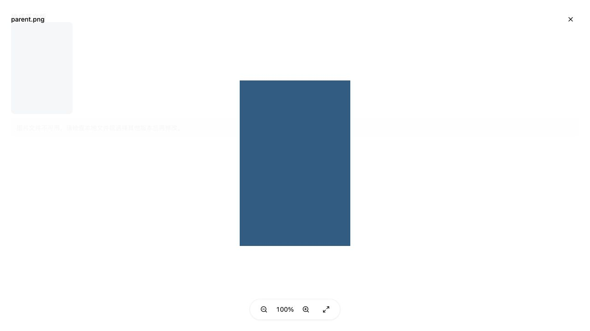

# 图片交互修复验证

- 整合基线 main：`4b0ad6a4a951ca8fb234587eb1fec40c0b52d6c2`
- 范围：移除会话 ScrollMinimap 挂载、图片版本对比、发送后原图引用缩略图、右侧二进制图片预览与共享放大查看器
- 保留：远端最新 Logo、工作台比例和生成图卡片样式，原图比例、精确版本、旧消息兼容、必要权限/付费策略
- 完整回归：3199 passed / 0 failed，358 文件，41.90 秒
- 检查：全项目 typecheck、Electron build、改动 TS/TSX ESLint 与 diff whitespace
- 提交前复核：复用既有二进制桥接与查看器，无新增 IPC 权限、依赖、数据迁移或全局状态库，未发现阻断问题
- 隔离浏览器：整合后实际组件验证对比图顶边、关闭返回、引用缩略图、缺图降级、放大125%、适应窗口及 Escape 焦点返回
- 前一轮隔离原生 Electron：右侧360px图片预览、特殊字符路径、全窗查看、33%至42%缩放、保存字节校验与关闭
- 截图均来自合成数据界面夹具，不是用户的真实会话，也不代表整个安装包端到端通过
- 没有访问真实密钥、调用模型、生图付费、修改用户会话数据、替换安装版或启动 Rust 整体迁移
- 旧消息没有引用元数据时不自动补图，未知或歧义裸文件名不猜测匹配

## 截图

