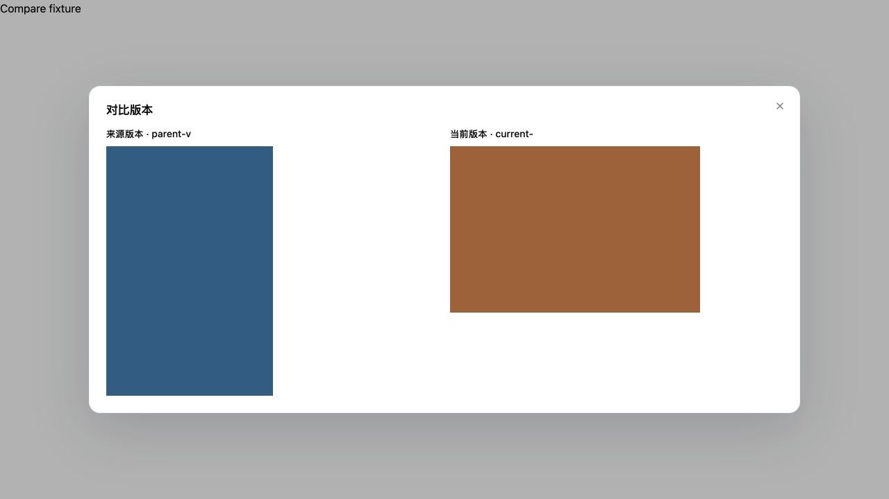
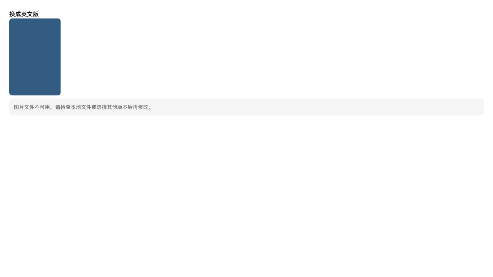

# Image Interaction Fix Validation

- Integration baseline main: `4b0ad6a4a951ca8fb234587eb1fec40c0b52d6c2`
- Scope: remove session ScrollMinimap mounting; image-version comparison, original-image reference thumbnails after sending, right-side binary-image preview, and shared enlarged viewer
- Retained: latest remote Logo, workbench proportions and generated-image card style, original image aspect ratios, exact versions, old-message compatibility, and required permission/payment policies
- Full regression: 3199 passed / 0 failed, 358 files, 41.90 seconds
- Checks: project-wide typecheck, Electron build, changed TS/TSX ESLint, and diff whitespace
- Pre-commit review: reused existing binary bridge and viewer, with no added IPC permissions, dependencies, data migrations, or global state libraries; no blocking issues found
- Isolated browser: integrated actual components validated comparison-image top alignment, closing and returning, reference thumbnails, missing-image fallback, 125% zoom, fit-to-window, and Escape focus restoration
- Previous isolated native Electron round: 360px right-panel image preview, special-character paths, full-window viewing, 33% to 42% zoom, saved-byte validation, and closing
- All screenshots use synthetic-data UI fixtures, not real user sessions, and do not establish end-to-end acceptance of the entire installation package
- No real keys accessed, models called, paid image generation used, user session data changed, installed version replaced, or overall Rust migration started
- Old messages without reference metadata do not receive images automatically; unknown or ambiguous bare filenames are not matched by guessing

## Screenshots

