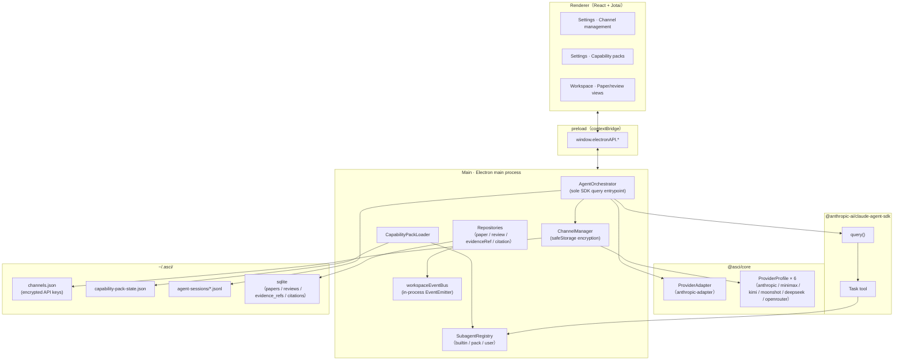
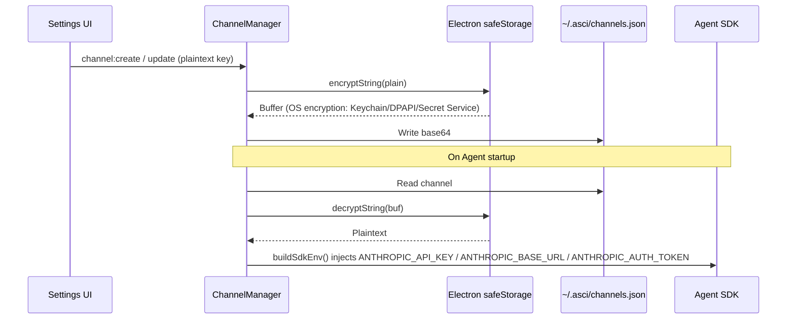
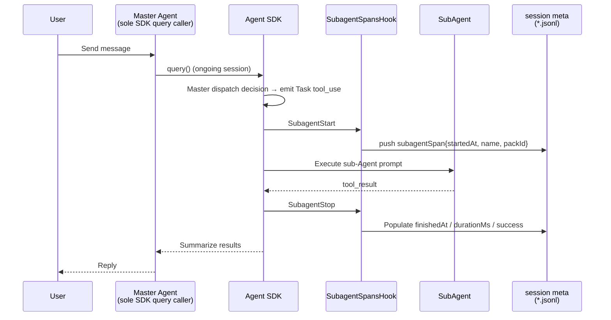
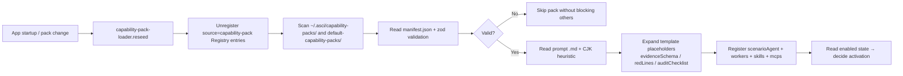
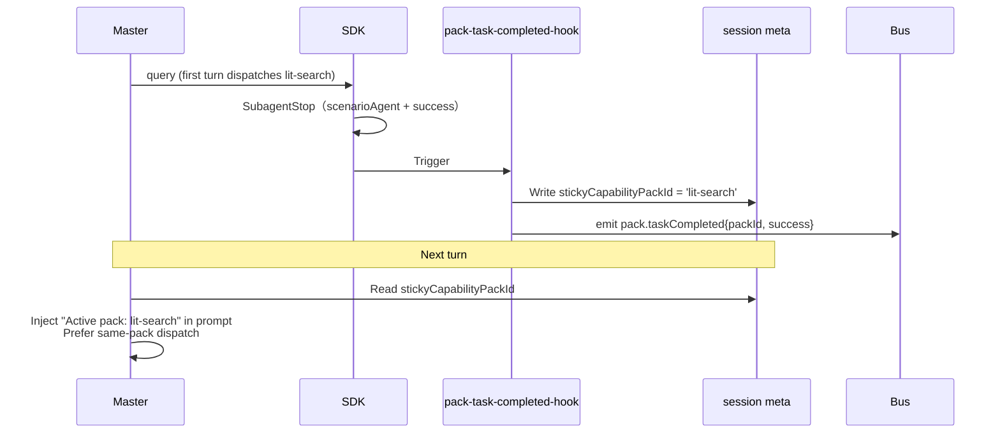
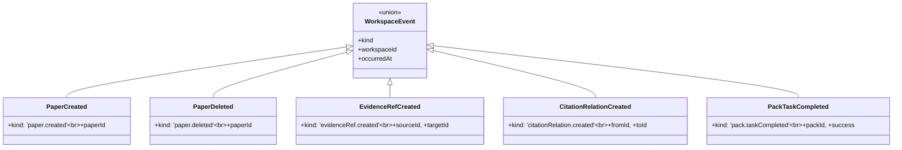

<a id="asci-02-阶段架构图"></a>

# ASCI 0.2 architecture overview

> **Status**: Core delivery complete (AI Providers / SubAgent / capability packs / workspace events); Proposal deferred to 0.3
> **Snapshot date**: 2026-05-26 (branch `feat/subagent-refine`)
> **Audience**: Engineers taking over 0.2 modules and AI agents extending them in 0.3

This document outlines the **architecture** of four core modules completed in 0.2, each organized as concepts → abstractions → data flow → key files. **Not an encyclopedia**; consult source and existing docs for detail ([`docs/architecture.md`](../../architecture.md), [`docs/agent-sdk-integration.md`](../../agent-sdk-integration.md), [`docs/i18n.md`](../../i18n.md)).

---

<a id="0-模块全景"></a>

## 0. Module panorama



> **Key interpretation**:
> - Renderer **never connects directly** to Providers / SDK; all calls use main-process IPC
> - SubagentRegistry is the central 0.2 refactor hub: packs / built-ins / users converge on one registry
> - workspaceEventBus is **in-process**, never IPC; renderer updates through dedicated `workspace-papers:changed`

---

<a id="1-模块所有权与协作边界"></a>

## 1. Module ownership and collaboration boundaries

> Multi-person collaboration begins in 0.2. This section defines **module ownership, shared-contract ownership, and cross-module rules**; Claude Code handling issues should use it to determine change ownership and coordination needs.

<a id="11-模块归属"></a>

### 1.1 Module ownership

| Domain | Owner | Scope |
|---|---|---|
| **Application layer** | This document's author | AI Providers / SubAgent architecture / packs / workspace events / repositories (papers / reviews / evidenceRefs / citations) / main services / IPC / Renderer |
| **Research object model** | Domain model owner | Domain entity types under [`packages/shared/src/types/`](../../../packages/shared/src/types) (`Paper` / `Review` / `EvidenceRef` / `CitationRelation`, etc.) + model invariants and cross-type conversions |

<a id="12-共享契约的所有权关键边界"></a>

### 1.2 Shared-contract ownership (key boundary)

Shared contracts crossing module boundaries follow **ownership = schema decision authority**. Once schema is fixed, remaining implementation can proceed in parallel, with Claude Code completing issue-based integration.

| Contract | Location | Owner |
|---|---|---|
| Domain entity types (`Paper` / `Review` / `EvidenceRef` / `CitationRelation`, etc.) | [`packages/shared/src/types/`](../../../packages/shared/src/types) | Research object model |
| Workspace event union schema | [`packages/shared/src/types/workspace-events.ts`](../../../packages/shared/src/types/workspace-events.ts) | Application layer |
| Provider / Channel types | [`packages/shared/src/types/channel.ts`](../../../packages/shared/src/types/channel.ts) | Application layer |
| Capability-pack manifest schema | [`packages/shared/src/schemas/capability-pack.ts`](../../../packages/shared/src/schemas/capability-pack.ts) | Application layer |
| Agent types (`AgentDefinition` / `SubagentSpan` / `AgentSessionMeta`) | [`packages/shared/src/types/agent.ts`](../../../packages/shared/src/types/agent.ts) | Application layer |

The **application layer** owns repositories ([`apps/electron/src/main/lib/objects/repositories/`](../../../apps/electron/src/main/lib/objects/repositories)) but **imports research object-model types**; never duplicate domain types in repositories or event payloads.

<a id="13-协作规则"></a>

### 1.3 Collaboration rules

1. **Domain fields**: Research model Owner changes `Paper` / `EvidenceRef` fields directly in [`packages/shared/src/types/`](../../../packages/shared/src/types); application layer adapts repositories + event payloads during PR review. **No advance coordination required**, but PR descriptions must explain field changes for repository Owner adaptation.

2. **New event types**: For new `WorkspaceEvent.kind`, research model Owner opens an issue describing scenario/trigger; application layer adds union case in [`workspace-events.ts`](../../../packages/shared/src/types/workspace-events.ts) and `emit` in the repository. **Never** create domain broadcasts bypassing `workspaceEventBus`.

3. **Repositories are the sole entity-persistence outlet**: Agent / UI never directly access SQLite; domain Owner adds new entity types in a PR, application layer adds corresponding repository (including workspace-event emission) in a PR.

4. **Issue-driven integration**: Outside these three boundaries, cross-module wiring (exposing entities to SubAgent prompts, packs consuming entities) uses **issue intent descriptions + Claude Code implementation**, without advance mutual alignment; fixed shared contracts make integration deterministic.

<a id="14-不需要协调的事"></a>

### 1.4 No coordination needed

- Internal implementation details, file splits, naming, refactoring within owned modules
- Module unit tests
- Module patch-version increment cadence
- Independent module UI components in Renderer

---

<a id="2-ai-providers-&#45;adapter-&#45;profile-两层抽象"></a>

## 2. AI Providers — Adapter + Profile abstraction layers

<a id="21-动机"></a>

### 2.1 Motivation
Provider configuration was scattered in 0.1; 0.2 separates **Adapter / Profile**: Adapter owns protocol, Profile owns channel, so a new vendor needs only a Profile + registration.

<a id="22-核心抽象"></a>

### 2.2 Core abstractions

| Layer | Interface | Responsibility | File |
|---|---|---|---|
| **Adapter** | `ProviderAdapter` | `buildStreamRequest()` builds HTTP body; `parseSSELine()` parses SSE → generic `StreamEvent[]` | [`packages/core/src/providers/anthropic-adapter.ts`](../../../packages/core/src/providers/anthropic-adapter.ts) |
| **Profile** | `ProviderProfile` | `defaultProbeModel` / `validateEndpoint` / `formatAuthError` / `defaultCapabilities` / `fetchModels` | [`packages/core/src/providers/profiles/*.ts`](../../../packages/core/src/providers/profiles) |

**Only one Adapter in 0.2**: All built-in providers are Anthropic-compatible endpoints sharing `anthropic-adapter`. Add a second Adapter for future OpenAI protocol support.

<a id="23-内置-provider-清单"></a>

### 2.3 Built-in Provider inventory

| Provider | Default Base URL | Special behavior |
|---|---|---|
| **anthropic** | `https://api.anthropic.com` | Official endpoint |
| **minimax** | `https://api.minimaxi.com/anthropic` | Anthropic-compatible |
| **kimi** | `https://api.kimi.com/coding` | Customized 401 copy |
| **moonshot** | `https://api.moonshot.cn/anthropic` | PDF blocks unsupported (declared capabilities) |
| **deepseek** | `https://api.deepseek.com/anthropic` | Anthropic-compatible |
| **openrouter** | `https://openrouter.ai/api` | Model names require namespace prefix + ranking header |

Each Profile has independent unit tests (`packages/core/src/providers/profiles/*.test.ts`) and contract checks in `profile-contract.test.ts`.

<a id="24-凭据与运行时注入"></a>

### 2.4 Credentials and runtime injection



- Encryption: [`channel-manager.ts`](../../../apps/electron/src/main/lib/channel-manager.ts) uses Electron `safeStorage` (macOS Keychain / Windows DPAPI / Linux Secret Service)
- Storage: [`~/.asci/channels.json`](../../../apps/electron/src/main/lib/config-paths.ts) (development `~/.asci-dev/`)
- SDK injection: [`agent-orchestrator.ts` `buildSdkEnv()`](../../../apps/electron/src/main/lib/agent-orchestrator.ts) — ⚠️ Final `ANTHROPIC_*` empty-string override loop is a **hard constraint** ([CLAUDE.md §7.2](../../../CLAUDE.md))

<a id="25-ipc-&#45;ui-入口"></a>

### 2.5 IPC / UI entry points

- Shared constants: `CHANNEL_IPC_CHANNELS` in [`packages/shared/src/types/channel.ts`](../../../packages/shared/src/types/channel.ts) (`channel:list / create / update / delete / test / test-direct / fetch-models / decrypt-key`)
- UI：[`components/settings/ChannelSettings.tsx`](../../../apps/electron/src/renderer/components/settings/ChannelSettings.tsx) + `ChannelForm.tsx`
- Atom：[`atoms/channels-atoms.ts`](../../../apps/electron/src/renderer/atoms/channels-atoms.ts)

<a id="26-扩展指南"></a>

### 2.6 Extension guide
- New Provider (same protocol): Add `profiles/{name}-profile.ts` + register in `profile-registry.ts` + matching tests
- New protocol family: Implement second Adapter + adapt `agent-orchestrator.buildSdkEnv()` routing

---

<a id="3-subagent-架构重构-&#45;registry-&#45;master-orchestrator"></a>

## 3. SubAgent architecture refactor — Registry + Master Orchestrator

<a id="31-动机01-&#45;02-的根本变化"></a>

### 3.1 Motivation (fundamental 0.1 → 0.2 change)

| Pain point | After refactor |
|---|---|
| Built-in SubAgents hardcoded in `buildBuiltinAgents()`, preventing pack extensions | **SubagentRegistry** singleton accepts three sources: `builtin` / `capability-pack` / `user-config` |
| Inconsistent Skill / SubAgent / MCP registration | Registry holds all three entry types with one snapshot interface |
| No SubAgent dispatch observability | `SubagentStart` / `SubagentStop` hooks write spans to session meta |
| Risk of uncontrolled sub-Agent chains | **C1 red line**: SubAgents cannot spawn SubAgents (manifest schema validates tools omit Task) |

<a id="32-核心抽象"></a>

### 3.2 Core abstractions

```mermaid
classDiagram
  class AgentDefinition {
    +description: string
    +prompt: string
    +tools?: string[]
    +model?: 'sonnet' | 'haiku' | 'opus'
  }

  class SubagentRegistryEntry {
    +source: 'builtin' | 'capability-pack' | 'user-config'
    +role: 'scenario' | 'worker'
    +packId?: string
    +nameI18n?: { en, zh }
  }

  AgentDefinition <|-- SubagentRegistryEntry : extends

  class SubagentRegistry {
    +register(entry)
    +unregisterBySource(source)
    +list(filter)
    +snapshot()
  }

  SubagentRegistry o-- SubagentRegistryEntry : holds *
```

**Conflict policy**: `builtin` cannot be overwritten; `capability-pack` cannot be overwritten by another pack; `user-config` may override packs but not built-ins.

<a id="33-生命周期与观测"></a>

### 3.3 Lifecycle and observability



**Key constraints**:
- Master Orchestrator is the **sole caller** of SDK `query()` ([`run-orchestrator-query.ts`](../../../apps/electron/src/main/lib/run-orchestrator-query.ts)); all SubAgents dispatch through it
- Manifest zod schema guards C1: worker SubAgent tools allowlists exclude `Task` / `Agent`

<a id="34-subagent-&#45;skill-&#45;mcp-三者分工"></a>

### 3.4 SubAgent / Skill / MCP responsibilities

| Dimension | SubAgent | Skill | MCP |
|---|---|---|---|
| **Role** | Decision + execution | Execution primitive | Third-party tool |
| **Dispatch** | Master uses Task tool | SubAgent references in system prompt | Visible to all Agents after registration |
| **Examples** | searcher / synthesizer | review-proposer / literature-review-result | paper-search |
| **State** | Single task | Stateless | Long-lived connection (stdio / http) |

### 3.5 i18n / nameI18n（UI-only）

- **Agent system prompts always English** (CLAUDE.md §2); trailing Output Language directive routes output language (UI language + user-message language)
- `nameI18n: { en, zh }` **only** renders the UI SubAgent selector, never enters Agent injection, preventing translated dispatch interference

<a id="36-关键文件"></a>

### 3.6 Key files

| Purpose | File |
|---|---|
| Registry implementation | [`subagent-registry.ts`](../../../apps/electron/src/main/lib/subagent-registry.ts) |
| Sole SDK entry | [`run-orchestrator-query.ts`](../../../apps/electron/src/main/lib/run-orchestrator-query.ts) |
| Dispatch observability | [`subagent-spans-hook.ts`](../../../apps/electron/src/main/lib/subagent-spans-hook.ts) |
| Type definitions | [`packages/shared/src/types/agent.ts`](../../../packages/shared/src/types/agent.ts) (`AgentDefinition` / `SubagentSpan` / `AgentSessionMeta`) |
| Tool recognition | [`packages/shared/src/utils/subagent-tool-name.ts`](../../../packages/shared/src/utils/subagent-tool-name.ts) |
| Renderer state | [`renderer/atoms/agent-atoms.ts`](../../../apps/electron/src/renderer/atoms/agent-atoms.ts) (ActivityGroup / TeammateState) |

---

<a id="4-能力包capability-pack-&#45;检索-&#45;综述"></a>

## 4. Capability Packs — Search + review

<a id="41-概念"></a>

### 4.1 Concept

**Capability pack = scenario Agent + Worker SubAgents + Skill references + MCP references + UI framework** as a packaged unit. File structure:

```
apps/electron/default-capability-packs/{pack-id}/
├── manifest.json           # CapabilityPackManifest (zod validation)
├── scenario/
│   └── system-prompt.md    # Scenario Agent prompt
└── sub-agents/
    ├── {worker-1}.md
    └── {worker-2}.md
```

<a id="42-内置包清单"></a>

### 4.2 Built-in pack inventory

| Pack | Scenario Agent | Workers | MCP | UI framework |
|---|---|---|---|---|
| **lit-search**<br/>Literature search | `lit-search` (sonnet) | `searcher` (haiku, 8 paper-search tools allowlisted)<br/>`relevance-scorer` (haiku, F22 + LLM two-stage scoring)<br/>`citation-explorer` (haiku, snowball_search) | `paper-search` (global) | `conversation-and-artifact` |
| **lit-review**<br/>Literature review | `lit-review` (sonnet) | `review-proposer` (sonnet, Read/Glob/Grep)<br/>`synthesizer` (sonnet, file writes allowed)<br/>`reader` (haiku, close reading of one paper)<br/>`fact-checker` (haiku, final traceability review) | `paper-search` (get_paper_meta only) | `conversation-and-artifact` |

<a id="43-加载与启停"></a>

### 4.3 Loading and enable/disable



**Layered enabled state**:
- Global: [`~/.asci/capability-pack-state.json`](../../../apps/electron/src/main/lib/capability-pack-state.ts)
- Workspace override: `~/.asci/agent-workspaces/{slug}/capabilities.json` — three states (`null` inherit / `true` force-enable / `false` disable)

**UI entry**: [`renderer/components/config/CapabilityPackPanel.tsx`](../../../apps/electron/src/renderer/components/config/CapabilityPackPanel.tsx), optimistic updates + rollback on failure.

<a id="44-d2-会话粘滞sticky-session"></a>

### 4.4 D2 Sticky Session

Purpose: Avoid reclassifying intent every turn when users repeatedly use the same pack in one session.



**No preference on failure**: Do not write sticky when `success === false`, avoiding next-turn dispatch to a known failed pack.

<a id="45-数据落地"></a>

### 4.5 Data persistence

- **lit-search** → [`paper-repository`](../../../apps/electron/src/main/lib/objects/repositories/paper-repository.ts) (persist papers individually + emit `paper.created`)
- **lit-review** → [`review-repository`](../../../apps/electron/src/main/lib/objects/repositories) + [`evidence-ref-repository`](../../../apps/electron/src/main/lib/objects/repositories/evidence-ref-repository.ts) (review HTML + citation links + emit `evidenceRef.created`)

<a id="46-关键文件"></a>

### 4.6 Key files

| Purpose | File |
|---|---|
| Manifest schema | [`packages/shared/src/schemas/capability-pack.ts`](../../../packages/shared/src/schemas/capability-pack.ts) |
| Loader (core assembly) | [`apps/electron/src/main/lib/capability-pack-loader.ts`](../../../apps/electron/src/main/lib/capability-pack-loader.ts) |
| IPC service | [`capability-pack-service.ts`](../../../apps/electron/src/main/lib/capability-pack-service.ts) |
| D2 sticky hook | [`pack-task-completed-hook.ts`](../../../apps/electron/src/main/lib/pack-task-completed-hook.ts) |
| Built-in packs | [`apps/electron/default-capability-packs/lit-search/`](../../../apps/electron/default-capability-packs/lit-search) / [`lit-review/`](../../../apps/electron/default-capability-packs/lit-review) |
| Design background | [`2026-05-22-pack-orchestration-overview.md`](./2026-05-22-pack-orchestration-overview.md) / [`agent-and-capability-pack-spec.md`](./agent-and-capability-pack-spec.md) |

---

<a id="5-工作区事件-&#45;进程内总线-&#45;跨进程-ipc-推送"></a>

## 5. Workspace events — In-process bus + cross-process IPC push

<a id="51-两条独立路径"></a>

### 5.1 Two independent paths

ASCI has **two coexisting workspace-event systems with different responsibilities**:

| Path | Form | Purpose | Producer | Consumer |
|---|---|---|---|---|
| **workspaceEventBus** | Synchronous in-process EventEmitter | Domain events reserved for derived computations (0.3 integration) | Repository CRUD + pack hook | Future main-process subscribers (currently none) |
| **`workspace-papers:changed`** | IPC + `webContents.send` broadcast | UI refresh | `workspace-paper-events.emitPapersChanged()` | Renderer `useGlobalAgentListeners` |

They **do not call each other**; they are independent sinks for the same domain operation. This layering exposes only UI-refresh needs to renderer without contaminating IPC payloads with main-process derivation logic.

<a id="52-总线事件类型"></a>

### 5.2 Bus event types



<a id="53-ipc-四联同步论文变更"></a>

### 5.3 Four-part IPC synchronization (paper changes)

| Layer | File | Content |
|---|---|---|
| Shared constants | [`packages/shared/src/types/agent.ts`](../../../packages/shared/src/types/agent.ts) | `WORKSPACE_PAPERS_IPC_CHANNELS.CHANGED_EVENT = 'workspace-papers:changed'` + `WorkspacePapersChangedEvent { workspaceId, changedKeys[], reason }` |
| Main broadcast | [`workspace-paper-events.ts`](../../../apps/electron/src/main/lib/workspace-paper-events.ts) | `emitPapersChanged()` → iterate `BrowserWindow.getAllWindows()` and call `webContents.send` |
| Preload bridge | [`preload/index.ts`](../../../apps/electron/src/preload/index.ts) | `workspacePapers.onChanged(callback)` |
| Renderer subscription | [`useGlobalAgentListeners.ts`](../../../apps/electron/src/renderer/hooks/useGlobalAgentListeners.ts) | Precisely update `workspacePapersAtom` by `changedKeys`; toast on `reason === 'reflow_failed'` |

`reason` semantics (`append` / `update` / `batchUpdate` / `external` / `reflow_failed`) let renderer choose **local patch vs full-table reload**.

<a id="54-持久化"></a>

### 5.4 Persistence

**No separate JSONL log**: Event data itself lives in SQLite (`papers` / `evidence_refs` / `citation_relations` tables); bus events merely notify that persistence completed.

<a id="55-关键文件"></a>

### 5.5 Key files

| Purpose | File |
|---|---|
| Union types | [`packages/shared/src/types/workspace-events.ts`](../../../packages/shared/src/types/workspace-events.ts) |
| Bus implementation | [`workspace-event-bus.ts`](../../../apps/electron/src/main/lib/workspace-event-bus.ts) |
| IPC broadcast | [`workspace-paper-events.ts`](../../../apps/electron/src/main/lib/workspace-paper-events.ts) |
| Renderer listeners | [`useGlobalAgentListeners.ts`](../../../apps/electron/src/renderer/hooks/useGlobalAgentListeners.ts) |
| Atom | [`workspace-papers-atoms.ts`](../../../apps/electron/src/renderer/atoms/workspace-papers-atoms.ts) |

---

<a id="6-proposal-模块-&#45;延期至-03"></a>

## 6. Proposal module — Deferred to 0.3

**Original plan**: Add a third built-in pack (working name `lit-proposal`) producing research proposals (hypothesis / methodology / timeline).

**Reasons for deferral**:
1. **Uncovered lit-review traceability edge cases**: synthesizer + fact-checker still misattribute cross-paragraph citations across papers; stabilize basic review capability first
2. **Hypothesis generation + experiment design exceeds current Master Orchestrator scope decisions**: Proposal tasks require longer context/cross-pack collaboration; gather 0.2 dispatch observations (`subagentSpans`) before design
3. **Prioritize SubAgent refactor stability**: Newly implemented D2 stickiness needs real-use validation over time

**Extension points reserved for 0.3** (no breaking changes needed):
- `workspaceEventBus.pack.taskCompleted` permits arbitrary `packId`, no new-pack schema change
- `CapabilityPackManifest.uiFramework` may extend with enum values (e.g. `proposal-canvas`)
- `SubagentRegistry` tags `source / role / packId` allow Proposal packs to **directly reuse** lit-search/lit-review workers (e.g. reader / synthesizer)

---

<a id="附录-a02-阶段核心目录索引"></a>

## Appendix A: Core 0.2 directory index

| Domain | Path |
|---|---|
| Provider abstractions | [`packages/core/src/providers/`](../../../packages/core/src/providers) |
| SubAgent registry | [`apps/electron/src/main/lib/subagent-*`](../../../apps/electron/src/main/lib) |
| Pack loading | [`apps/electron/src/main/lib/capability-pack-*`](../../../apps/electron/src/main/lib) |
| Built-in packs | [`apps/electron/default-capability-packs/`](../../../apps/electron/default-capability-packs) |
| Workspace events | [`apps/electron/src/main/lib/workspace-event-bus.ts`](../../../apps/electron/src/main/lib/workspace-event-bus.ts) + [`workspace-paper-events.ts`](../../../apps/electron/src/main/lib/workspace-paper-events.ts) |
| Data repositories | [`apps/electron/src/main/lib/objects/repositories/`](../../../apps/electron/src/main/lib/objects/repositories) |
| Type contracts | [`packages/shared/src/types/`](../../../packages/shared/src/types) + [`schemas/`](../../../packages/shared/src/schemas) |

<a id="附录-b相关-adr-&#45;spec"></a>

## Appendix B: Related ADRs / Specs

| Document | Subject |
|---|---|
| [`docs/adr/ADR-000-common-convention.md`](../../adr/ADR-000-common-convention.md) | Collaboration workflow (branch / commit / PR) |
| [`docs/adr/ADR-001-local-storage.md`](../../adr/ADR-001-local-storage.md) | `~/.asci/` local storage strategy |
| [`docs/adr/ADR-003-ui-design-system-layering.md`](../../adr/ADR-003-ui-design-system-layering.md) | UI design system layering |
| [`docs/milestones/0.2/2026-05-22-pack-orchestration-overview.md`](./2026-05-22-pack-orchestration-overview.md) | Capability-pack orchestration principles (5) |
| [`docs/milestones/0.2/agent-and-capability-pack-spec.md`](./agent-and-capability-pack-spec.md) | Detailed Agent + capability-pack spec |
| [`docs/milestones/0.2/subagents-more.md`](./subagents-more.md) | SubAgent extension discussion |
| [`docs/milestones/0.2/architecture-audit-2026-05-21.md`](./architecture-audit-2026-05-21.md) | 0.2 architecture audit |

<a id="附录-c常用横切约定"></a>

## Appendix C: Common cross-cutting conventions

- **i18n**: [`docs/i18n.md`](../../i18n.md) — UI copy uses `useT(ns)`; Agent prompts always English; `nameI18n` UI-only
- **Four-part IPC synchronization**: Shared constants → main handle → preload bridge → renderer call; see [CLAUDE.md §5](../../../CLAUDE.md)
- **SDK packaging**: `@anthropic-ai/claude-agent-sdk` must be `--external`; see [CLAUDE.md §7.1](../../../CLAUDE.md) + [`docs/build-and-packaging.md`](../../build-and-packaging.md)
- **SDK env semantics**: Never remove final `ANTHROPIC_*` empty-string override loop from `buildSdkEnv()`; see [CLAUDE.md §7.2](../../../CLAUDE.md)
