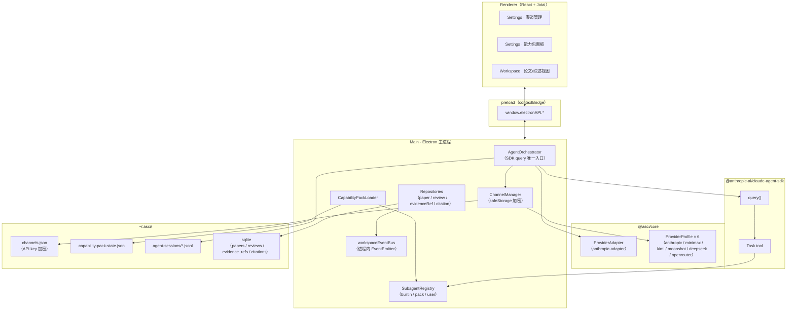
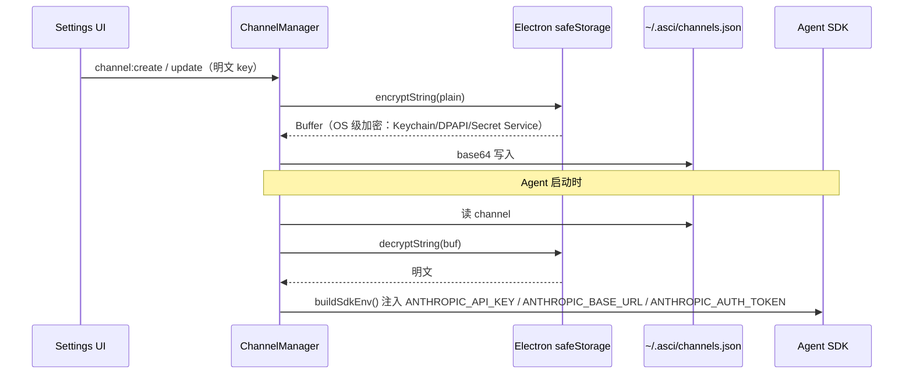
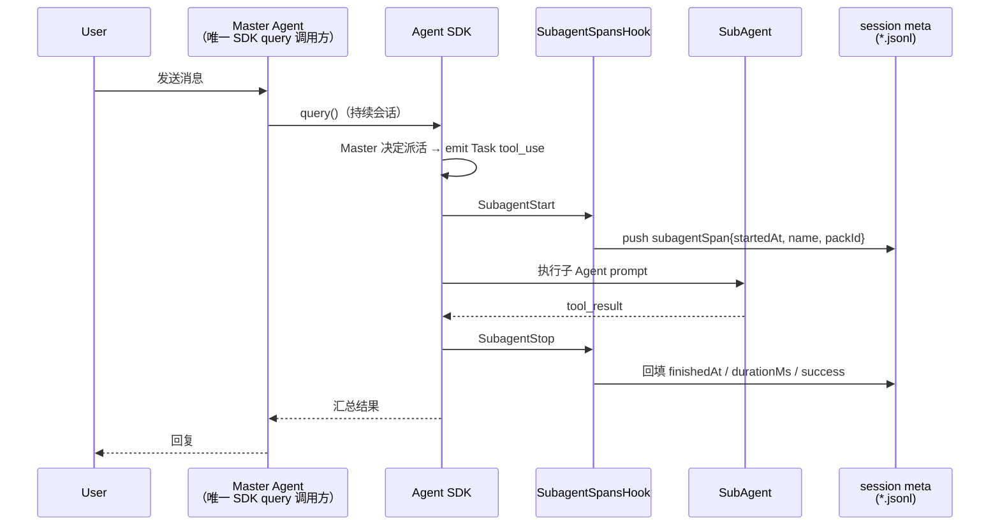
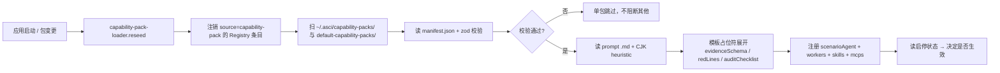
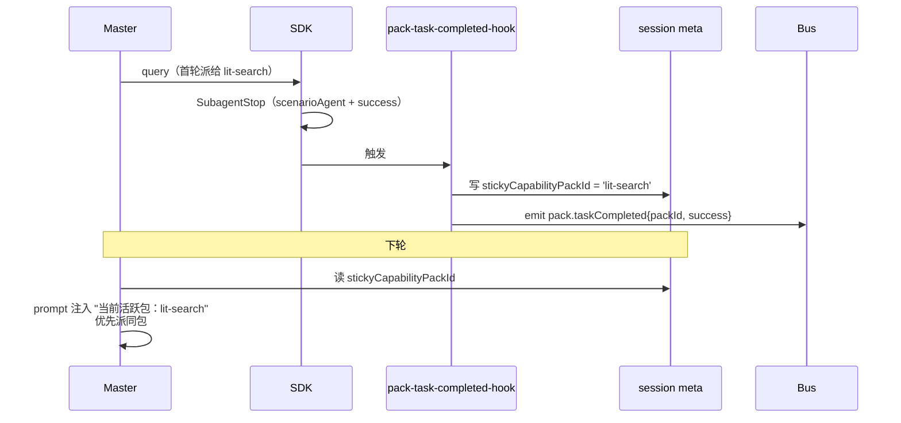

# ASCI 0.2 阶段架构图

> **状态**：核心交付完成（AI Providers / SubAgent / 能力包 / 工作区事件），Proposal 模块延期至 0.3
> **快照日期**：2026-05-26（分支 `feat/subagent-refine`）
> **适用对象**：接手 0.2 模块的工程师、需要在 0.3 之上扩展的 AI 代理

本文汇总 0.2 阶段完成的四个核心模块的**架构脉络**，每个模块按"概念 → 抽象 → 数据流 → 关键文件"四段组织。**不是百科全书**——细节请下钻到源码与既有文档（[`docs/architecture.md`](../../architecture.md)、[`docs/agent-sdk-integration.md`](../../agent-sdk-integration.md)、[`docs/i18n.md`](../../i18n.md)）。

---

## 0. 模块全景



> **关键解读**：
> - Renderer **永远不直连** Provider / SDK，所有调用经主进程 IPC
> - SubagentRegistry 是 0.2 重构的核心枢纽——能力包 / 内置 / 用户三种来源汇入同一注册中心
> - workspaceEventBus 是**进程内**总线，不跨 IPC；renderer 用专门的 `workspace-papers:changed` 通道更新 UI

---

## 1. 模块所有权与协作边界

> 0.2 起多人协作，本节明确**各模块归属、共享契约的所有权、跨模块协作规则**——接 Issue 工作的 Claude Code 也应按此判断改动归属与是否需要跨 owner 协调。

### 1.1 模块归属

| 模块域 | Owner | 范围 |
|---|---|---|
| **应用层** | 本文档作者 | AI Providers / SubAgent 架构 / 能力包 / 工作区事件 / 仓储层（papers / reviews / evidenceRefs / citations repositories）/ 主进程服务 / IPC / Renderer |
| **科研对象模型** | Domain 模型负责人 | [`packages/shared/src/types/`](../../../packages/shared/src/types) 下的 domain entity 类型（`Paper` / `Review` / `EvidenceRef` / `CitationRelation` 等）+ 模型不变量与跨类型转换逻辑 |

### 1.2 共享契约的所有权（关键边界）

跨模块边界上有以下 shared 契约，**谁拥有 = 谁拍板 schema**。schema 一旦定下来，剩余实现工作可以并行，由 Claude Code 按 Issue 兜底。

| 契约 | 位置 | Owner |
|---|---|---|
| Domain entity 类型（`Paper` / `Review` / `EvidenceRef` / `CitationRelation` 等） | [`packages/shared/src/types/`](../../../packages/shared/src/types) | 科研对象模型 |
| 工作区事件 union schema | [`packages/shared/src/types/workspace-events.ts`](../../../packages/shared/src/types/workspace-events.ts) | 应用层 |
| Provider / Channel 类型 | [`packages/shared/src/types/channel.ts`](../../../packages/shared/src/types/channel.ts) | 应用层 |
| 能力包 manifest schema | [`packages/shared/src/schemas/capability-pack.ts`](../../../packages/shared/src/schemas/capability-pack.ts) | 应用层 |
| Agent 类型（`AgentDefinition` / `SubagentSpan` / `AgentSessionMeta`） | [`packages/shared/src/types/agent.ts`](../../../packages/shared/src/types/agent.ts) | 应用层 |

仓储层（[`apps/electron/src/main/lib/objects/repositories/`](../../../apps/electron/src/main/lib/objects/repositories)）由**应用层**所有，但 **import 科研对象模型的类型**——不允许在仓储或事件 payload 内再造一份重复的 domain 类型。

### 1.3 协作规则

1. **Domain 字段调整**：科研对象模型 Owner 改 `Paper` / `EvidenceRef` 等字段 → 直接改 [`packages/shared/src/types/`](../../../packages/shared/src/types)；仓储层 + 事件 payload 由应用层在 PR review 时同步适配。**不需要事先协调**，但 PR 描述需说明字段变更，方便仓储 Owner 在 review 阶段补适配。

2. **新增事件类型**：需要新 `WorkspaceEvent.kind` 时 → 科研对象模型 Owner 提 Issue 描述场景与触发点 → 由应用层在 [`workspace-events.ts`](../../../packages/shared/src/types/workspace-events.ts) 加 union case + 在对应仓储里 `emit`。**禁止**在 domain 模型内绕过 `workspaceEventBus` 自建广播。

3. **仓储是 entity 唯一持久化出口**：Agent / UI 不直接读写 SQLite；新增 entity 类型时由 domain Owner 提 PR 加类型，应用层提 PR 加对应 repository（含 emit 工作区事件）。

4. **Issue 驱动整合**：除上述三条边界外，剩余跨模块衔接（如新 entity 怎么暴露给 SubAgent prompt、能力包怎么消费 entity 数据）走 **Issue 描述意图 + Claude Code 兜底实现**，无需双方提前对齐——shared 契约定了，整合就是确定性工作。

### 1.4 不需要协调的事

- 各自模块内部的实现细节、文件拆分、命名风格、重构
- 各自模块的单元测试
- 各自模块的 patch 版本递增节奏
- Renderer 端各自模块的 UI 组件（彼此独立）

---

## 2. AI Providers — Adapter + Profile 两层抽象

### 2.1 动机
0.1 阶段 provider 配置散落在多处；0.2 抽象为 **Adapter / Profile 两层**：协议归 Adapter，渠道归 Profile，使新增供应商只需写一个 Profile + 注册。

### 2.2 核心抽象

| 层 | 接口 | 职责 | 文件 |
|---|---|---|---|
| **Adapter** | `ProviderAdapter` | `buildStreamRequest()` 构造 HTTP body；`parseSSELine()` 解析 SSE → 通用 `StreamEvent[]` | [`packages/core/src/providers/anthropic-adapter.ts`](../../../packages/core/src/providers/anthropic-adapter.ts) |
| **Profile** | `ProviderProfile` | `defaultProbeModel` / `validateEndpoint` / `formatAuthError` / `defaultCapabilities` / `fetchModels` | [`packages/core/src/providers/profiles/*.ts`](../../../packages/core/src/providers/profiles) |

**0.2 仅一个 Adapter**——所有内置 provider 都是 Anthropic 协议兼容端点，复用同一个 `anthropic-adapter`。后续若接入 OpenAI 协议族，则增加第二个 Adapter。

### 2.3 内置 Provider 清单

| Provider | 默认 Base URL | 特殊点 |
|---|---|---|
| **anthropic** | `https://api.anthropic.com` | 官方端点 |
| **minimax** | `https://api.minimaxi.com/anthropic` | Anthropic 兼容 |
| **kimi** | `https://api.kimi.com/coding` | 401 定制文案 |
| **moonshot** | `https://api.moonshot.cn/anthropic` | PDF block 不支持（capabilities 声明） |
| **deepseek** | `https://api.deepseek.com/anthropic` | Anthropic 兼容 |
| **openrouter** | `https://openrouter.ai/api` | 模型名需 namespace 前缀 + ranking header |

每个 Profile 都有独立 unit test（`packages/core/src/providers/profiles/*.test.ts`），并由 `profile-contract.test.ts` 做契约校验。

### 2.4 凭据与运行时注入



- 加密：[`channel-manager.ts`](../../../apps/electron/src/main/lib/channel-manager.ts) 用 Electron `safeStorage`（macOS Keychain / Windows DPAPI / Linux Secret Service）
- 落地：[`~/.asci/channels.json`](../../../apps/electron/src/main/lib/config-paths.ts)（开发模式 `~/.asci-dev/`）
- SDK 注入：[`agent-orchestrator.ts` `buildSdkEnv()`](../../../apps/electron/src/main/lib/agent-orchestrator.ts) —— ⚠️ 末尾的 `ANTHROPIC_*` 空字符串覆盖循环是**硬约束**（[CLAUDE.md §7.2](../../../CLAUDE.md)）

### 2.5 IPC / UI 入口

- Shared 常量：[`packages/shared/src/types/channel.ts`](../../../packages/shared/src/types/channel.ts) 的 `CHANNEL_IPC_CHANNELS`（`channel:list / create / update / delete / test / test-direct / fetch-models / decrypt-key`）
- UI：[`components/settings/ChannelSettings.tsx`](../../../apps/electron/src/renderer/components/settings/ChannelSettings.tsx) + `ChannelForm.tsx`
- Atom：[`atoms/channels-atoms.ts`](../../../apps/electron/src/renderer/atoms/channels-atoms.ts)

### 2.6 扩展指南
- 加新 Provider（同协议）：新增 `profiles/{name}-profile.ts` + 在 `profile-registry.ts` 注册 + 配套 test
- 加新协议族：实现第二个 Adapter + 改造 `agent-orchestrator.buildSdkEnv()` 路由

---

## 3. SubAgent 架构重构 — Registry + Master Orchestrator

### 3.1 动机（0.1 → 0.2 的根本变化）

| 痛点 | 重构后 |
|---|---|
| 内置 SubAgent 硬编码在 `buildBuiltinAgents()`，能力包无法扩展 | **SubagentRegistry** 单例，三种来源汇入：`builtin` / `capability-pack` / `user-config` |
| Skill / SubAgent / MCP 注册口径不统一 | Registry 同时承载三类条目，统一 snapshot 接口 |
| 子 Agent 派发缺少观测点 | `SubagentStart` / `SubagentStop` hooks 写 span 到 session meta |
| 子 Agent 链路无序扩散风险 | **C1 红线**：禁止子 Agent 再派生子 Agent（manifest schema 校验 tools 不含 Task） |

### 3.2 核心抽象

```mermaid
classDiagram
  class AgentDefinition {
    +description: string
    +prompt: string
    +tools?: string[]
    +model?: 'sonnet' | 'haiku' | 'opus'
  }

  class SubagentRegistryEntry {
    +source: 'builtin' | 'capability-pack' | 'user-config'
    +role: 'scenario' | 'worker'
    +packId?: string
    +nameI18n?: { en, zh }
  }

  AgentDefinition <|-- SubagentRegistryEntry : extends

  class SubagentRegistry {
    +register(entry)
    +unregisterBySource(source)
    +list(filter)
    +snapshot()
  }

  SubagentRegistry o-- SubagentRegistryEntry : holds *
```

**冲突策略**：同名条目时 `builtin` 不可被覆盖；`capability-pack` 不可被另一个 pack 覆盖；`user-config` 可覆盖 pack 但不能覆盖 builtin。

### 3.3 生命周期与观测



**关键约束**：
- Master Orchestrator 是 SDK `query()` 的**唯一调用方**（[`run-orchestrator-query.ts`](../../../apps/electron/src/main/lib/run-orchestrator-query.ts)），所有 SubAgent 都经它派活
- C1 红线由 manifest zod schema 守门：worker SubAgent 的 tools 白名单不允许 `Task` / `Agent`

### 3.4 SubAgent / Skill / MCP 三者分工

| 维度 | SubAgent | Skill | MCP |
|---|---|---|---|
| **角色** | 决策 + 执行 | 执行原语 | 第三方工具 |
| **派发方式** | Master 用 Task tool 派活 | SubAgent 在 system prompt 引用 | 注册后所有 Agent 可见 |
| **典型例子** | searcher / synthesizer | review-proposer / literature-review-result | paper-search |
| **状态** | 单次任务 | 无状态 | 长连接（stdio / http） |

### 3.5 i18n / nameI18n（UI-only）

- **Agent system prompt 永远英文**（CLAUDE.md §2），输出语言由末尾的 Output Language directive 路由（UI 语言 + 用户消息语言双判断）
- `nameI18n: { en, zh }` 字段**只**用于 UI 渲染 SubAgent 选择器，不进 Agent 注入路径，避免翻译干扰派发逻辑

### 3.6 关键文件

| 用途 | 文件 |
|---|---|
| Registry 实现 | [`subagent-registry.ts`](../../../apps/electron/src/main/lib/subagent-registry.ts) |
| SDK 唯一入口 | [`run-orchestrator-query.ts`](../../../apps/electron/src/main/lib/run-orchestrator-query.ts) |
| 派发观测 | [`subagent-spans-hook.ts`](../../../apps/electron/src/main/lib/subagent-spans-hook.ts) |
| 类型定义 | [`packages/shared/src/types/agent.ts`](../../../packages/shared/src/types/agent.ts)（`AgentDefinition` / `SubagentSpan` / `AgentSessionMeta`） |
| 工具识别 | [`packages/shared/src/utils/subagent-tool-name.ts`](../../../packages/shared/src/utils/subagent-tool-name.ts) |
| Renderer 状态 | [`renderer/atoms/agent-atoms.ts`](../../../apps/electron/src/renderer/atoms/agent-atoms.ts)（ActivityGroup / TeammateState） |

---

## 4. 能力包（Capability Pack） — 检索 + 综述

### 4.1 概念

**能力包 = 场景 Agent + Worker SubAgent 集合 + Skill 引用 + MCP 引用 + UI 框架** 的打包单元。文件形态：

```
apps/electron/default-capability-packs/{pack-id}/
├── manifest.json           # CapabilityPackManifest（zod schema 校验）
├── scenario/
│   └── system-prompt.md    # 场景 Agent prompt
└── sub-agents/
    ├── {worker-1}.md
    └── {worker-2}.md
```

### 4.2 内置包清单

| 包 | 场景 Agent | Worker | MCP | UI 框架 |
|---|---|---|---|---|
| **lit-search**<br/>文献检索 | `lit-search`（sonnet） | `searcher`（haiku, 8 个 paper-search 工具白名单）<br/>`relevance-scorer`（haiku, F22 + LLM 两阶段评分）<br/>`citation-explorer`（haiku, snowball_search） | `paper-search`（全局） | `conversation-and-artifact` |
| **lit-review**<br/>文献综述 | `lit-review`（sonnet） | `review-proposer`（sonnet, Read/Glob/Grep）<br/>`synthesizer`（sonnet, 可写文件）<br/>`reader`（haiku, 单篇精读）<br/>`fact-checker`（haiku, traceability 终审） | `paper-search`（仅 get_paper_meta） | `conversation-and-artifact` |

### 4.3 加载与启停



**启停状态分层**：
- 全局：[`~/.asci/capability-pack-state.json`](../../../apps/electron/src/main/lib/capability-pack-state.ts)
- 工作区级覆盖：`~/.asci/agent-workspaces/{slug}/capabilities.json` —— 三态（`null` 继承 / `true` 强启 / `false` 禁用）

**UI 入口**：[`renderer/components/config/CapabilityPackPanel.tsx`](../../../apps/electron/src/renderer/components/config/CapabilityPackPanel.tsx)，乐观更新 + 失败回滚。

### 4.4 D2 会话粘滞（Sticky Session）

为什么需要：用户在一个会话内反复用同一个包时，避免 Master 每轮重新分类意图。



**失败不留偏好**：`success === false` 时不写 sticky，避免下轮误派到已知失败的包。

### 4.5 数据落地

- **lit-search** → [`paper-repository`](../../../apps/electron/src/main/lib/objects/repositories/paper-repository.ts)（单篇论文落库 + emit `paper.created`）
- **lit-review** → [`review-repository`](../../../apps/electron/src/main/lib/objects/repositories) + [`evidence-ref-repository`](../../../apps/electron/src/main/lib/objects/repositories/evidence-ref-repository.ts)（综述 HTML + 引文链接 + emit `evidenceRef.created`）

### 4.6 关键文件

| 用途 | 文件 |
|---|---|
| Manifest schema | [`packages/shared/src/schemas/capability-pack.ts`](../../../packages/shared/src/schemas/capability-pack.ts) |
| Loader（核心装配） | [`apps/electron/src/main/lib/capability-pack-loader.ts`](../../../apps/electron/src/main/lib/capability-pack-loader.ts) |
| IPC 服务 | [`capability-pack-service.ts`](../../../apps/electron/src/main/lib/capability-pack-service.ts) |
| D2 粘滞 hook | [`pack-task-completed-hook.ts`](../../../apps/electron/src/main/lib/pack-task-completed-hook.ts) |
| 内置包 | [`apps/electron/default-capability-packs/lit-search/`](../../../apps/electron/default-capability-packs/lit-search) / [`lit-review/`](../../../apps/electron/default-capability-packs/lit-review) |
| 设计背景 | [`2026-05-22-pack-orchestration-overview.md`](./2026-05-22-pack-orchestration-overview.md) / [`agent-and-capability-pack-spec.md`](./agent-and-capability-pack-spec.md) |

---

## 5. 工作区事件 — 进程内总线 + 跨进程 IPC 推送

### 5.1 两条独立路径

ASCI 内有**两套并存但职责不同**的"工作区事件"系统：

| 路径 | 形态 | 用途 | 谁产生 | 谁消费 |
|---|---|---|---|---|
| **workspaceEventBus** | 同步 EventEmitter，进程内 | 领域事件，为衍生计算预留（0.3 接入） | Repository CRUD + pack hook | 主进程内未来订阅者（当前空） |
| **`workspace-papers:changed`** | IPC + `webContents.send` 广播 | 驱动 UI 刷新 | `workspace-paper-events.emitPapersChanged()` | renderer 的 `useGlobalAgentListeners` |

两者**不互相调用**，是同一领域操作下的两个独立 sink。这种分层让 renderer 只感知"UI 要刷什么"，主进程内的衍生逻辑不会污染 IPC payload。

### 5.2 总线事件类型


### 5.3 IPC 四联同步（论文变更）

| 层 | 文件 | 内容 |
|---|---|---|
| Shared 常量 | [`packages/shared/src/types/agent.ts`](../../../packages/shared/src/types/agent.ts) | `WORKSPACE_PAPERS_IPC_CHANNELS.CHANGED_EVENT = 'workspace-papers:changed'` + `WorkspacePapersChangedEvent { workspaceId, changedKeys[], reason }` |
| Main 广播 | [`workspace-paper-events.ts`](../../../apps/electron/src/main/lib/workspace-paper-events.ts) | `emitPapersChanged()` → 遍历 `BrowserWindow.getAllWindows()` 调 `webContents.send` |
| Preload 桥接 | [`preload/index.ts`](../../../apps/electron/src/preload/index.ts) | `workspacePapers.onChanged(callback)` |
| Renderer 订阅 | [`useGlobalAgentListeners.ts`](../../../apps/electron/src/renderer/hooks/useGlobalAgentListeners.ts) | 按 `changedKeys` 精确更新 `workspacePapersAtom`；`reason === 'reflow_failed'` 时弹 toast |

`reason` 字段的语义（`append` / `update` / `batchUpdate` / `external` / `reflow_failed`）让 renderer 决定**局部 patch 还是整表重载**。

### 5.4 持久化

**无独立 JSONL 日志**——事件对应数据本身就落 SQLite（`papers` / `evidence_refs` / `citation_relations` 表），事件总线只是"已入库"的通知。

### 5.5 关键文件

| 用途 | 文件 |
|---|---|
| Union 类型 | [`packages/shared/src/types/workspace-events.ts`](../../../packages/shared/src/types/workspace-events.ts) |
| 总线实现 | [`workspace-event-bus.ts`](../../../apps/electron/src/main/lib/workspace-event-bus.ts) |
| IPC 广播 | [`workspace-paper-events.ts`](../../../apps/electron/src/main/lib/workspace-paper-events.ts) |
| Renderer 监听 | [`useGlobalAgentListeners.ts`](../../../apps/electron/src/renderer/hooks/useGlobalAgentListeners.ts) |
| Atom | [`workspace-papers-atoms.ts`](../../../apps/electron/src/renderer/atoms/workspace-papers-atoms.ts) |

---

## 6. Proposal 模块 — 延期至 0.3

**原计划**：在能力包之上扩展第三种内置包（暂名 `lit-proposal`），输出科研提案（hypothesis / methodology / timeline）。

**延期原因**：
1. **lit-review 链路尚有 traceability 边界 case 未覆盖**——synthesizer + fact-checker 在多份论文跨段引用时仍有误标，需先稳住基础综述能力
2. **"假设生成 + 实验设计"超出当前 Master Orchestrator 的范围决策**——Proposal 类任务需要更长的会话上下文与跨包协作，需先沉淀 0.2 的派发观察数据（`subagentSpans`）再设计
3. **优先级让位给 SubAgent 重构的稳定性**——D2 粘滞机制刚落地，需要在真实使用中验证一段时间

**已为 0.3 预留的扩展点**（无需 breaking change）：
- `workspaceEventBus.pack.taskCompleted` 的 `packId` 字段允许任意 ID，新包无需改 schema
- `CapabilityPackManifest.uiFramework` 允许扩展为新枚举值（如 `proposal-canvas`）
- `SubagentRegistry` 的 `source / role / packId` 标签允许 Proposal 包**直接复用** lit-search/lit-review 的 worker SubAgent（如 reader / synthesizer）

---

## 附录 A：0.2 阶段核心目录索引

| 域 | 路径 |
|---|---|
| Provider 抽象 | [`packages/core/src/providers/`](../../../packages/core/src/providers) |
| SubAgent 注册中心 | [`apps/electron/src/main/lib/subagent-*`](../../../apps/electron/src/main/lib) |
| 能力包加载 | [`apps/electron/src/main/lib/capability-pack-*`](../../../apps/electron/src/main/lib) |
| 内置能力包 | [`apps/electron/default-capability-packs/`](../../../apps/electron/default-capability-packs) |
| 工作区事件 | [`apps/electron/src/main/lib/workspace-event-bus.ts`](../../../apps/electron/src/main/lib/workspace-event-bus.ts) + [`workspace-paper-events.ts`](../../../apps/electron/src/main/lib/workspace-paper-events.ts) |
| 数据仓储 | [`apps/electron/src/main/lib/objects/repositories/`](../../../apps/electron/src/main/lib/objects/repositories) |
| 类型契约 | [`packages/shared/src/types/`](../../../packages/shared/src/types) + [`schemas/`](../../../packages/shared/src/schemas) |

## 附录 B：相关 ADR / Spec

| 文档 | 主题 |
|---|---|
| [`docs/adr/ADR-000-common-convention.md`](../../adr/ADR-000-common-convention.md) | 协作流程（分支 / commit / PR） |
| [`docs/adr/ADR-001-local-storage.md`](../../adr/ADR-001-local-storage.md) | `~/.asci/` 本地存储策略 |
| [`docs/adr/ADR-003-ui-design-system-layering.md`](../../adr/ADR-003-ui-design-system-layering.md) | UI 设计系统分层 |
| [`docs/milestones/0.2/2026-05-22-pack-orchestration-overview.md`](./2026-05-22-pack-orchestration-overview.md) | 能力包编排原则（5 条） |
| [`docs/milestones/0.2/agent-and-capability-pack-spec.md`](./agent-and-capability-pack-spec.md) | Agent + 能力包详细 spec |
| [`docs/milestones/0.2/subagents-more.md`](./subagents-more.md) | SubAgent 扩展讨论 |
| [`docs/milestones/0.2/architecture-audit-2026-05-21.md`](./architecture-audit-2026-05-21.md) | 0.2 阶段架构审计 |

## 附录 C：常用横切约定

- **i18n**：[`docs/i18n.md`](../../i18n.md) —— UI 文案走 `useT(ns)`；Agent prompt 永远英文；`nameI18n` UI-only
- **IPC 四联同步**：shared 常量 → main handle → preload 桥接 → renderer 调用，详见 [CLAUDE.md §5](../../../CLAUDE.md)
- **SDK 打包**：`@anthropic-ai/claude-agent-sdk` 必须 `--external`，详见 [CLAUDE.md §7.1](../../../CLAUDE.md) + [`docs/build-and-packaging.md`](../../build-and-packaging.md)
- **SDK env 语义**：`buildSdkEnv()` 末尾的 `ANTHROPIC_*` 空字符串覆盖循环不可移除，详见 [CLAUDE.md §7.2](../../../CLAUDE.md)
