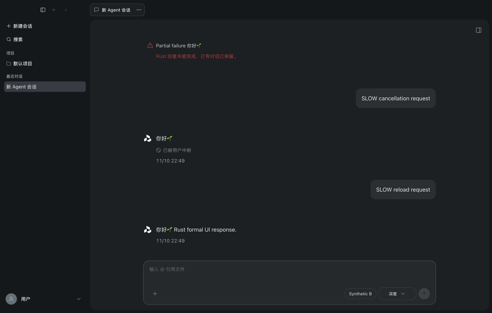

<a id="正式界面与-rust-会话引擎迁移"></a>

# Migration of the Production UI and Rust Session Engine

Status: M1 implementation and local acceptance complete, independent review passed, default unchanged. Main at startup and latest verification: `5683b781cc46ab631f73c7e84c735dcb9fb58021`. This does not complete replacement of the entire product.

<a id="架构与本批范围"></a>

## Architecture and Batch Scope

This batch reuses the production React renderer/preload and switches session services to a Rust process in an isolated development mode. Rust DesktopRuntime owns sessions, immutable request bindings, model selection, execution, events, and recovery; JSONL sidecar and Tauri commands share this service. Production still defaults to Electron/SDK.

| Path | Batch status | Evidence boundary |
|---|---|---|
| Rust DesktopRuntime / JSONL process | Implemented and independently reviewed | Real subprocess, local HTTP, synthetic data |
| OpenAI-compatible and Anthropic text protocols | Implemented and independently reviewed | Both protocols simulated locally, not online models |
| Tauri desktop_runtime_request | Connected to the same service | Actual handler with MockRuntime, not a native WebView |
| Isolated Rust mode in production Electron UI | Wired and passed native primary flow, boundary regressions, independent review | Actual Electron, not a Tauri shell or online model |
| Original default Electron/SDK | Retained | No default switch or installation replacement |
| Tools/permissions/image generation/media/background work and Tauri platform shell | M2/M3 | Must not call this a complete migration |

Code entry points:

- `apps/tinker-rust/src-tauri/src/desktop_runtime/`: Sessions, model configuration registry, execution, persistence.
- `apps/tinker-rust/src-tauri/src/bin/tinker-runtime.rs`: Actual JSONL process entry.
- `apps/tinker-rust/src-tauri/src/desktop_commands.rs`: Tauri invocation of the same application service.
- `apps/tinker-rust/src-tauri/src/chat_http/`: Both protocol codecs and SSE framing, sharing HTTP, cancellation, and secret protection.
- `packages/shared/src/types/desktop-runtime.ts`: Versioned requests, results, events, and boundary constants.
- `apps/electron/src/main/entry.ts`: Validates isolated preview before importing old services. Normal startup synchronously loads original `index.ts`; preview alone loads a separate bootstrap.
- `apps/electron/src/main/lib/desktop-runtime/`, `main/ipc/desktop-runtime.ts`: JSONL client, production-message projection, original IPC routing, and isolated platform compatibility services.

<a id="数据模型与恢复契约"></a>

## Data, Model, and Recovery Contracts

- Uses only separate `desktop-runtime-v1`; no importing/rewriting real chats, projects, accounts, channels, or keys. The host must durably create a canonical absolute root beforehand; on every open the service validates root and parent before writing.
- Metadata journal stores sessions and immutable request bindings; run JSONL stores output/state; snapshot is only a cache. Startup first validates all data under a lock, then marks nonterminal runs interrupted, avoiding partial log changes before validation failure.
- profile, model, configRevision, input, and effort freeze per request. Replaying an identical request sends no HTTP; conflicts are rejected. New sends may change profile; old replay does not revert current selection. Failed, cancelled, and interrupted exchanges do not enter the next successful parent chain.
- Bounded bytes, sessions, active counts, and historical aggregation. JSONL frames max 4MiB, history pages max 2MiB, host legacy-API aggregation max 16MiB. No silent truncation presented as complete history.
- Only trusted hosts load configuration; renderer passes logical IDs only. Public metadata excludes endpoint/key; model effort uses explicit supportedEfforts, never name-based guesses.
- This batch's host networking allows only numeric loopback, prohibiting DNS, proxies, redirects, and automatic retries. All requests use fake keys and synthetic content, without real credential reads or model fees.

<a id="已完成的独立审查与回归"></a>

## Completed Independent Reviews and Regressions

| Phase | Local commit | Final evidence |
|---|---|---|
| Design | c4400e03134853506bd1af5d799caf610cefbdd8 | Tracked spec and production-chain inventory |
| Session service and process | 36480123eb068b38e8f7e27d5865609f2ff90c01 | 171 Rust checks passed, independent SpecPass/QualityApprove |
| Text protocols and effort | 696cdc684ef25811d6a61126ae7efccdee7cb3a3 | Final 186 Rust checks passed, independent SpecPass/QualityApprove |
| Original production UI and Rust wiring | 9e9c790d84bc5036d46b462f87cd3466f1914cf7 | Native loop, 47 focused checks, independent SpecPass/QualityApprove |
| Post-PR request ownership fix | e1344fddc3d232d6151a362b633408a244b3526f | Independent requestId, 54 focused checks, native clock-rollback validation and re-review passed |

Task1 review found and fixed startup global read-only preflight ordering, directory durability synchronization/failure retry, and the 2MiB boundary budget, with behavioral regressions. Task2 review found and fixed compatibility with multiple Anthropic message_delta events; actual HTTP and runtime-process tests went red then green. usage-only/null updates preserve confirmed normal stop; conflicting stops still fail.

Actual-process validation covers both protocols, two alias models, bytewise Unicode, 1/3/5-turn requests, cross-protocol switching, restart, replay, early rejection of unsupported capabilities, successful ancestors after failure, concurrent cancellation, timeout, error-body and known-key reflection across frames, truncation, invalid UTF8, budgets, and socket release. No tool runner exists; tool blocks explicitly return unsupported, so tool capability must not be reported as migrated.

<a id="最终验收与操作方式"></a>

## Final Acceptance and Operation

<a id="实际原生链路"></a>

### Actual Native Chain

A separate owned Electron process loads this repository's original production renderer/preload, using the original AgentView, AgentMessages, Jotai, and global listeners, passing through actual main-process IPC, Rust subprocess, local HTTP, and persistent history. This is not a separate mock page. Input uses the original editor, the model menu uses real pointer events, and sending uses the original button.

- Initially Synthetic A; Unicode increments visible before completion. Switch to Synthetic B through the original model menu; the second turn displays normally.
- The mock service outputs Unicode before returning bad SSE. Partial reply, fixed error, and original recovery card remain; clicking Restore draft restores the original text without resending HTTP.
- Attempting to queue during streaming is rejected before input clearing and optimistic-message creation; input remains, with no additional HTTP.
- The original stop button cancels the request; `stoppedByUser` and per-turn host stop annotations remain.
- Refreshing the renderer mid-run restores the complete current text snapshot before resuming increments. Terminal history contains 11 stable messages without duplicate UUIDs.
- Quit the entire owned Electron and Rust processes, then reopen the same synthetic root. Original saved tabs, model selection, and 11 historical messages recover without automatic model resends.
- Reopening in Chinese/dark and English/light passed. Screenshots wait for entrance animations to settle.
- The test entry temporarily simulates Date construction and Date.now rollback only in the renderer. It captures a second startedAt earlier than the first, distinct requestIds, and normal original-UI completion. The shim is restored in finally; system time is unchanged.

Native simulation made 5 HTTP requests, switching from model A to B. Every request actually carried high; role counts were `[1,3,5,5,5]`; failed and cancelled exchanges did not enter the successful parent chain. The 11 messages comprise 5 user, 5 assistant, and 1 actual host cancellation annotation, without fabricated SDK results, session origins, tokens, or costs.

Native GUI used one OpenAI mock profile. Anthropic was tested through actual Rust processes and HTTP, not separately in native UI. GUI process reopening followed normal exit; forced interruption during partial output and interrupted recovery are covered by actual-process adapter tests, not GUI force-kill acceptance. Tauri uses actual-handler MockRuntime; native Tauri/WebView remains unaccepted. No online models ran.

<a id="复现入口"></a>

### Reproduction Entry

Build the Rust binary and production Electron assets, then compile the test entry and invoke the synthetic launcher:

```sh
cargo build --manifest-path apps/tinker-rust/src-tauri/Cargo.toml --bin tinker-runtime
bun run electron:build
bunx esbuild apps/electron/scripts/ui-runtime-acceptance-main.ts --bundle --platform=node --format=cjs --external:electron --outfile=apps/electron/dist/ui-runtime-acceptance.cjs
bun apps/electron/scripts/ui-runtime-acceptance.ts /absolute/Electron /absolute/output /absolute/tinker-runtime
```

The final three arguments are the local Electron executable, output directory, and Rust binary from the previous step. The launcher creates only its own temporary root, fake profile, and local mock HTTP, without reading real channels. Do not copy real configuration into that directory or replace this round's restricted profile with a real model endpoint.

Manual development preview requires an unpackaged app, `TINKER_DESKTOP_RUNTIME=rust-preview`, and explicit `TINKER_DESKTOP_ROOT/BINARY/PROFILES`; `ASCI_CONFIG_HOME` must be exactly `electron-compat` under that root. The root must carry a matching marker and pass security checks; invalid configuration rejects startup. Prefer the launcher above to avoid accidentally targeting real data.

The native console still reports original-initializer probes for unmigrated domains, such as Zotero, ASR, updates, workspace papers, and output feedback. These are explicitly rejected, never falsely reported successful, and do not block the primary text flow. Existing failure cards and explanations are reused; this round does not redesign product copy or visuals.

<a id="最终检查"></a>

### Final Checks

| Check | Actual result | Local log |
|---|---|---|
| Repository-wide `bun test` | 3443 pass, 0 fail, 9454 assertions, 400 files | pr21-final-bun.log |
| Repository-wide `bun run typecheck` | Six workspaces exit 0 | pr21-final-typecheck.log |
| Repository-wide `bun run lint` | exit 0 | pr21-final-lint.log |
| `bun run electron:build` | exit 0, includes normal hook version changes and post-PR fix | pr21-final-build.log |
| Rust `cargo test` | 186 top-level tests passed, 0 failed; filtered subprocess tests not counted again | final-rust.log |
| Rust fmt / clippy all-targets `-D warnings` | exit 0 | final-fmt.log / final-clippy.log |
| Final focused UI/adapter tests | 54 pass, 333 assertions, 11 files | ui-runtime-pr21-focused.log |
| Latest native automation | exit 0, 5 synthetic HTTP requests, including actual renderer clock rollback | ui-runtime-pr21-native.log / pr21-identity/ui-runtime-http.json |
| Independent spec and quality review | R1–R6 and EOF issues closed, SpecPass / QualityApprove | task-3-review.md |
| Post-PR review | Clock-rollback P2 fix passed re-review; no other important issues found | pr21-review.md |
| Full-branch simplify review | approve, no required changes | simplify-runtime.md |

All Rust commands use `--manifest-path apps/tinker-rust/src-tauri/Cargo.toml`. clippy arguments: `--all-targets -- -D warnings`; fmt: `cargo fmt ... -- --check`. All local logs reside in `/private/tmp/tinker-runtime-checks-20261110`. Runs strip ambient service variables and point ASCI configuration/runtime to new test roots; Cargo reuses existing target. Loopback/native validation used normal tool permissions without bypassing rejections.

Normal commit hooks incremented the Electron workspace from 0.1.617 to 0.1.618, with other related workspaces updated by normal hooks. Latest screenshots use frozen source after the post-PR request ownership fix, followed by another successful full build. Rust source did not change in that fix; the 186 Rust results correspond to identical Rust source. No installation package was created or replaced.

<a id="审查后补齐的边界"></a>

### Boundaries Completed After Review

| Contract | Fix and semantic regression |
|---|---|
| Reload latest snapshot and event pagination | Advance cursor to complete snapshot sequence; backlog beyond 128 deltas and later increments appear exactly once |
| All failing Promises | Legitimate polling/history errors such as storeIo also reject sends and close invalid sidecars, leaving no invisible execution |
| File resources | Reject all deliverables resources; permit only trusted build assets, without exposing private roots or other files through links |
| Old/new request ownership | Explicitly register bounded independent requestIds; owned old EVENT/ERROR/COMPLETE and Promises cannot contaminate new requests, even after the new request ends. Old SDK/external paths without identity retain compatibility |
| Rolled-back and equal clocks | startedAt represents actual time only and no longer orders identity. Five local entry points capture one opaque ID; success, failure, rollback, equal clocks, and duplicate clicks have regressions |
| Workspace compatibility directories | Use actual `.asci/.asci-dev`; actual preload low/high reads/writes verified on startup and reopening |
| Legacy workspace-index migration | Preflight main, tmp, bak candidates before any legacy reader; reject v1, future, malformed, and unsafe slugs; owned external sentinel and original index remain unchanged |
| stdout EOF | EOF after an incomplete frame fails immediately, without waiting for the next request timeout or replaying |

All issues above have pre-fix behavioral RED and post-fix GREEN evidence; static checks do not substitute for executed regressions. Filesystem TOCTOU and physical power loss remain untested; no claim of resistance to malicious concurrent rewriting.

<a id="正式页面证据"></a>

### Production Page Evidence




<a id="ui与默认路径影响"></a>

### UI and Default-path Impact

This batch does not have zero production-source differences. The build entry adds a preliminary guard, normal main adds read-only false preview state, and preload exposes a main-confirmed read-only boolean. Renderer changes cover typed delta/snapshot, late-request ownership, Rust error explanations, and preview queue rejection only; accounts and Sentry are skipped only under strongly isolated preview true. Normal startup still synchronously follows old index with flag false.

No production layout, CSS, icons, or component redesign. Platform preferences, themes, onboarding, profiles, and workspace indexes still come from Electron within the separate compat root and are not claimed migrated to Rust. Rust stores only logical workspace association within sessions; this batch grants no project-directory tool execution. The full old SDK system prompt, memory, tools, and context strategies remain future replacement scope.

<a id="保护与回滚"></a>

## Protection and Rollback

Implementation occurred only on `feat/rust-desktop-runtime` in `/private/tmp/tinker-research-cleanup-20261110`; no writes to original dirty source, cleanup of other worktrees, Applications installation, or access to the user's official app/history. The original main repository had 63 uncommitted changes at startup, all left in place; slow old-source status is not treated as clean.

Disabling explicit preview returns to the original default SDK path. New Rust data stays in its separate root; rollback does not delete data. Individual stages may be normally reverted using independent commits in the table; no reset or force operation may discard user or remote progress. Consider default switching and old-code retirement only after tools, platform, data, feature matrix, and production staged acceptance pass.

Delivery branch: `feat/rust-desktop-runtime`; target repository: `SimmonJ-WYJ/tinker`. Delivery is a safe push and Draft PR, without merge, release, or installation. Final head, PR, and remote CI follow GitHub's actual records; local checks passing does not mean remote CI passed.

<a id="剩余里程碑"></a>

## Remaining Milestones

- M2: Actual tool request → authorization → execution → result → next model turn, covering rejection, cancellation, expiration, and wrong-run zero execution. Complete queues, concurrency, rich events, artifacts, and image generation. Tauri loads the same production renderer, replacing startup platform APIs domain by domain.
- M3: Synthetic legacy-data compatibility, authorized real credential/data migration and rollback, three platforms and equivalent resource measurements, itemized feature acceptance, then staged default switching.
- This batch promises neither all-model/SDK/feature compatibility nor whole-machine memory improvement or complete native Tauri product acceptance. Physical power loss, malicious concurrent filesystem TOCTOU, and real providers remain unverified.
