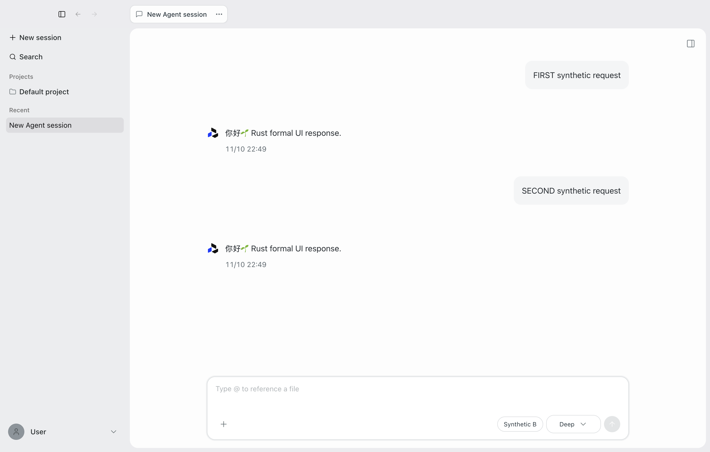

# 正式界面与 Rust 会话引擎迁移

状态：M1实现及本机验收完成，独立审查通过，默认未切换。开工及最新核验main为 `5683b781cc46ab631f73c7e84c735dcb9fb58021`。这不是整套产品完成替换。

## 架构与本批范围

本批复用正式React renderer/preload，把隔离开发模式的会话服务切到Rust进程。Rust DesktopRuntime负责会话、不可变请求绑定、模型选择、执行、事件和恢复，JSONL sidecar与Tauri command共用该服务。默认生产仍走Electron/SDK。

| 路径 | 本批状态 | 证据边界 |
|---|---|---|
| Rust DesktopRuntime / JSONL进程 | 已实现并独立审查 | 真实子进程、本机HTTP、合成数据 |
| OpenAI兼容与Anthropic文本协议 | 已实现并独立审查 | 两协议本机模拟，不是线上模型 |
| Tauri desktop_runtime_request | 已接相同服务 | 真实handler的MockRuntime，不是原生WebView |
| 正式Electron UI的隔离Rust模式 | 已接线并通过原生主路径、边界回归和独立审查 | 实际Electron，不是Tauri壳或线上模型 |
| 原默认Electron/SDK | 保留 | 无默认切换、无安装替换 |
| 工具/权限/生图/媒体/后台与Tauri平台壳 | M2/M3 | 本批不得称完整迁移 |

代码入口：

- `apps/tinker-rust/src-tauri/src/desktop_runtime/`：会话、模型配置注册表、执行与持久化。
- `apps/tinker-rust/src-tauri/src/bin/tinker-runtime.rs`：真实JSONL进程入口。
- `apps/tinker-rust/src-tauri/src/desktop_commands.rs`：相同application service的Tauri调用。
- `apps/tinker-rust/src-tauri/src/chat_http/`：两协议codec与SSE分帧，复用同一HTTP、取消、秘密保护层。
- `packages/shared/src/types/desktop-runtime.ts`：版本化请求、结果、事件与边界常量。
- `apps/electron/src/main/entry.ts`：在导入旧服务前验证隔离预览。默认同步加载原`index.ts`，预览才加载独立bootstrap。
- `apps/electron/src/main/lib/desktop-runtime/`、`main/ipc/desktop-runtime.ts`：JSONL客户端、正式消息投影、原IPC路由与隔离平台兼容服务。

## 数据、模型与恢复契约

- 只用独立 `desktop-runtime-v1`，不导入或改写真实聊天、项目、账户、渠道或密钥。宿主必须提前durable创建规范绝对根，服务每次open确认root和parent再写。
- 元数据journal保存会话及不可变请求绑定，run JSONL保存输出和状态，snapshot仅缓存。启动先持锁验证全部数据，再标记非终态interrupted，不能验证失败时已改一部分日志。
- profile、model、configRevision、input、effort按请求冻结。相同request重放不发HTTP，冲突拒绝。新发送可换profile，旧重放不回退当前选择。失败、取消和中断不进入下一轮成功父链。
- 字节、会话、活动数及历史聚合有界。JSONL frame最多4MiB，历史页最多2MiB，宿主旧API聚合最多16MiB。没有静默截断冒充完整历史。
- 配置仅由可信宿主加载，renderer只能传逻辑ID。公开metadata不含endpoint/key，模型effort由显式supportedEfforts决定，不按模型名称猜测。
- 本批宿主网络仅numeric loopback，禁DNS、代理、重定向和自动重试。全部请求为伪key和合成内容，无真实凭据读取或模型费用。

## 已完成的独立审查与回归

| 阶段 | 本地提交 | 最终证据 |
|---|---|---|
| 设计 | c4400e03134853506bd1af5d799caf610cefbdd8 | tracked spec与生产链盘点 |
| 会话服务与进程 | 36480123eb068b38e8f7e27d5865609f2ff90c01 | 171项Rust通过，独立SpecPass/QualityApprove |
| 文本协议与effort | 696cdc684ef25811d6a61126ae7efccdee7cb3a3 | 最终186项Rust通过，独立SpecPass/QualityApprove |
| 原正式UI与Rust接线 | 9e9c790d84bc5036d46b462f87cd3466f1914cf7 | 原生闭环、47项focused、独立SpecPass/QualityApprove |

Task1审查发现并修复了启动全局只读预检顺序、目录持久化同步及失败重试、2MiB边界预算，补有行为回归。Task2审查发现并修复了Anthropic多个message_delta的兼容性，真实HTTP和真实runtime进程先红后绿。usage-only/null更新保留已确认的正常stop，冲突stop仍失败。

真实进程验证包括两协议、两alias模型、逐字节Unicode、1/3/5轮次请求、跨协议切换、重启、重放、不支持能力先拒绝、失败后成功祖先、并发取消、超时、错误正文及已知key跨帧反射、截断、非法UTF8、预算和socket释放。没有工具runner，工具块明确unsupported，不能将它写成工具能力已迁移。

## 最终验收与操作方式

### 实际原生链路

独立owned Electron进程加载本仓库原正式renderer/preload，使用原AgentView、AgentMessages、Jotai及全局监听，实际经过主进程IPC、Rust子进程、本机HTTP、持久历史。不是另一张mock页面。输入使用原编辑器，模型菜单使用真实指针事件，发送使用原按钮。

- 初始Synthetic A，Unicode增量在完成前可见。原模型菜单切Synthetic B，第二轮正常显示。
- 模拟服务先输出Unicode再返回坏SSE。部分回复、固定错误和原恢复卡保留，实际点击Restore draft恢复原文，未重新发送HTTP。
- 流中尝试排队在清空输入和乐观消息之前拒绝，输入仍在，不创建额外HTTP。
- 原停止按钮取消请求，`stoppedByUser`及每轮host stop注释保留。
- 运行中刷新renderer，恢复当前完整文本快照再接增量。终态为11条稳定消息，无重复UUID。
- 退出整个owned Electron及Rust，再以同一合成根重开。原保存标签、模型选择及11条历史恢复，不自动重发模型。
- 中文深色与英文浅色重开检查通过。截图等待入场动画稳定后采集。

原生模拟共5次HTTP，模型A后切B，所有请求真实携带high，角色数量为`[1,3,5,5,5]`，失败和取消未进入成功父链。11条消息是5条user、5条assistant和1条真实host取消注释，没有伪造SDK结果、session来源、token或费用。

原生GUI使用一个OpenAI模拟profile。Anthropic通过真实Rust进程与HTTP测试，未在原生UI另测。GUI整进程重开为正常退出后重开，强制部分输出中断及interrupted恢复由真实进程适配测试覆盖，不能说成GUI强杀已验。Tauri为真实handler的MockRuntime，原生Tauri/WebView未验收。未运行线上模型。

### 复现入口

先构建Rust二进制和正式Electron资源，再编译测试入口并调用合成launcher：

```sh
cargo build --manifest-path apps/tinker-rust/src-tauri/Cargo.toml --bin tinker-runtime
bun run electron:build
bunx esbuild apps/electron/scripts/ui-runtime-acceptance-main.ts --bundle --platform=node --format=cjs --external:electron --outfile=apps/electron/dist/ui-runtime-acceptance.cjs
bun apps/electron/scripts/ui-runtime-acceptance.ts /absolute/Electron /absolute/output /absolute/tinker-runtime
```

最后三个参数是本机Electron可执行文件、输出目录、上一步Rust二进制。launcher仅创建自己的temp根、伪profile及本机模拟HTTP，不读取真实渠道。不得把真实配置复制到该目录或用真实模型地址替代本轮受限profile。

手动开发预览要求未打包、`TINKER_DESKTOP_RUNTIME=rust-preview`及显式`TINKER_DESKTOP_ROOT/BINARY/PROFILES`，`ASCI_CONFIG_HOME`严格为该根下`electron-compat`。根目录必须带相符marker并满足安全校验，错误配置拒绝启动。优先使用上述launcher，避免手工误指真实数据。

原生console仍有原initializer对尚未迁移域的探测错误，例如Zotero、ASR、更新、workspace papers及output feedback。它们被明确拒绝，未伪装成功，不阻止文本主路径。原有失败卡片及其中的说明继续复用，未在本轮做产品文案或视觉改版。

### 最终检查

| 检查 | 实际结果 | 本机日志 |
|---|---|---|
| 全仓`bun test` | 3436 pass，0 fail，9337断言，400文件 | final-bun.log |
| 全仓`bun run typecheck` | 六个workspace exit 0 | final-typecheck.log |
| 全仓`bun run lint` | exit 0 | final-lint.log |
| `bun run electron:build` | exit 0，正常hook版本变更后再构建 | final-electron-build.log / final-electron-build-versioned.log |
| Rust `cargo test` | 186个顶层测试通过，0失败，不重复计算子进程filtered测试 | final-rust.log |
| Rust fmt / clippy all-targets `-D warnings` | exit 0 | final-fmt.log / final-clippy.log |
| 最终定向UI/适配测试 | 47 pass，215断言，11文件 | ui-runtime-review-focused-final.log |
| 最新原生自动化 | exit 0，5次合成HTTP | ui-runtime-review-r6-native.log / review-r6/ui-runtime-http.json |
| 独立规格及质量审查 | R1–R6和EOF问题关闭，SpecPass / QualityApprove | task-3-review.md |
| 全分支simplify复盘 | approve，无必须修改项 | simplify-runtime.md |

Rust命令均使用`--manifest-path apps/tinker-rust/src-tauri/Cargo.toml`。clippy参数为`--all-targets -- -D warnings`，fmt为`cargo fmt ... -- --check`。本机日志全部位于`/private/tmp/tinker-runtime-checks-20261110`。运行时剥离ambient服务变量，ASCI配置和runtime指向新建测试根，Cargo复用既有target。回环/原生验证使用正常工具权限，没有绕过拒绝。

正常提交hook把Electron workspace由0.1.617增至0.1.618，其他相关workspace也按正常hook更新。截图取自提交前冻结的同一功能源码，版本hook仅改变package版本，随后完整构建重新通过。没有制作或替换安装包。

### 审查后补齐的边界

| 契约 | 修复及语义回归 |
|---|---|
| 重载最新快照与事件分页 | 游标推进到完整快照sequence，超过128个delta的积压及后续增量均只出现一次 |
| 所有失败Promise | polling/history的合法storeIo等错误也拒绝发送，关闭失效sidecar，不留不可见执行 |
| 文件资源 | 全部deliverables资源拒绝，只允许可信构建资源，不经链接暴露私有根或其它文件 |
| 新旧请求归属 | 保留有界最新attempt，旧EVENT/ERROR/COMPLETE和旧Promise不污染新请求，含新请求已结束后 |
| 工作区兼容目录 | 使用真实`.asci/.asci-dev`，实际preload low/high读写在启动与重开验证 |
| 旧workspace索引迁移 | 在任何旧reader前预检main、tmp、bak候选，拒绝v1、future、畸形和不安全slug，owned外部sentinel及原索引不变 |
| stdout EOF | 残缺frame后EOF立即失败，不等下一次请求超时，不重放 |

上述问题均有修复前行为RED和修复后GREEN，不用静态检查代替已执行的回归。文件系统TOCTOU及物理断电仍未测试，不能宣称抵抗恶意并发改写。

### 正式页面证据




### UI与默认路径影响

本批不是生产源码零差异。构建入口增加前置guard，正常main增加只读false预览状态，preload暴露主进程确认的只读boolean。renderer只补typed delta/snapshot、迟到请求归属、Rust错误说明和预览队列拒绝，账户及Sentry跳过只在强隔离预览true时发生。普通启动仍同步走旧index，flag为false。

未修改正式布局、CSS、图标或重做组件。平台偏好、主题、引导、用户档案、工作区索引仍由Electron在独立compat根提供，不称其已迁Rust。Rust只保存会话中的逻辑workspace关联，本批没有项目目录工具执行权限。完整旧SDK系统提示、记忆、工具及上下文策略仍属后续替代范围。

## 保护与回滚

本批仅在 `/private/tmp/tinker-research-cleanup-20261110` 的 `feat/rust-desktop-runtime` 实现，不向原dirty source写入，不清理其他worktree，不安装到Applications，不触碰用户正式应用或历史。开工原主仓有63项未提交，均留原处，旧source的慢状态不按干净处理。

停用显式预览开关即可回到原默认SDK路径。Rust新数据保留在独立根，不以删除数据回滚。单阶段可按表中独立commit正常revert，不能reset或force丢掉用户及远端进展。只有工具、平台、数据、功能矩阵和正式灰度验收通过后，才评估默认切换及旧代码退役。

交付分支为`feat/rust-desktop-runtime`，目标仓库`SimmonJ-WYJ/tinker`。交付方式是安全推送和Draft PR，不合并、不发布、不安装。具体最终head、PR及远端CI以GitHub当时记录为准，本机检查通过不等于远端CI通过。

## 剩余里程碑

- M2：实际工具请求→授权→执行→结果→模型续轮，覆盖拒绝、取消、过期、错run零执行。完善队列、并发、富事件、产物和生图。Tauri加载同一正式renderer，逐域替换启动平台API。
- M3：合成旧数据兼容、授权后的真实凭据及数据迁移与回退、三平台和同条件资源测量、功能逐项验收，再灰度改默认。
- 本批不承诺全部模型、SDK及功能兼容，不声称整机内存改善或原生Tauri完整产品验收。物理断电、恶意并发文件系统TOCTOU和真实provider未验证。
