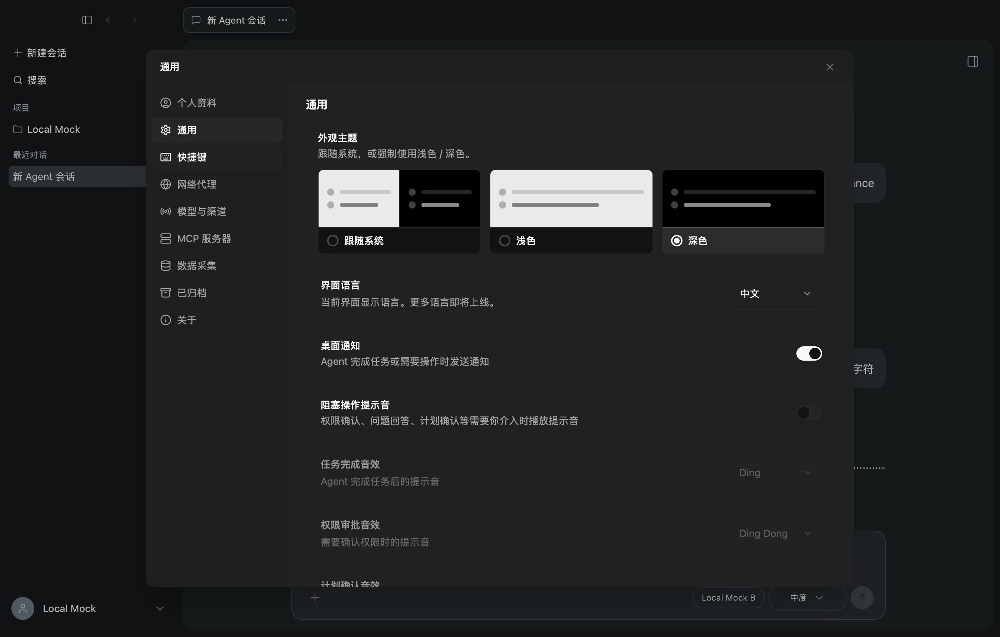

<a id="tinker-原工作台的-taurirust-迁移预览"></a>

# Tauri/Rust Migration Preview of the Original Tinker Workbench

Status: Isolated implementation, native acceptance, and final gates passed, for Draft PR review. Production still defaults to Electron/SDK; this batch is not a complete product switch.

<a id="基线与交付"></a>

## Baseline and Delivery

- Baseline main: `63fdde632dcb625df1f5736d9f7ea5270f5de547`, merged PR #21.
- Batch execution source: `29349f4109de44b7aceb49f57083cc7bf2c6c9fe`, branch `feat/tauri-formal-ui`.
- Separate application: Tinker Formal Preview `0.0.1`, identifier `com.tinker.formal-preview`, Apple Silicon.
- Workbench version `0.1.619`, reusing original React/TypeScript entry, App, CSS, Jotai, Tiptap, and message components.
- Test chain: Original workbench → Tauri IPC → Rust FormalAgentHost/DesktopRuntime → local HTTP/SSE mock service.
- Final ordinary executable SHA-256: `450eefea1a9d6625c4bd174edb26af3a4eadc7467aac2589587d846cf9216973`, 50,092,480 bytes, arm64.
- Strict local ad-hoc signature verification passed; LICENSE/NOTICE match repository originals. No claim of Developer ID, Apple notarization, or Gatekeeper approval. Only macOS 26.5.1 arm64 was actually verified; configured minimumSystemVersion 11.0 does not establish older-system verification.

<a id="已接线的行为"></a>

## Wired Behaviors

- Extracted original preload API into pure transport factories, preserving parameters, event subscriptions, synchronous reads, and cancellation contracts for 270 members. Production Electron adapter still uses original ipcRenderer/contextBridge.
- Rust native platform persists versioned settings, model selection, workspaces, tabs, language, and theme; cache updates only after durable ack. Real configuration and user data were not migrated.
- Native actor owns execution, event sequence, cancellation, generation, and recovery barriers. History uses observed watermarks, complete snapshots, and resume; page reload does not take over as a new request.
- Closing uses preparation and commit phases. Only closeWindow matching a successful receipt may close. Unknown commit state stays frozen; late results cannot close automatically. Preparation failure requires native abort acknowledgment before interaction resumes.
- Ordinary and QA entries are separate; validate context identifier before windows or data. Ordinary bundles contain no QA module symbols, QA atom-state markers, or early capture script markers. QA uses separate Vite output and its own public WebKit APIs without adding renderer control IPC.

<a id="原生验收"></a>

## Native Acceptance

All sessions, configuration, screenshots, requests, and tool markers are synthetic. The following uses DOM/native-window/menu automation in the owned WebView, not manual system-mouse acceptance or real-model requests.

| Scenario | Actual result and boundary |
| --- | --- |
| Startup and original UI | tauri://localhost loads original workbench, strict marker established, actual editor and Send available |
| Unicode, multiple models/turns | Original editor receives Chinese, emoji, café, Japanese; actual A/high and B/medium selection, with HTTP role counts proving context transfer |
| Partial failure and continuation | Partial assistant and restore-draft action retained; subsequent requests exclude failed exchange |
| Stop and duplicate sends | Original Stop clicked; double-click Send makes one request. Captured actual Send DTO precisely replayed, HTTP 1→1, result appears once |
| Active refresh | Native reload recovers same run, complete output, no permanent running state or new HTTP |
| More than 128 unread deltas | Actually held 133 deltas before refresh, 165 before release. Boundary is native delivery, not a claim of actor queue saturation |
| Old generation/old run | Injected high sequence 620 using current identity with old document, and current document with completed old identity; neither contaminates results/watermarks |
| Crash recovery | Terminated only identity-verified QA PID; journal restores interrupted/processInterrupted without automatic HTTP. Later context excludes interrupted turn |
| Language, theme, fullscreen | Actual settings switch Chinese/dark and English/light; own window API enters/exits fullscreen. System appearance unchanged |
| Tabs in final 500ms | About 210ms from clicking new session to CloseRequested; restart retains latest tabs and activeTab |
| Project-file state 400ms | Current original UI lacks old projectFiles switch. QA white-box injection into the same default Jotai store only; actual NSMenu Quit about 274ms later; snapshot and restart both read true. Not UI-switch feature acceptance |
| Native Quit | Public menu action on actual Quit Tinker item in owned NSMenu follows menu event and native exit flow |
| Startup diagnostics | Captured before bootstrap. Finally no resource/error/rejection. One CSP occurrence from Zod allowsEval capability probing, caught and returning false; strict CSP unchanged. Classified unsupported paper/feedback reads and old-document callback warnings retained; no claim of zero console output |
| Unimplemented capability rejection | Two local dialog facades return meaningful unsupported errors, without actual dialogs, file reads, or external calls |
| Ordinary bundle startup | Final29349f4 ordinary bundle launched via LaunchServices without arguments/environment overrides; PID72043 alive for 6 seconds, separate marker correct; only that batch-owned PID then ended. Not an ordinary-bundle menu Quit test |

Normal restart, crash restart, and language/model/effort/tab recovery each have independent HTTP-count and persistence evidence. Native write-failure/close-timeout injection, background-session switching, and system-appearance changes were not run; related unit/integration evidence is separate and cannot be extrapolated.




<a id="最终门禁"></a>

## Final Gates

Checks on final frozen source29349f4:

| Check | Result |
| --- | --- |
| Repository-wide Bun | 3481 passed / 0 failed, 409 files, 61.40s |
| All Rust, QA feature, all targets serially | 248 top-level tests passed / 0 failed, 28 targets. Another 11 filtered subprocess fixture calls are not counted as independent tests |
| cargo fmt / clippy -D warnings | exit0 |
| All 6 workspace typechecks | exit0 |
| Affected preload/tauri-formal/main.tsx ESLint | exit0. Configuration/build scripts are not claimed covered by this ESLint scope |
| Electron build | exit0 |
| Ordinary Tauri build, entry, signing, no-argument launch | exit0; native synthetic marker and owned PID exit confirmed |
| Independent task/full-branch reviews / simplify | No Critical / Important. One Minor internal incidental return value from public void cleanup retained; no mandatory code changes |

Machine summary: [gate evidence](2026-11-11-tauri-formal-preview-evidence.json). Complete local logs: `/private/tmp/tinker-tauri-checks-20261111`.

Commands used follow. Dependencies use the existing lockfile; default Lab and separate QA frontends were built for each binary's compile-time assets. Tests use temporary ASCI_CONFIG_HOME/ASCI_RUNTIMES_HOME, with Cargo offline and serial; never substitute real user directories for test isolation.

```sh
bun run --cwd apps/tinker-rust build
bun apps/tinker-rust/scripts/build-native-qa.ts
bun test
bun run typecheck
bun run electron:build
bun run --cwd apps/tinker-rust formal:desktop:build
cargo test --manifest-path apps/tinker-rust/src-tauri/Cargo.toml --all-targets --features formal-native-qa -- --test-threads=1
cargo fmt --manifest-path apps/tinker-rust/src-tauri/Cargo.toml --check
cargo clippy --manifest-path apps/tinker-rust/src-tauri/Cargo.toml --all-targets --features formal-native-qa -- -D warnings
```

Resource-intensive Rust mock fixtures run serially as established, now explicitly set in `test:rust`. Default parallel execution previously had 5 backlog timeouts; default parallel passing is not claimed. Two earlier full-Bun cold-start timeouts were fixed separately through an actual ready handshake preserving the 3s EOF assertion, and an outer 25s budget matching four 5s probes; production DesktopClient/RuntimeProvisioner unchanged.

Known output includes existing chunk-size/Browserslist/Jotai deprecation notices and expected failure logs. Dependencies were not upgraded and logs not suppressed to fabricate warning-free output.

<a id="保护范围与未迁移能力"></a>

## Protected Scope and Unmigrated Capabilities

- Final main/PDF CSS is byte-identical across Electron and ordinary Tauri builds, which still does not establish cross-engine pixel equivalence. Original App, CSS, Electron default main/IPC/build configuration, and old Lab source entry remain. Shared preload underwent factory extraction; main.tsx adds only explicitly Tauri-gated nonvisual initialization/persistence coordination. Unchanged local files do not equalon-device regression of every production feature.
- No writes/cleanup in the original development directory; uncommitted work remains. No reset, clean, whole-directory copying, real-data/credential migration, or overwrite installation. Other users' or concurrent operations were not audited file by file.
- Real channel/key management, OAuth, general tools/permission execution, image generation, and attachment/file operations remain incomplete in this preview. No online-model requests or model fees. Old production implementation remains active.
- Unsent editor drafts are not guaranteed to recover after restart; failed messages/partial history were verified preserved. Platform retains preview limits including 1MiB snapshot and 1024 receipts.
- No whole-machine process-tree memory testing or savings-percentage conclusion. No promise of pixel-perfect WebKit/Chromium equivalence.

<a id="构建错误与数据边界说明"></a>

## Build Errors and Data Boundaries

An early cargo-tauri CLI renamed the default-run Lab entry into a candidate bundle; an 8-second smoke created this batch's Lab store under the new formal identifier. The incorrect bundle was not delivered. Direct Cargo now specifies bin, cross-verified with entry symbols and actual launch. Only known-directory owner/permissions/creation time were checked, without reading, deleting, or migrating contents.

Initial QA compilation omitted explicit TAURI_CONFIG; a default WebView was created before duplicate main failure, potentially touching old Lab identifier WebKit system caches. Complete absence of system-cache side effects cannot be inferred. No active reading/rewriting of old Lab session files; default WebView cache impact was not further inspected. New preliminary identifier/window configuration guards prevent this configuration crossover.

<a id="回滚与下一里程碑"></a>

## Rollback and Next Milestone

This batch delivers only a separate branch/Draft PR, without automatic main merge, deployment, or installation. Exiting preview stops the new chain; production defaults to the old stack. If later merged and rollback is needed, normally revert the PR merge commit without resetting/cleaning user directories. Synthetic data stays; no automatic destruction.

Next milestone: Actual typed tool-call/result, permission state, timeout/cancellation, runner, and log/context loop, followed by existing image/file interactions. Real channel/credential/fee testing requires a separate minimal scope; successful local simulation cannot replace online acceptance.
