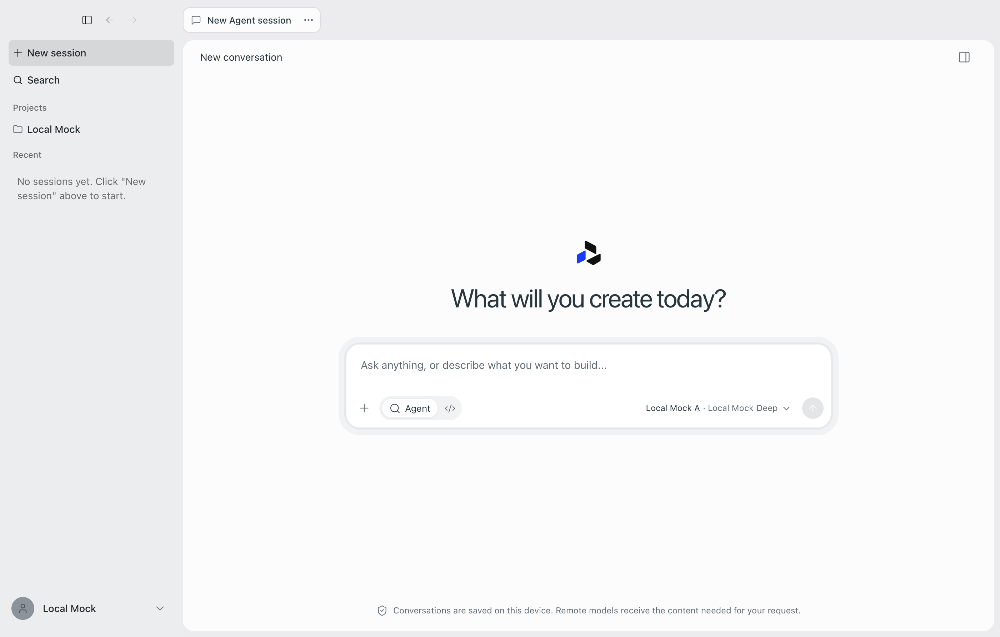

# Tinker 原工作台的 Tauri/Rust 迁移预览

状态：隔离实现、原生验收与最终门禁通过，供 Draft PR 评审。生产默认入口仍为 Electron/SDK，本批不是完整产品切换。

## 基线与交付

- 基线 main：`63fdde632dcb625df1f5736d9f7ea5270f5de547`，已合并 PR #21。
- 本批执行源码：`29349f4109de44b7aceb49f57083cc7bf2c6c9fe`，分支 `feat/tauri-formal-ui`。
- 独立应用：Tinker Formal Preview `0.0.1`，identifier `com.tinker.formal-preview`，Apple Silicon。
- 工作台版本 `0.1.619`，复用原 React/TypeScript 入口、App、CSS、Jotai、Tiptap 和消息组件。
- 测试链路：原工作台 → Tauri IPC → Rust FormalAgentHost/DesktopRuntime → 本机 HTTP/SSE 模拟服务。
- 最终普通可执行文件 SHA-256：`450eefea1a9d6625c4bd174edb26af3a4eadc7467aac2589587d846cf9216973`，50,092,480 字节，arm64。
- 本地 ad-hoc 签名严格校验通过，LICENSE/NOTICE 与仓库原文一致。没有 Developer ID、Apple 公证或 Gatekeeper 批准的声明。仅实际验证 macOS 26.5.1 arm64，配置的 minimumSystemVersion 11.0 不表示已验证旧系统。

## 已接线的行为

- 把原 preload API 提取为纯 transport 工厂，保留 270 个成员的参数、事件订阅、同步读取和取消契约。生产 Electron adapter 继续使用原 ipcRenderer/contextBridge。
- Rust 原生平台保存版本化设置、模型选择、工作区、标签、语言和主题，durable ack 后才更新缓存。真实配置与用户数据未迁入。
- 原生 actor 拥有执行、事件序列、取消、generation 和恢复屏障。历史读取通过 observed 水位、完整 snapshot 与 resume 恢复，页面重载不接管为新的请求。
- 关闭采用准备与提交两阶段。只有匹配成功 receipt 的 closeWindow 才能关窗。未知提交保持冻结，迟到结果不能自行关窗。准备失败得到原生 abort 确认才恢复交互。
- 普通入口和 QA 入口分离，创建窗口或数据前校验 context identifier。普通包无 QA 模块符号、无 QA 原子状态/早期捕获脚本标记。QA 使用单独 Vite 输出和自身 WebKit 公共 API，没有增加 renderer 控制 IPC。

## 原生验收

所有会话、配置、截图、请求和工具标记均为合成数据。以下是自身 WebView 的 DOM/原生窗口/菜单自动化，不是人工系统鼠标验收，也没有请求真实模型。

| 场景 | 实际结果与边界 |
| --- | --- |
| 启动与原 UI | tauri://localhost 加载原工作台，严格 marker 建立，真实编辑器和 Send 可用 |
| Unicode、多模型、多轮 | 原编辑器输入中文、emoji、café、日本語，实际选择 A/high 与 B/medium，HTTP 角色计数证明上下文传递 |
| 部分失败与继续 | 保留 partial assistant 和恢复草稿操作，后续请求排除失败 exchange |
| 停止与重复发送 | 点击原 Stop，双击 Send 只产生一次请求。捕获真实 Send DTO 后精确重放，HTTP 1→1，结果只出现一次 |
| 活跃刷新 | 原生 reload 路径恢复同一 run，完整输出、无永久 running、无新增 HTTP |
| 超过128未读增量 | 刷新前实际暂扣133个 delta，释放前165个。边界是 native delivery，不宣称 actor 队列饱和 |
| 旧 generation/旧 run | 使用当前 identity 配旧 document，以及当前 document 配已完成旧 identity，分别注入高序号620。均未污染结果或水位 |
| 崩溃恢复 | 仅终止身份核实的 QA PID，journal 恢复为 interrupted/processInterrupted，无自动 HTTP。后续上下文排除中断 turn |
| 语言、主题、全屏 | 真实设置切中文/深色与英文/浅色。自身窗口 API 全屏往返。未修改系统外观 |
| 标签最后500ms | 新会话点击到 CloseRequested 约210ms，重启保留最新标签与 activeTab |
| 项目文件状态400ms | 当前原 UI 没挂载旧 projectFiles 开关。仅 QA 白盒注入同一个默认 Jotai store，约274ms 后实际 NSMenu Quit，snapshot 与重启均读回 true。不是 UI 开关功能验收 |
| 原生 Quit | 对自身 NSMenu 的真实 Quit Tinker 项执行公共菜单动作，走菜单事件和原生退出流程 |
| 启动诊断 | bootstrap 前捕获。最终无 resource/error/rejection。CSP 一次为 Zod allowsEval 能力探测，异常被捕获且返回 false，严格 CSP 未放宽。未迁移的 paper/feedback 读取和旧文档 callback 警告分类保留，未称 console 全零 |
| 未实现能力拒绝 | 两个本地 dialog facade 返回有意义的 unsupported 错误，没有实际弹框、读取文件或调用外部服务 |
| 普通包启动 | 最终29349f4普通包经 LaunchServices 无参数/无环境覆盖启动，PID72043存活6秒、独立 marker 正确，随后只结束该本批 PID。这不是普通包菜单 Quit 测试 |

正常重启、崩溃重启、语言/模型/effort/标签恢复均有独立 HTTP 计数与持久化证据。原生写失败/close超时故障、后台会话切换及系统外观变化未执行，相关单元/集成证据单列，不能外推。




## 最终门禁

最终冻结源码29349f4的检查：

| 检查 | 结果 |
| --- | --- |
| 全仓 Bun | 3481 passed / 0 failed，409 files，61.40s |
| 全 Rust，含 QA feature，全目标串行 | 248 顶层测试 passed / 0 failed，28个目标。另有11次 filtered 子进程夹具调用，不重复计作独立测试 |
| cargo fmt / clippy -D warnings | exit0 |
| 全6 workspace typecheck | exit0 |
| 受影响 preload/tauri-formal/main.tsx ESLint | exit0。配置/构建脚本不冒称已被此 ESLint 范围覆盖 |
| Electron build | exit0 |
| 普通 Tauri 构建、入口、签名、无参数启动 | exit0，原生合成 marker 与 owned PID退出均确认 |
| 独立分任务与全分支审查 / simplify | 无 Critical / Important。保留一个公开 void cleanup 的内部附带返回值 Minor，无必须改码项 |

机器摘要见[门禁证据](2026-11-11-tauri-formal-preview-evidence.json)。完整本机日志保存在 `/private/tmp/tinker-tauri-checks-20261111`。

本次命令如下。依赖按现有锁文件准备，默认 Lab 前端与独立 QA 前端也已构建以满足各 binary 的编译资产需求。测试使用临时 ASCI_CONFIG_HOME/ASCI_RUNTIMES_HOME，Cargo 离线且串行，不能用真实用户目录代替测试隔离。

```sh
bun run --cwd apps/tinker-rust build
bun apps/tinker-rust/scripts/build-native-qa.ts
bun test
bun run typecheck
bun run electron:build
bun run --cwd apps/tinker-rust formal:desktop:build
cargo test --manifest-path apps/tinker-rust/src-tauri/Cargo.toml --all-targets --features formal-native-qa -- --test-threads=1
cargo fmt --manifest-path apps/tinker-rust/src-tauri/Cargo.toml --check
cargo clippy --manifest-path apps/tinker-rust/src-tauri/Cargo.toml --all-targets --features formal-native-qa -- -D warnings
```

Rust 资源密集模拟夹具按既有方式串行执行，`test:rust` 脚本已显式指定。直接默认 parallel 曾有5项 backlog超时，不能称默认并行已通过。先前全Bun曾有两项不同冷启动超时，分别通过真实 ready handshake 保留3s EOF断言、以及匹配4次5s探测的外层25s预算修复，生产 DesktopClient/RuntimeProvisioner 未改。

已知输出包含原有 chunk-size/Browserslist/Jotai 弃用提示及预期故障日志。没有用升级依赖或压制日志伪造无警告。

## 保护范围与未迁移能力

- 最终 main/PDF CSS 在 Electron 与普通 Tauri 两份构建中逐字节一致，仍不代表跨引擎像素一致。原 App、CSS、Electron 默认主进程/IPC/构建配置与旧 Lab 源码入口保持。共享 preload 做了工厂提取，main.tsx 只增加 Tauri 明确门控的非视觉初始化和持久化协调。不能把局部源文件无差异等同全部生产功能现场回归。
- 未写入或清理原开发目录，原有未提交工作保留原处，没有 reset、clean、整体复制、真实数据/凭据迁移或覆盖安装。未逐文件审计其它用户或并行操作。
- 真实渠道/密钥管理、OAuth、通用工具及权限执行、生图、附件/文件操作等仍未在此预览完成。未发送线上模型请求，不产生模型费用。旧生产实现没有退役。
- 未发送的编辑器草稿不保证重启恢复，失败消息/partial历史已验证保留。平台仍有1MiB snapshot、1024 receipts等预览边界。
- 未测整机进程树内存，没有节省比例结论。未承诺跨 WebKit/Chromium 像素完全一致。

## 构建错误与数据边界说明

早期 cargo-tauri CLI 曾把 default-run Lab 入口改名放进候选包，8秒 smoke 在新 formal identifier 下建立了本批的 Lab store。错误包未交付，现已改 direct Cargo指定bin、入口符号和实际启动交叉验证。只核查已知目录的owner/权限/创建时间，没有读、删或迁移其内容。

首次 QA 编译配置未显式传 TAURI_CONFIG，默认 WebView 先创建后因重复 main 失败，可能触及旧 Lab identifier 的 WebKit 系统缓存，不能倒推为完全无系统缓存副作用。没有主动读取或改写旧 Lab 会话文件，默认 WebView 的缓存影响未进一步检查。新的前置 identifier/窗口配置 guard 已阻止该类串用。

## 回滚与下一里程碑

本批仅提交独立分支/Draft PR，不自动合 main、部署或安装。退出预览即可停止本批新链路，生产默认仍旧栈。若以后合并需要回滚，正常 revert 该 PR 的合并提交，不 reset/clean 用户目录。合成数据保留，不自动销毁。

下一里程碑是 typed tool-call/result、权限状态、超时取消、runner 与日志/上下文的真实闭环，再接现有图片和文件交互。真实渠道/凭据及费用测试须另定最小范围，不能以本地模拟通过替代线上验收。
