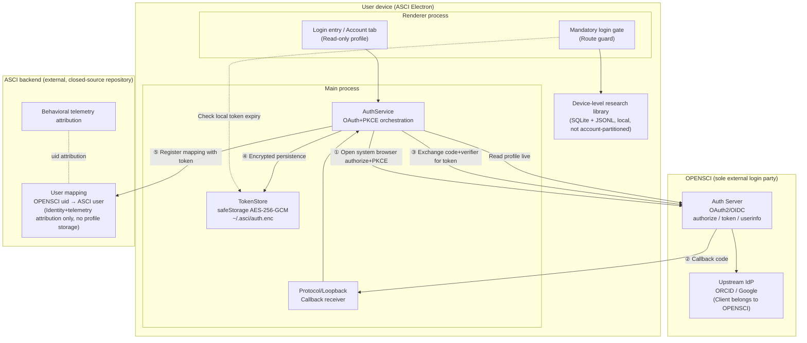
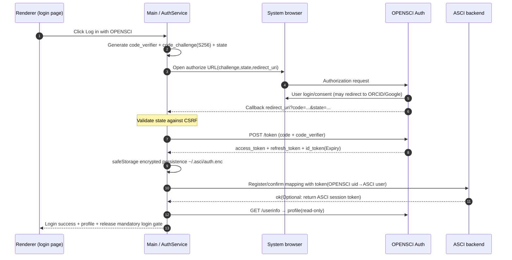
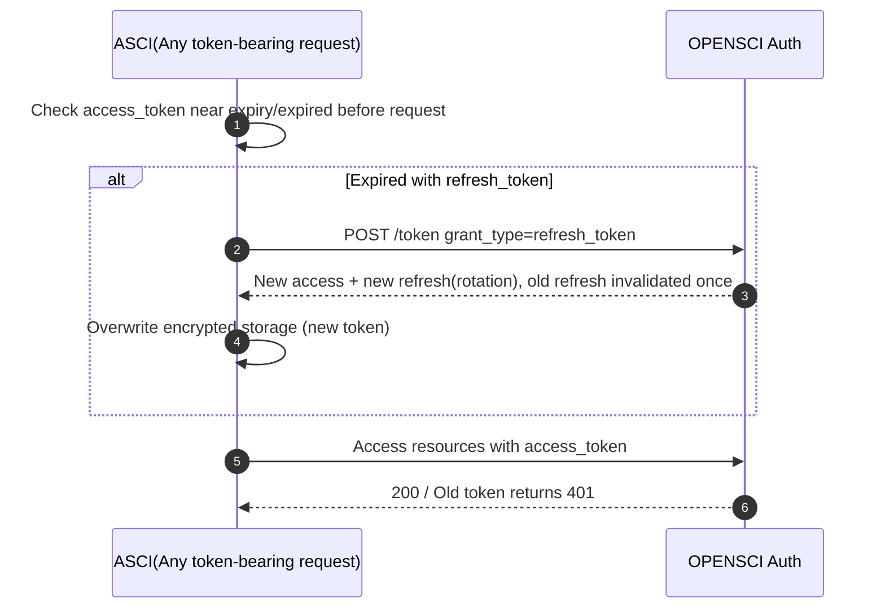
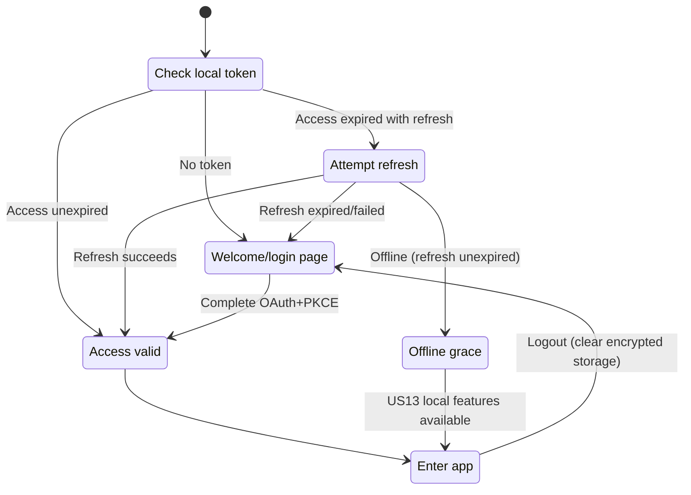

# Account OAuth Architecture Spec (Account OAuth Architecture Specification)

> **Status**: Draft · Awaiting review
> **Related issues**: #413 (Epic 7 slice 7.4 email-domain prerequisite, introducing SSO contract dependency) · Epic 1 account system
> **Domain source of truth**: `CONTEXT.md` (OAuth terminology to be added)
> **Input dependencies**: `docs/specs/0.3.0/0.3.0-prd.md` Epic 1 (account system) + Epic 7 (pre-release LT-3 SSO contract freeze)
> **Blocks**: Epic 1 login-chain implementation (U-A1~U-A6); depends on OPENSCI SSO interface contract freeze (Epic 7 LT-3)

---

## 1. Overview and Positioning

ASCI 0.3 implements mandatory login using **OPENSCI as the sole login entry** (OAuth2/OIDC delegation). This spec turns Epic 1 account constraints into implementable authentication architecture and sequences, identifying decisions that depend on the OPENSCI contract.

### 1.1 Two Prerequisites That Determine Architecture

1. **Desktop OAuth = Native App flow**: Must use **Authorization Code + PKCE** (RFC 8252 "OAuth 2.0 for Native Apps"), never implicit flow or embedded client secrets.
2. **Offline requirements (US13) + locally encrypted tokens (U-A2)** largely rule out pure BFF (backend holds tokens) → **the app must hold tokens locally** to pass mandatory-login gating offline.

### 1.2 Current Starting Point (Implementation Reference)

- Accounts/server communication: Greenfield in 0.2, no existing OAuth code.
- Reusable: 0.1/0.2 `safeStorage` AES-256-GCM encryption (see `channel-manager.ts`), proxy-fetch pattern.
- Research data: One device-level local library (SQLite + JSONL under `~/.asci/`), **not partitioned by account** (aligned with Zotero).

---

## 2. Overall Architecture / Trust Boundaries

The preserved diagram labels mean: user device (ASCI Electron), Renderer process (login entry/account tab with read-only profile, mandatory-login route guard), Main process (AuthService OAuth+PKCE orchestration, encrypted TokenStore, protocol/loopback callback receiver), and device-level local research library. External OPENSCI is the sole login party with upstream ORCID/Google IdPs; the external closed-source ASCI backend keeps only OPENSCI uid→ASCI user mapping and behavioral telemetry attribution. Arrows: check local token expiry; ① open system browser authorize+PKCE; ② callback code; ③ exchange code+verifier for tokens; ④ encrypted persistence; ⑤ register mapping with token; read profile live; attribute telemetry by uid.

**Key points**:
- Persist profile nowhere locally or server-side; **read OPENSCI** `/userinfo` **live**.
- The research library is device-level, not account-partitioned; switching accounts on one device shows the same library (US11).
- ASCI backend stores only `OPENSCI uid → ASCI user` mapping for identity and behavioral telemetry attribution.

---

## 3. Login Sequence (Authorization Code + PKCE)

Preserved sequence, in English: Renderer login page → Main/AuthService → system browser → OPENSCI Auth → ASCI backend. Click "Log in with OPENSCI"; generate verifier/challenge(S256)/state; open authorize URL; request authorization; user login/consent (possibly ORCID/Google); receive callback; validate state against CSRF; exchange code+verifier for access/refresh/id tokens and expiry; encrypt to ~/.asci/auth.enc; register/confirm uid mapping (optional ASCI session token); fetch read-only profile; report login success and release the login gate.

Acceptance mapping: U-A1 (complete login chain), U-A5 (read-only profile).

---

## 4. Token Refresh + Old-token Invalidation (U-A3)

Preserved sequence, in English: Before any token-bearing request, check access_token nearing expiry/expired; if expired and refresh_token exists, POST refresh grant, receive new access/refresh with rotation invalidating the old refresh once, overwrite encrypted storage; request resources using access_token, receiving 200 while old tokens receive 401.

> **Refresh token rotation** (new refresh on each refresh, old one immediately invalidated) is essential to U-A3's "leaked old token is invalid" requirement and **depends on OPENSCI support**. Confirm during Epic 7 LT-3 contract freeze (§6 D4).

---

## 5. Startup / Mandatory Login / Offline State Machine

Preserved states and transitions, in English: Check local token → welcome/login if absent, access-valid if unexpired, attempt refresh if expired with refresh available. Refresh → access-valid on success, offline grace on network loss with unexpired refresh, welcome/login on expired/failed refresh. Complete OAuth+PKCE → access-valid → enter app. Offline grace permits local features under US13. Logout clears encrypted storage and returns to welcome/login.

> Offline grace: All research features are local; an unexpired local token suffices (US13). Grace duration depends on OPENSCI refresh-token TTL (§6 D5).

Acceptance mapping: U-A1 (mandatory-login gate), U-A2 (encrypted storage / logout clearing).

---

## 6. Key Decisions Requiring Approval

| # | Decision | Options | Preference / dependency |
|---|--------|------|------|
| D1 | **Callback mechanism** | A. Custom protocol `asci://callback` (deep link) B. Loopback `http://127.0.0.1:port` | A offers good UX but requires protocol registration; B is most robust (RFC 8252 recommendation). Recommend **B primary, A fallback**, **depending on which redirect_uri OPENSCI permits** |
| D2 | **OAuth client mode** | A. Native public client (PKCE, direct app connection) B. BFF (backend holds tokens) | **A**: Offline + local-token requirements effectively mandate A; B violates US13 |
| D3 | **Which token to cache** | A. OPENSCI access/refresh B. Additional ASCI session token | Depends on whether ASCI backend requires separate authentication; if only telemetry attribution, **A suffices**, temporarily carrying OPENSCI token in backend calls |
| D4 | **Refresh rotation** | Whether OPENSCI supports rotation | U-A3 strongly depends on it; **confirm at Epic 7 LT-3 contract freeze** |
| D5 | **Token expiry vs mandatory login** | Offline grace duration | Depends on OPENSCI refresh-token TTL, affecting "how long it works offline while traveling" |
| D6 | **Multiple accounts** | Switch OPENSCI account on one device → same device library | Already settled by PRD (device-level sharing) and reflected in diagram; no further decision |

> D1/D3/D4/D5 **all depend on the OPENSCI SSO interface contract** (Epic 7 LT-3). Thus #413 (release prerequisites) connects to SSO contract freeze and should advance concurrently.

---

## 7. Implementation Locations (Reference for Epic 1 Issue Breakdown)

Synchronize all four IPC layers (CLAUDE.md §5):
1. `packages/shared/src/...` — Authentication IPC channel constants + request/response types (login / logout / getProfile / tokenStatus).
2. `apps/electron/src/main/ipc.ts` — `ipcMain.handle` registration invoking `main/lib/auth-service`.
3. `apps/electron/src/preload/index.ts` — `contextBridge` exposes `window.electronAPI.auth.*`.
4. `apps/electron/src/renderer/atoms/` — Login-state atoms + mandatory-login route guard.

Suggested new main-process services:
- `auth-service.ts` — OAuth+PKCE orchestration (verifier/challenge/state generation, exchange, refresh).
- `token-store.ts` — Reuse safeStorage AES-256-GCM; persist at `~/.asci/auth.enc` (dev uses `~/.asci-dev`).
- Callback receiver — Protocol handler (D1-A) or local loopback server (D1-B).

> Server implementation details (mapping schema / APIs / deployment) belong to a separate closed-source repository + ADR-002, outside this spec.

---

## 8. Actual httpClient Integration (OPENSCI OIDC, Replacing Stub)

#531 assembled the skeleton (types / IPC / login page / route guard / token storage / deeplink), with OAuth data from
a disk stub (`auth-stub.oauthExchange` + `auth-stub-server` mock consent page). This section implements "replace httpClient
when the server is ready," connecting actual ASCI-Server (OIDC broker) integration into the same skeleton.

### 8.1 Selected Implementation (Resolving §6 Decisions)
- **D1 callback = loopback (B)**: `/auth/start?redirect_uri=http://127.0.0.1:port/callback`.
  Actual ASCI-Server contract uses loopback, so OAuth callbacks use a loopback server (**not** #531's
  `asci://` deeplink; deeplink remains for email-verify / reset).
- **D2/D3 = broker passthrough**: PKCE / state / discovery / token exchange happen in ASCI-Server; desktop only
  `POST /auth/handoff` exchanges a one-time code for OPENSCI passthrough access/refresh/id tokens, without holding a client secret.

### 8.2 Modules
- `auth-oidc.ts` (dependency-free pure logic): `parseCallbackUrl` / `parseHandoffResponse` /
  `decodeJwtClaims` / `parseProfileFromClaims` / `parseProfileFromTokens` / `isTokenExpired`.
- `auth-opensci-client.ts` (`OpensciAuthClient`): `startLogin()` starts loopback + constructs authorizeUrl,
  receives code → `/auth/handoff` → decodes id_token → maps to `User` through `opensciProfileToUser`;
  also manages device-level `User` cache (`~/.asci[-dev]/auth-opensci-user.json`).

### 8.3 AuthService Wiring (Four Points)
1. `oauthStart(provider='opensci')`: With injected `opensciClient` → `client.startLogin()` starts loopback,
   opens browser, waits asynchronously for `completion`; on resolution, stores tokens + caches User + emits `login-success`.
2. `oauthCancel`: Check OIDC pending first (close loopback), otherwise fall back to deeplink.cancel.
3. `getCurrentUser`: OIDC first: cached User + valid token (refresh exists or access unexpired) → restore;
   clear cache if invalid. Retain stub / dev-bypass compatibility.
4. `logout`: Clear tokens + `opensciClient.clearCachedUser()`.

`auth-token-store`: Broaden `refreshToken` to `string | null` (OPENSCI may omit refresh); add optional `expiresAt`.

### 8.4 Dev / Gating
- Gating is unified through `LOGIN_ENABLED` (renderer) / `isLoginEnabled()` (main), **on by default**;
  only `bun run dev:skip-login` (`ASCI_SKIP_LOGIN=1`) disables it; packaged artifacts always include login.
  See [`login-default-on-spec.md`](./login-default-on-spec.md). stub / stubServer remain injected
  (email/password + dev-bypass + future providers); opensci OAuth follows the actual chain because `opensciClient` takes precedence.
- Actual dev runs require local ASCI-Server (`localhost:6060`, overridden via `auth-config.json`) or reachable online `api.asci.opensci.io`.

### 8.5 Follow-up Slices (Outside This Change)
- Refresh token rotation (`/auth/refresh`, integrating `rotateRefreshToken`);
- Online profile refresh (`/me`); add `orcidId` to `User` (mapping currently discards orcid_id).

---

**Spec version**: v1 · 2026-06-03 · Draft awaiting review; v1.1 · 2026-06-09 · Added §8 actual httpClient integration
