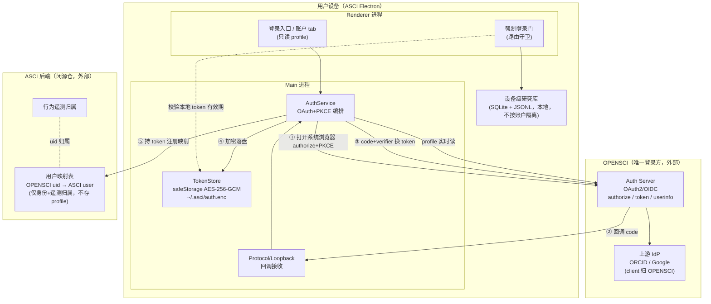
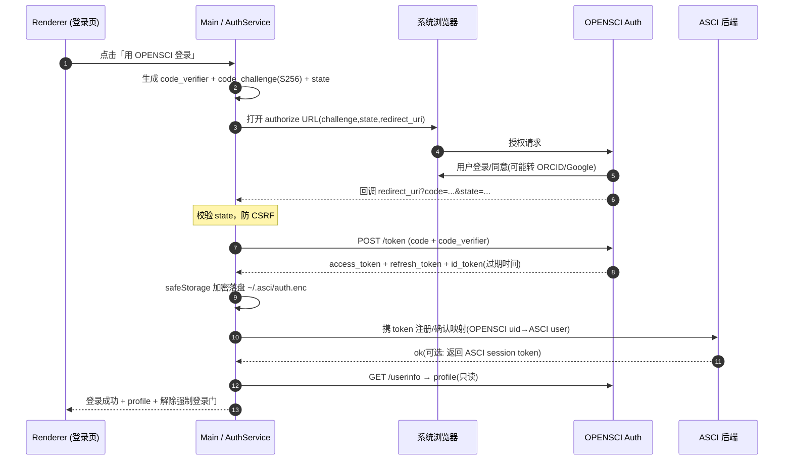
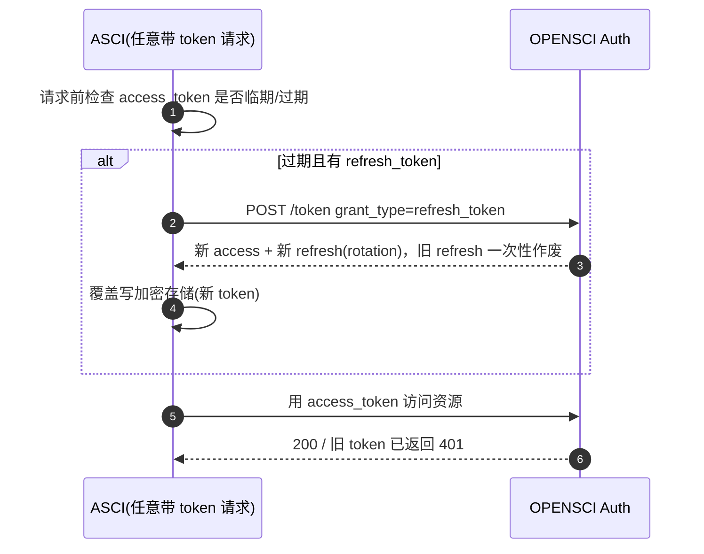
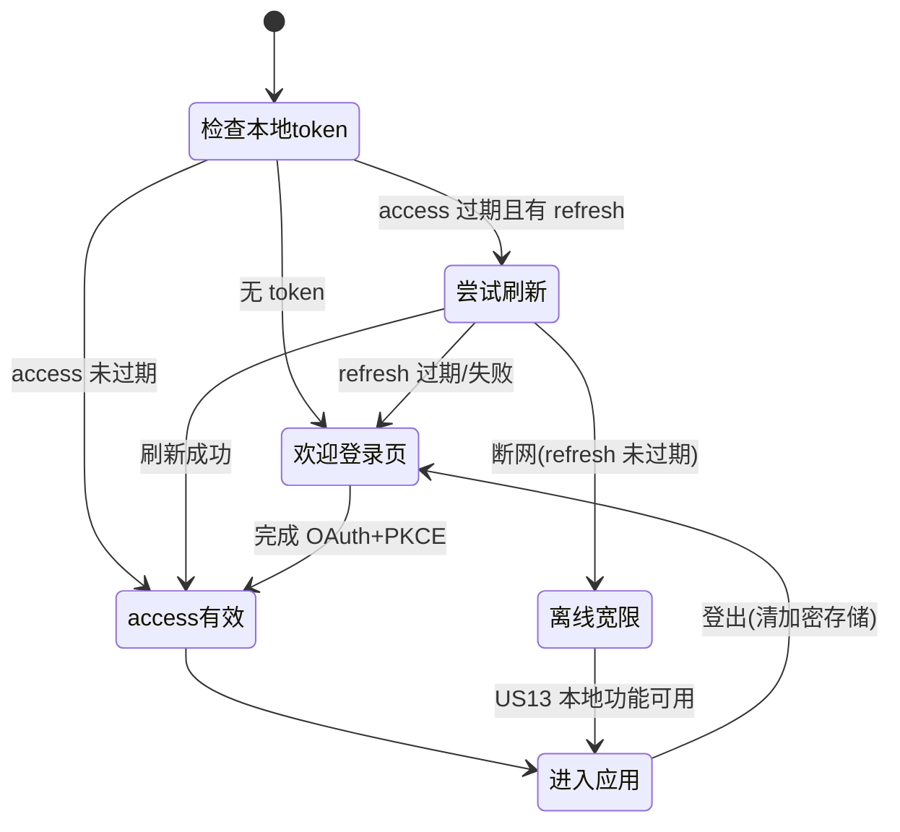

# 账户体系 OAuth 架构 Spec（Account OAuth Architecture Specification）

> **状态**：草稿 · 待 review
> **关联 issue**：#413（Epic 7 切片 7.4 邮件域前置，引出 SSO 契约依赖）· Epic 1 账户体系
> **领域语言事实源**：`CONTEXT.md`（待补 OAuth 术语）
> **依赖输入**：`docs/specs/0.3.0/0.3.0-prd.md` Epic 1（账户体系）+ Epic 7（发布前置 LT-3 SSO 契约冻结）
> **阻塞后续**：Epic 1 登录链路实现（U-A1~U-A6）；依赖 OPENSCI SSO 接口契约冻结（Epic 7 LT-3）

---

## 1. 概述与定位

ASCI 0.3 通过 **OPENSCI 作为唯一登录入口**（OAuth2/OIDC 委托）完成强制登录。本 spec 把 Epic 1 的账户硬约束落成可实现的认证架构与时序，并标注依赖 OPENSCI 契约的待决点。

### 1.1 两个决定架构形态的前置事实

1. **桌面应用 OAuth = Native App 流程**：必须用 **Authorization Code + PKCE**（RFC 8252 "OAuth 2.0 for Native Apps"），不能用隐式流，不能在客户端内嵌 client secret。
2. **离线要求（US13）+ token 本地加密（U-A2）** 基本排除纯 BFF（后端持 token）模式 → **app 本地持 token** 才能在断网时通过强制登录门。

### 1.2 现状起点（供实现参考）

- 账户/服务端通信：0.2 为 greenfield，无现成 OAuth 代码。
- 可复用：0.1/0.2 的 `safeStorage` AES-256-GCM 加密（见 `channel-manager.ts`）、proxy-fetch 模式。
- 研究数据：设备级单一本地库（SQLite + JSONL，落 `~/.asci/`），**不按账户隔离**（对齐 Zotero）。

---

## 2. 整体架构 / 信任边界

**要点**：
- profile 不落任何本地/服务端，**实时读 OPENSCI** `/userinfo`。
- 研究库设备级、不按账户隔离；同设备换账户看到同一份库（US11）。
- ASCI 后端只存 `OPENSCI uid → ASCI user` 映射，用于身份与行为遥测归属。

---

## 3. 登录时序（Authorization Code + PKCE）

对应验收：U-A1（走完登录链路）、U-A5（只读 profile）。

---

## 4. Token 刷新 + 旧 token 失效（U-A3）

> **refresh token rotation**（刷新即换新 refresh、旧的立即失效）是 U-A3「旧 token 泄露无效」的实现关键，**依赖 OPENSCI 是否支持** —— 属 Epic 7 LT-3 契约冻结需确认项（见 §6 D4）。

---

## 5. 应用启动 / 强制登录 / 离线 状态机

> 离线宽限：所有研究功能本地化，只需本地 token 未过期即可用（US13）。宽限期长短取决于 OPENSCI refresh token TTL（§6 D5）。

对应验收：U-A1（强制登录门）、U-A2（加密存储 / 登出清除）。

---

## 6. 需要拍板的关键决策

| # | 决策点 | 选项 | 倾向 / 依赖 |
|---|--------|------|------|
| D1 | **回调机制** | A. 自定义协议 `asci://callback`(deep link) B. Loopback `http://127.0.0.1:port` | A 体验好但需注册 protocol handler；B 最稳(RFC 8252 推荐)。建议 **B 主、A 备**，**取决于 OPENSCI 允许注册哪种 redirect_uri** |
| D2 | **OAuth client 模式** | A. Native public client(PKCE,app 直连) B. BFF(后端持 token) | **A** —— 离线 + 本地 token 要求基本锁定 A；B 违背 US13 |
| D3 | **缓存的是哪个 token** | A. OPENSCI access/refresh B. 额外发 ASCI session token | 看 ASCI 后端是否要独立鉴权；若仅遥测归属，**A 足够**，后端调用临时带 OPENSCI token |
| D4 | **refresh rotation** | OPENSCI 是否支持旋转 | U-A3 强依赖；**Epic 7 LT-3 契约冻结需确认** |
| D5 | **token 过期 vs 强制登录** | 离线宽限期长短 | 取决于 OPENSCI refresh token TTL，影响"出差断网能用多久" |
| D6 | **多账户切换** | 同设备换 OPENSCI 账户 → 同一份设备库 | PRD 已定(设备级共享)，图已反映，无需再决 |

> D1/D3/D4/D5 **都依赖 OPENSCI SSO 接口契约**（Epic 7 LT-3）。因此 #413（发布前置）与 SSO 契约冻结连在一起，应同期推进。

---

## 7. 实现侧落点（供 Epic 1 拆 issue 参考）

IPC 四联同步（按 CLAUDE.md §5）：
1. `packages/shared/src/...` — 认证 IPC 通道名常量 + 请求/响应类型（login / logout / getProfile / tokenStatus）。
2. `apps/electron/src/main/ipc.ts` — `ipcMain.handle` 注册，调用 `main/lib/auth-service`。
3. `apps/electron/src/preload/index.ts` — `contextBridge` 暴露 `window.electronAPI.auth.*`。
4. `apps/electron/src/renderer/atoms/` — 登录态 atom + 强制登录路由守卫。

主进程新增服务（建议）：
- `auth-service.ts` — OAuth+PKCE 编排（生成 verifier/challenge/state、换 token、刷新）。
- `token-store.ts` — 复用 safeStorage AES-256-GCM，落 `~/.asci/auth.enc`（dev 走 `~/.asci-dev`）。
- 回调接收 — protocol handler（D1-A）或本地 loopback server（D1-B）。

> 服务端实现细节（映射表 schema / API / 部署）归独立闭源仓 + ADR-002，本 spec 不展开。

---

## 8. 真实 httpClient 接入（OPENSCI OIDC，替代 stub）

#531 把骨架（类型 / IPC / 登录页 / 路由守卫 / token 存储 / deeplink）搭齐，OAuth 数据来源是
disk stub（`auth-stub.oauthExchange` + `auth-stub-server` 的 mock 同意页）。本节落地"服务端就绪后
换 httpClient"——把真实对接 ASCI-Server（OIDC broker）的逻辑接进同一套骨架。

### 8.1 选型落点（对 §6 决策的收敛）
- **D1 回调机制 = loopback（B）**：`/auth/start?redirect_uri=http://127.0.0.1:port/callback`。
  实测 ASCI-Server 真实契约用 loopback；故 OAuth 回调走 loopback server（**不**用 #531 的
  `asci://` deeplink，deeplink 保留给 email-verify / reset）。
- **D2/D3 = broker 透传**：PKCE / state / discovery / token 交换在 ASCI-Server；桌面端只
  `POST /auth/handoff` 用一次性 code 换 OPENSCI 透传 token（access/refresh/id），不在客户端持 client secret。

### 8.2 模块
- `auth-oidc.ts`（零依赖纯逻辑）：`parseCallbackUrl` / `parseHandoffResponse` /
  `decodeJwtClaims` / `parseProfileFromClaims` / `parseProfileFromTokens` / `isTokenExpired`。
- `auth-opensci-client.ts`（`OpensciAuthClient`）：`startLogin()` 起 loopback + 构造 authorizeUrl，
  收 code → `/auth/handoff` → 解码 id_token → `opensciProfileToUser` 映射成 `User`；
  并管理 `User` 设备级缓存（`~/.asci[-dev]/auth-opensci-user.json`）。

### 8.3 AuthService 接线（四个点）
1. `oauthStart(provider='opensci')`：若注入 `opensciClient` → `client.startLogin()` 起 loopback、
   开浏览器、异步等 `completion`，resolve 后存 token + 缓存 User + 发 `login-success`。
2. `oauthCancel`：先查 OIDC pending（关 loopback），否则回落 deeplink.cancel。
3. `getCurrentUser`：OIDC 优先——有 User 缓存 + 有效 token（refresh 存在或 access 未过期）→ 恢复；
   失效则清缓存。stub / dev-bypass 路径保留兼容。
4. `logout`：清 token + `opensciClient.clearCachedUser()`。

`auth-token-store`：`refreshToken` 放宽为 `string | null`（OPENSCI 可能无 refresh），新增可选 `expiresAt`。

### 8.4 dev / 门控
- 门控由 `LOGIN_ENABLED`（渲染侧）/ `isLoginEnabled()`（主进程）统一控制，**默认开启**；
  仅 `bun run dev:skip-login`（`ASCI_SKIP_LOGIN=1`）关闭，打包产物恒含登录。
  机制详见 [`login-default-on-spec.md`](./login-default-on-spec.md)。stub / stubServer 仍注入
  （email/password + dev-bypass + 未来其他 provider）；opensci OAuth 因 `opensciClient` 优先而走真实链路。
- dev 实跑需本地 ASCI-Server（`localhost:6060`，经 `auth-config.json` 覆盖）或可达线上 `api.asci.opensci.io`。

### 8.5 后续切片（不在本次）
- refresh token rotation（`/auth/refresh`，对接 `rotateRefreshToken`）；
- 在线刷新 profile（`/me`）；`User` 增 `orcidId`（当前映射暂丢弃 orcid_id）。

---

**Spec 版本**：v1 · 2026-06-03 · 草稿待 review；v1.1 · 2026-06-09 · 补 §8 真实 httpClient 接入
