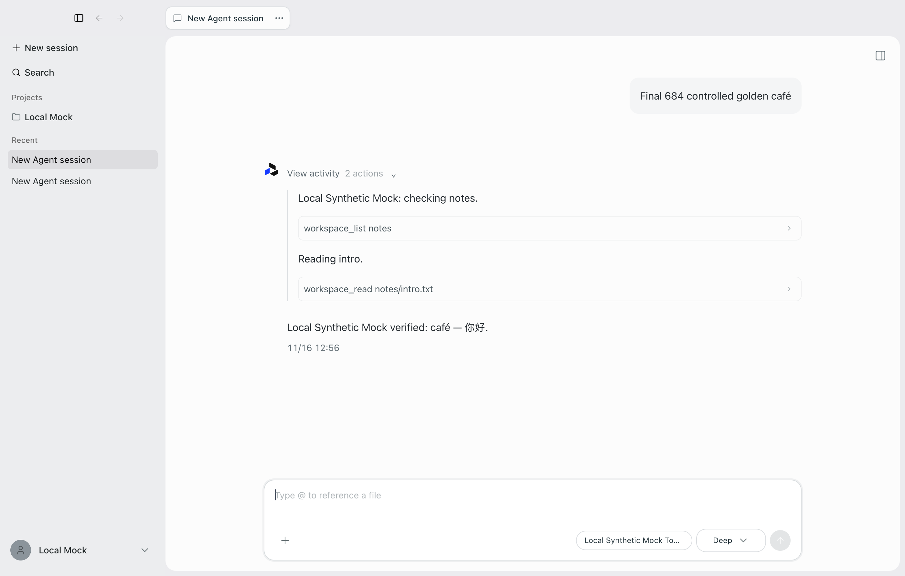
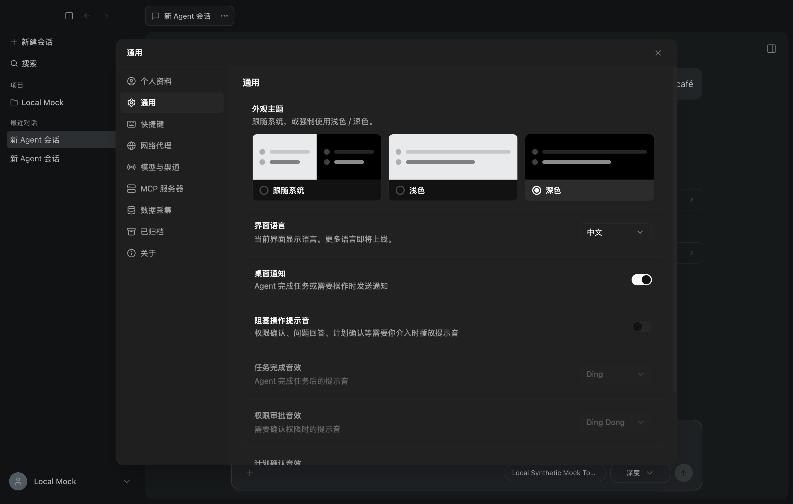
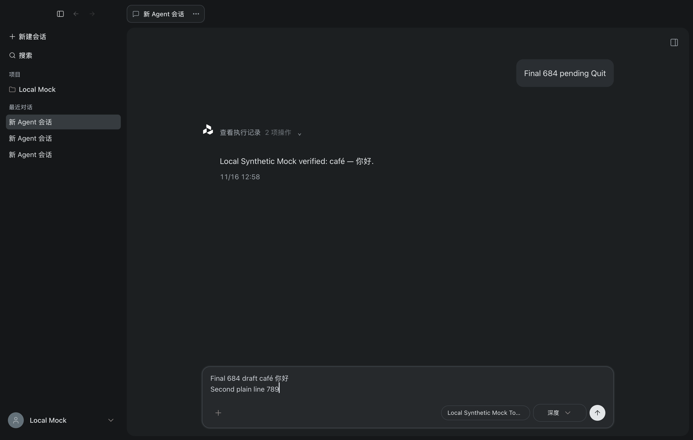
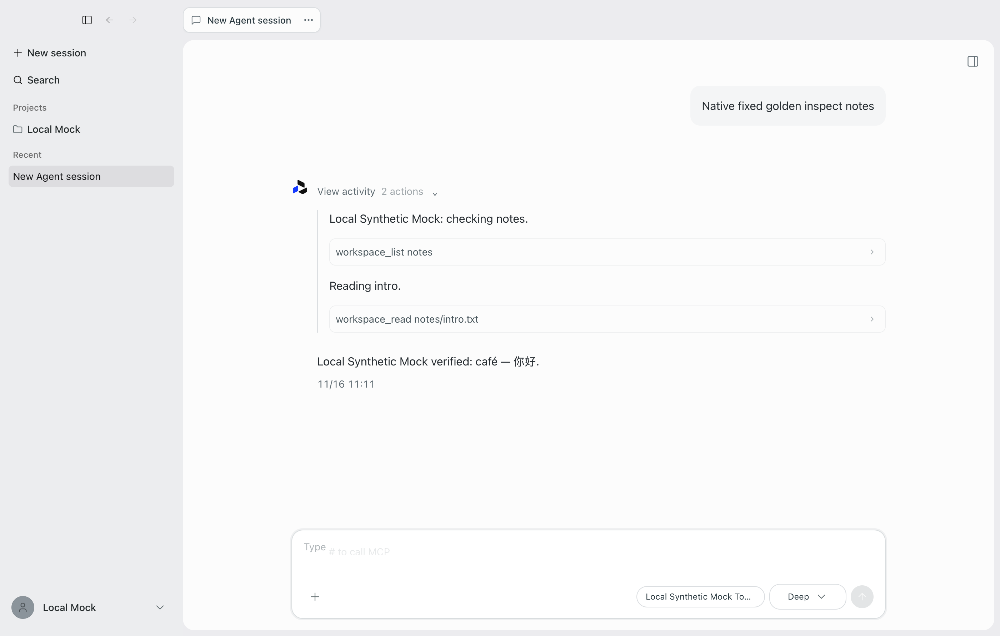
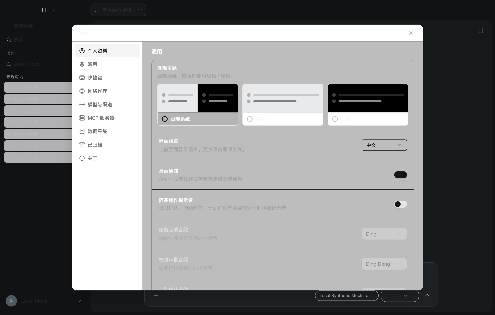

# Tinker-A Native Tool-Permission Acceptance Record

**Current status (2026-11-16): source and independent static review complete; automated checks, ordinary/QA candidate-package audits, and final native gates complete. The original screen-lock blocker cleared after the user unlocked normally. Not yet pushed, PR-published, installed, or switched into production; handed to Root for independent verification and publication.**

Code freeze: `68455c9aee34bd0fda153101addfe4150d960fee`. Persistent worktree `/Users/simmonj/Documents/ChatGPT/Tinker/migration-work/tools-native-acceptance-20261116`, branch `feat/tauri-tools-native-acceptance`. Subsequent documentation commits change reports/synthetic screenshots only; artifacts and final native acceptance correspond to that code SHA. Tasks1–3 baseline: `7e58fe4fd59d25dfaeb502e31fc64e972f10ebe9`.

Final independent supplementary static review: 68455c9 CodeReadyApproved, Critical/Important/Minor all 0, simplify/reuse passed; static review itself ran no tests or GUI.

All raw logs, failures, commands, and exit receipts are in `/Users/simmonj/Documents/ChatGPT/Tinker/migration-work/tools-native-checks-20261116` (“checks”). Checks are recorded by actual source version; old logs are not presented as reruns on new SHAs:

| Check and source | Actual result | Log |
|---|---|---|
| 952698d cargo fmt --check | exit0 | final952-fmt.log |
| 952698d cargo test --offline --all-features -- --test-threads=1 | Top-level 335 pass / 0 fail | final952-rust.log, final952-rust-counts.json |
| 952698d cargo clippy --offline --all-features --all-targets -- -D warnings | exit0 | final952-clippy.log |
| 952698d bun test --max-concurrency=1 | 3500 pass / 4 existing skip / 0 fail, 12705 assertions, 3504 tests / 413 files, 79.49s | final952-bun.log |
| 952698d typecheck / lint / Electron and two tool-package builds | All exit0 | final952-{typecheck,lint,electron-build,tools-build,qa-build}.log |
| 68455c9 persistence / restore / tools / package behavioral regressions | 27 pass / 0 fail | native-workspace-green-2.log |
| 68455c9 final full bun test --max-concurrency=1 | 3503 pass / 4 existing skip / 0 fail, 12715 assertions, 3507 tests / 413 files, 61.79s | final684-bun.log, final684-bun.receipt.json |
| 68455c9 typecheck / lint | All exit0 | native-workspace-typecheck-2.log, native-workspace-lint-2.log |
| 68455c9 Electron / ordinary tool package / QA package builds | All exit0 | final-active-electron-build.log, final-active-tools-build.log, final-active-qa-build.log |

68455c9 changes only the formal-capture fallback to trusted bootstrap workspace when the current workspace atom is null, plus regressions; Rust is unchanged. Reran 27 affected frontend tests, type/lint, and three builds; unchanged Rust retains the above 335-test evidence. After taking over, Root additionally ran full Bun on current 684 source: 3503 passed, 4 existing skips, without timeout changes or new skips. RED was actually 5 pass/1 fail; first GREEN mocked native complete settings incorrectly as a patch, preserving 26 pass/1 fail logs; correcting the mock contract yielded 27 pass. Nonempty current workspace priority and no fabricated foreign/deleted-active-tab mappings passed.

Rust counts exclude duplicate real child-test output. The old default-concurrency Bun scientific-assets 30-second timeout is retained; no fixture, timeout, or skip changes; final full concurrency-1 run passed. Existing Vite chunk/Browserslist warnings remain. Scripts are outside current eslint matching; ignored warnings are not script lint coverage, with actual Bun tests/builds recorded separately.

## Final Candidate Packages

Ordinary package `/private/tmp/tinker-tauri-tools-package-MrorTB/Tinker Tools Preview.app`, `com.tinker.tools-preview`, arm64, bundle `52331399` bytes, main binary `52242080` bytes, SHA-256 `4ceed1bc70ab68752197384e71eb149044ada8b7ba7c608a87345fedf2bcd8f7`.

Persistent archive `checks/delivery/Tinker-Tools-Preview-68455c9-arm64.zip`, `18050157` bytes, SHA-256 `545162757801c0f9131b97aa01cc2f916b7f45fb308e4f46701758ec335d2f54`. All unpacked bundle file SHAs matched individually, and strict signature verification passed again. QA package `/private/tmp/tinker-tauri-tools-package-rvhwqE/Tinker Tools Native QA.app`, `com.tinker.tools-native-qa`, main binary SHA-256 `6f13ece47bf032e42302f78f8a6c1b42266e101ca64eaa0823bf0f96a4ee0f59`. QA is not the delivery package.

Verified both packages' entries/identifiers/arm64, LICENSE/NOTICE/icon, and ordinary-package absence of QA controller nm/strings markers; full file hashes, signatures, and archives are verified in `delivery-audit-active.json` / `.log`. Signing is local ad-hoc only, not notarized; no OS security-warning bypass or Applications installation. Each build creates owned 0700 staging to avoid writing through old package symlinks. Rollback stops preview and continues original Electron; production paths never switched.

## Final Native Evidence After Unlock

Used only original React editor/Send/permission banners/settings UI and this QA's public WKWebView/NSMenu driver; host API or atom calls were not passed off as clicks. Synthetic root `/private/tmp/tinker-tauri-tools-preview-ui-20261116-final684-native` uses source 68455c9 and the above QA binary; raw protocol directories are `/private/tmp/tinker-tauri-checks-m3-tools-20261116/native-qa/<batch>`, copied each time into checks/native-qa. Journal/platform snapshots also saved in `checks/synthetic-evidence/final684-final-closed`, summary `final-native-summary.json`.

- `final684-native` seq2–13: original editor Send→list pending→reload→Allow→read pending→reload→Allow→final; confirmed only one visible human bubble. Three mock HTTP calls have assistantMessages 0/1/2. Journal has exactly one ToolStarted and Succeeded for each list_1/read_1; read content includes `café — 你好` (“hello”), matching the model's final reply. seq14–21 repeats golden in another controlled synthetic session and expands both tool cards; shared screenshots use that driver-only synthetic-content session.
- `final952-golden` actually reverified duplicate Allow, Deny, Stop, Esc, partial-error and post-Failed same-session follow-up, and default 60-second Expired on the same unchanged Rust path. Journal shows Deny with no ToolStarted and Completed explanation; Stop/Esc Cancelled/closedCall Cancelled; partial stream failure Failed/httpProtocol with retained text; follow-up parent=null and HTTP userMessages1; Expired no ToolStarted, final Completed, then permission DOM disappears. Source was 952698d; do not describe every old step as a 684 rerun.
- 952 original NSMenu Quit-pending test actually Cancelled without ToolStarted; draft survived, but wrong workspace active mapping restored an older session. Real failures remain in `final952-quit-race.json` and `final952-reopen`. Minimal fallback fix: 68455c9, without Electron/UI/style changes.
- First 684 Quit input→ack conservative upper bound 418.927ms, not claimed below 400ms; recorded in `final684-quit-race.json`. Later, same unchanged CLI through Python runpy submitted original editor input and original NSMenu Quit consecutively, without screenshots/copy/waits: `final684-quit-fast-race.json` seq4–5, pre-input-submit→Quit ack conservative upper bound **313.143ms <400ms**, revision18→19, latest session3 matches workspace active mapping, exactly saving `Final 684 draft café 你好\nSecond plain line 789` (Unicode greeting + second line). No debounce extension or forced host flush.
- `final684-final-reopen` PID46325 seq1–3: latest session3 user content, exact two-line Unicode draft, Chinese/dark restoration; visible, permissions 0, mock records=[], no automatic HTTP/tool replay. seq4 quits normally through original NSMenu. 684 session3 was pending at the earliest screenshot, but journal later shows two grants and Completed, so this Quit is not described as pending cancellation; use the above 952 and automated regression evidence for cancellation.

### Native Rendering Problems and Screenshots

Old blank conversations/white-on-white text were not visual passes. Measured `document.hidden=true`; opacity class was 100 but computed0 and CSS transition currentTime0, because WK pauses background frames. Normally activated only the exact owned QA bundle with OS `open -a` (same PID); once visible/focused, transitions progressed, computed opacity1, and colors/screenshots were normal. No forced opacity, animation disabling, or production CSS changes. Dark settings measured dialog background rgb31/text 250, sidebar background21,23,25/text 227,230,232; original settings controls changed language/theme, beyond checking classes. All original failure images retained; early images with stray non-driver input remain local and are excluded from new shared screenshots.

### Boundaries and Cleanup

Draft guarantees cover plain-text Unicode/newlines only; HTML formatting, mentions, attachments/images, and quote structures lack lossless-recovery acceptance. Native actor unread-queue saturation and precise kill between FD read and ToolFinished were not executed this round; old QA held 605 events/301 deltas proves real hold/release only, not unread saturation. Real core child exit73 after read, stale/run/delete, backpressure, and encoded-budget regressions are automated evidence. Duplicate Send core idempotency passed; an ambiguous double-click script is not listed as independent native acceptance.

After normal user unlock, the original CGS lock-true key disappeared, IOConsoleLocked=false/onConsole and loginDone=true; missing keys were not fabricated as false. No unlocking or system-setting changes. Final bounded keep-awake `/usr/bin/caffeinate -di -t 1800`, PID43186, started 2026-11-16T04:34:11.107175Z; pmset verified system/display assertions. Expired by 05:05:32.981373Z without renewal. Retained `wake-lease-final-ui.json`, `wake-assertions-final-ui.txt`, `wake-lease-final-ui-release.json`. `final684-process-audit.json` at 05:05:33.018022Z confirms QA0/wake0 and all known PIDs gone. No real Tinker/user directories, real models/credentials, spending, OAuth, or other apps operated.

## Approval Input Reconciliation and Final Cleanup

Passive event observation in `final684-grant-probe` remained pending after 8 seconds, with only two driver-triggered nontrusted clicks. Later result-8 records two native Allow clicks marked `isTrusted=true`, at times 64560/65306, matching list/read Granted; this was not automatic approval without input. This confirms input category only, not operator identity. Original session3 lacked prior input-source records and cannot be retrospectively attributed, so its pending-Quit claim is excluded. No event propagation/permission changes or other-app input collection. Raw probes/early failures remain local; new shared screenshots contain only verified synthetic content.

Root took over cleanup after interruption without starting a new native batch. Read-only verification found last known probe PID46655 exited, with no signal sent; then all known QA/keep-awake PIDs were checked in `root-final-process-audit.json`. Source stays 68455c9; later commits contain only documentation and three synthetic screenshots. Normal fetch repeated; original main remains `e961d92911f7574ce38c1f8b11f402e255ff0250`. GitHub publication uses only a safe branch and Draft PR, without automatic merge/deployment/installation.

## Historical Execution and Fix Records

The following retains each phase's then-current status, failures, and evidence; current results follow the above 68455c9 freeze and layered receipts.

Status: Task4 in progress; user-download delivery threshold not reached. Resumed 2026-11-16 in the persistent worktree.

Source baseline: `7e58fe4fd59d25dfaeb502e31fc64e972f10ebe9` (Tasks1–3 complete). Task4 adds only build entries, QA isolation, and actual acceptance records. README/CLAUDE unchanged.

This round's checks: `/Users/simmonj/Documents/ChatGPT/Tinker/migration-work/tools-native-checks-20261116`.
Commands filter environment through `run-clean.py`, use isolated ASCI home, offline Cargo, and separate persistent targets; no real credentials, external models, or app installation.

### Build Identities

| Purpose | binary | identifier | renderer | feature |
|---|---|---|---|---|
| Ordinary tool preview | tinker-tools-preview | com.tinker.tools-preview | formal-dist | formal-preview |
| Native tool QA | tinker-tools-native-qa | com.tinker.tools-native-qa | native-qa-dist | formal-native-qa |

Ordinary entry fixes probe to `None`; even all-features compilation never installs QA controllers. QA requires explicit `TINKER_TOOLS_PREVIEW_ROOT`; TrustedRoot validates the synthetic tool temporary root before any window/data operations. Validate configuration identity before Builder creation. Ordinary package uses separate `synthetic-tools-v1`, replacing neither M2, Lab, nor Electron.

### Current Validation

- Build-isolation tests: initial 1 pass / 2 fail (missing configuration/helper), then 3 pass / 0 fail; raw task4-red.log / task4-green.log.
- Repository-wide typecheck/lint exit 0; typecheck.log / lint.log.
- Lab, formal, and QA renderers actually built with their own Vite configurations; known large-chunk warnings retained.
- Initial Electron Vite config run from repository root failed from Tailwind cwd; subsequent builds from each app's correct cwd passed without style changes to conceal failure.
- First all-feature Rust tests exit 0 (rust-all-features.log; final-source rerun pending). New `[partial-error]` synthetic mock failed then passed: formal_mock 3 pass / 0 fail (partial-red/partial-green logs/receipts), real SSE text then broken stream without terminal SSE; no fabricated core state.
- Final counts, artifacts, and native evidence to follow.

### Still Outstanding

Formal/QA package builds, complete actual WKWebView control flows, permission deny/timeout/cancel, reload/process restart/close, language/themes, backpressure and history/HTTP associations, full regressions and independent review. Unexecuted items are not passes.

Only local ad-hoc signing planned, not notarization/Developer ID; no OS security-warning bypass. Rollback stops preview and continues Electron; no Applications installation or production-data switch.

### Native Findings and Fixes (2026-11-16)

After first real composer Send, `.conversation-user__text` had two identical visible nodes (y=136/266, height 24 each); recovery/result-9.json. AgentView optimistic SDK user messages lacked stable identity while the first formal tool snapshot carried another real user message. New renderer regression failed first (3 nodes, expected2 preserving old message), fixed via local `_agentRequestId`: only same-request formal human tool snapshots replace optimistic messages; same-text old requests and Electron without formal metadata remain. Merge/regression tests17 pass, types/targeted lint exit0; native rebuild/retest pending.

Ordinary-package signing in Documents target was blocked by file-provider FinderInfo. Clearing only this new artifact root's FinderInfo once allowed strict verification, but QA saw it reattached. Switched to owned 0700 `/private/tmp/tinker-tauri-tools-package-<uid>` staging; QA signing/strict verification exit0. No quarantine/provenance cleanup or security-policy changes.

First QA process without an independent session exited (unconfirmed cause), dedicated CLI sequence6 had no response in 20 seconds; not screen lock (IOConsoleLocked=false), empty app log and no crash report for this app. Reopening same synthetic root in an independent session showed actual Interrupted/closedCall Interrupted, no permission UI, one user bubble, mock records=[], no HTTP/tool replay. This was unexpected process-exit recovery, not a planned kill test.

### Native Evidence Checkpoint (After ca33779, Before Review)

Native UI source 608acb1; afterquit uses ca33779 package (packaging-helper differences only). Both have separate ordinary/QA configurations; UI screenshots only from owned WKWebView.

- fixed sequence2–12: original TipTap input→Send→list Allow (repeat same-button click)→read Allow→final. Initial/pending/list-result/terminal reloads each show one real `.conversation-user__text`. Journal only list_1/read_1 starts and successes; three HTTP rounds with strict call/result adjacency verified by mock. Root actually viewed the final expanded image.
- fixed seq20–25: same-session follow-up Completed, parent exactly previous Completed run; mock userMessages2/assistantMessages3,4,5. Two intermediate Allow scripts returned WK exception with unexplained input source, excluded from independent interaction passes; journal/mock verifies final context association.
- fixed seq31–62: actual Deny/Stop/Esc, real partial-error broken-stream Failed and same-session follow-up. Deny no ToolStarted, Denied, Completed explanation; Stop/Esc Cancelled/closedCall Cancelled/no start; Failed retains partial text (httpProtocol), follow-up parent=null, mock userMessages1 again. Initial premature option query failure retained; corrected with bounded DOM waiting, not host/atom calls posing as clicks.
- Default 60-second timeout: session6 receipt Expired, ToolFinished Expired, no ToolStarted, final Completed; seq68 permissions=[], one user bubble. Existing partialFailed error toast remains; not treated as permission residue or hidden.
- fixed seq83–89: actual QA route holds605 events/301 text deltas (300 synthetic + first text), then real list/read Allow, final, single bubble/no permissions. **Native actor unread saturation not tested**; full-outbox core/actor passes listed separately.
- After existing QA stale-action injection, seq67 shows no old run/generation marker; explicitly white-box event injection, not user action.
- Original Settings General Dark button and language Chinese-option keydown Enter actually triggered (seq94–98); original UI and restart Chinese/dark. Initial golden covers English/light.
- Original NSMenu `performActionForItemAtIndex` actually invoked “Quit Tinker” (seq106); pending run cancelled, reopen no permissions/mock records=[]. However **latest-session/draft restoration failed**: session8 and draft visible before Quit; afterquit shows session2 and empty editor. Platform workspace activeTab stuck at session2; draft persistence locations not fully inspected. Blocking fix, not full close-gate success.
- Initial nonindependent-session QA process unexpectedly exited; reopen actually Interrupted/no HTTP. No repeat of Task2 precise child exit73 after FD read/before ToolFinished, native started kill window, or pending deletion. Source tests do not replace native actions.

Final normal-resource full Bun rerun 3500 pass/4 skip/0 fail (3504 tests/413 files); earlier scientific-assets existing fixture 30s timeout retained, focused 1.8s and full rerun65.10s passed, cause unproven, timeout unchanged. Full Rust passed before final-source backend fixes; exact top-level counts checks/rust-count-summary.json; fmt/clippy/type/lint/Electron exit0. Scripts outside eslint matching; ignored warnings are not script lint coverage.

Latest builds use unique staging: ordinary `/private/tmp/tinker-tauri-tools-package-UwPNup/Tinker Tools Preview.app`, QA `/private/tmp/tinker-tauri-tools-package-GqMvgG/Tinker Tools Native QA.app`. Normal ad-hoc codesign/strict verify exit0; not archived as final delivery because two Important review findings (pre-Bind credentials/context preflight, aggregate encoded budgets) and close recovery failure require concentrated fixes then rebuilding.

This batch's caffeinate `/usr/bin/caffeinate -di -t 1800`, PID21529, started 2026-11-16T03:02:35.958731Z; pmset verified PreventUserIdleSystemSleep/PreventUserIdleDisplaySleep. At 2026-11-16T03:25:13.887493Z, verified owned identity then SIGTERM released it; wake-lease.json/wake-assertions.txt/wake-lease-release.json retained. QA PID33989 closed normally; no wake lease during later compilation.

### Concentrated Review Fixes (Before New Native Rerun)

1. Added read-only complete parent-chain/context/catalog/credential preflight before Desktop Bind; `start_tools` still revalidates under lock. Both ancestor-mode regressions with input and rotated trusted synthetic keys first found journal mutation; fixed rejection changes zero binding-journal bytes, creates no V3header, sends no HTTP, and adds no rejected historical turn.
2. Tool output measures full JSON strings ≤256KiB; complete encoded snapshots ≤1MiB leave room for basic turns/at least one event in 2MiB desktop pages. Full context remains ≤512KiB with 32KiB nonterminal closure reserve. Before delta/round/result commits, compute candidates from the complete trusted in-memory context loaded at worker start, without rereading ancestor disk per chunk. Validate before Stop too; store/replay validates current snapshot/transcript, all turn_reply paths (duplicate Send/cancel included) bounded. Real130×2000 control-character SSE reproduced pageLimit first; after fixes, failure state/partial/events/history/duplicate/cancel/reopen readable. Separate ancestor-budget/journal no-append regressions. Old cross-version fixture reduces256KiB ASCII output by 2 JSON quote bytes, retaining metadata-overflow assertions without loosening limits.
3. Formal-only Settings adds optional `sessionDrafts: Record<sessionId,string>`, default empty for old snapshots. Plain text only, full JSON ≤64KiB, max 128 sessions; excess or known trusted profilekey rejects whole patch without truncation/receipt/snapshot. Formal renderer hydration restores the same draft atom;400ms ordinary save and final close capture include drafts. Capture normalizes workspace memory from valid current workspace/existing active tab without changing Electron default API/storage/initialization. RED→GREEN covers valid reopen, old snapshots, oversized/synthetic-key atomic rejection, and close-participant latest atoms.

Targeted tool lib36 pass; affected tool_desktop/tool_http_adversarial/formal_platform suites pass. Full suite/final packages and actual new-SHA Quit draft/active-tab reopen remain pending. Dark screenshot contrast anomaly recorded; `dark` class alone is insufficient visual acceptance, requiring new native computed-token checks.

Draft recovery boundary: plain text only (Unicode/newlines), no `agentSessionDraftHtmlAtom` persistence. HTML layout, mention chips, file/image attachments, and quote structures have no lossless guarantee or acceptance; plain-text validation cannot establish rich-text/quote recovery.

### Supplementary Boundary Fixes (Second Concentrated-Fix Checkpoint)

- Tool input now uniformly checks full JSON strings ≤64KiB (quotes/Unicode/escaping included), consistent across RunController start/preBind, ToolContext new input, and v3 headers; legacy text unchanged.60,000 U+0001 first reproduced acceptance, then rejected before Bind/header/HTTP. Encoded boundaries/header rejection have targeted tests; earlier60,000-control-character journal fixture was itself invalid, changed to 10,000 valid characters without relaxed limits.
- Historical autosave receipts no longer copy old draft bodies: recursively canonical JSON requests use SHA-256 fingerprints; receipts preserve original metadata/other patch fields, replacing drafts with empty markers; settings retains latest body only. Old full receipts remain readable/equivalently retryable and compact atomically next submit. Duplicate mutations make no extra writes; same-ID/different-body conflicts, object-key reorder equivalence, array order retained;1MiB snapshot/1024receipt limits unchanged. Real32 different ~59KiB drafts→reopen legacy receipt→final close save→reopen passed; final file lacks old draft-0 body.
- Fingerprints use standard `sha2 =0.10.9` already in Cargo.lock/local cache (checksum `a7507d819769d01a365ab707794a4084392c824f54a7a6a7862f8c3d0892b283`). Root explicitly accepted the necessary small plan adjustment to promote the cached package to exact direct dependency; actual lock diff adds only `sha2` to foundation dependencies, no new package/version/download or custom cryptography. Digest identifies idempotency conflicts, not snapshot authentication or real-credential storage.
- Private-provider known-key checks extend to structured request/parent/policy and full Bind/header metadata without key getters or fabricated model user context. Known synthetic MOCK_KEY as valid requestId first reproduced acceptance through Desktop/direct core; fixed paths produce zero journal/header/HTTP/runner0/rejected history, while normal IDs still reach real pending. Parent IDs, policy revisions, nested metadata also tested.

Actual targeted exit0: followup-lib38 pass; followup-integration formal_platform20/tool_desktop8/tool_http_adversarial7; followup-clippy -D warnings passes. receipt-growth-green.log is the initial reopen failure (empty patch rejected by existing contract), retained unchanged; only receipt-growth-green-2.log after legal empty-draft marker is1 pass/exit0. Empty-patch rule not relaxed.

03:45 lock check had CGSSessionScreenIsLocked=true alongside IOConsoleLocked=false, so IO alone is insufficient. One script mistakenly started caffeinate36930 based on IO; at 2026-11-16T03:45:44.708388Z immediately verified identity and SIGTERM released it (started03:45:17.301738Z), with no new QA launch/operation. Later native rerun blocked by lock; Root requested normal user unlock, and silence is not permission. Later old-SHA long builds stopped; full fixed-source suite will run separately; no system security/password/lock-setting changes.
