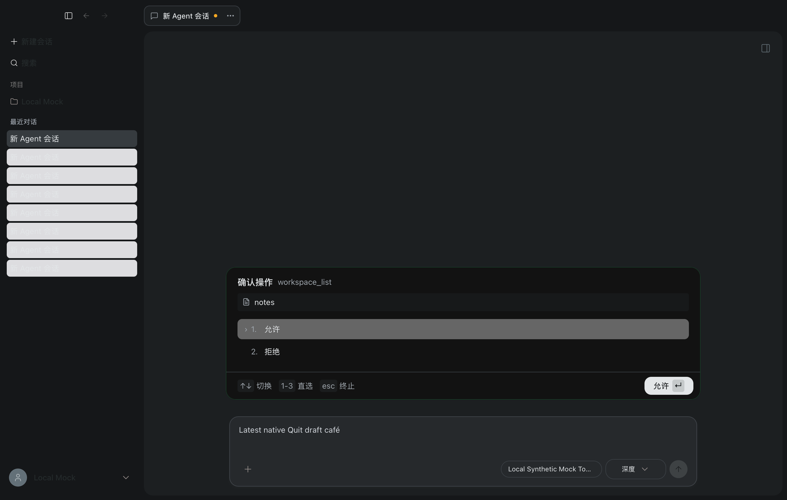

# Tinker-A 工具权限原生验收记录

状态：Task4 进行中；未达到用户下载交付门槛。2026-11-16 恢复于持久工作树。

源码基线：`7e58fe4fd59d25dfaeb502e31fc64e972f10ebe9`（Task1–3 已完成）。Task4 只增加构建入口、QA 隔离与实际验收记录。README/CLAUDE 未修改。

本轮 checks：`/Users/simmonj/Documents/ChatGPT/Tinker/migration-work/tools-native-checks-20261116`。
命令经 `run-clean.py` 过滤环境，使用隔离 ASCI home、离线 Cargo 和独立持久 target；不读取真实凭据、不连接外部模型、不安装应用。

## 构建身份

| 用途 | binary | identifier | renderer | feature |
|---|---|---|---|---|
| 普通工具预览 | tinker-tools-preview | com.tinker.tools-preview | formal-dist | formal-preview |
| 原生工具 QA | tinker-tools-native-qa | com.tinker.tools-native-qa | native-qa-dist | formal-native-qa |

普通入口固定 `None` 探针，即使 all-features 编译也不会安装 QA 控制器。QA 入口要求显式 `TINKER_TOOLS_PREVIEW_ROOT`；TrustedRoot 在任何窗口/数据操作前验证合成工具临时根。配置身份在 Builder 创建前验证。普通包使用独立 `synthetic-tools-v1`，不取代 M2、Lab 或 Electron。

## 当前验证

- 新增构建隔离测试：首次 1 pass / 2 fail（新配置及 helper 缺失），实现后 3 pass / 0 fail；原始日志 task4-red.log / task4-green.log。
- 全仓类型检查与 lint 退出 0；日志 typecheck.log / lint.log。
- Lab、正式、QA renderer 均已用自身 Vite 配置实际构建；保留已知大 chunk 警告。
- 初次从仓库根执行 Electron Vite config，因 Tailwind 工作目录错误失败；随后从各应用正确 cwd 构建通过，未修改样式掩盖失败。
- 首次全特性 Rust 测试退出 0（rust-all-features.log；最终源码复跑待补）。新增 `[partial-error]` 合成 mock 场景先失败后通过：formal_mock 3 pass / 0 fail（partial-red/partial-green 日志与收据），真实 SSE 文本后断流，无终态 SSE；不伪造核心状态。
- 后续补最终计数、构建产物与原生证据。

## 尚待完成

正式工具包与 QA 包构建、实际 WKWebView 控件完整流程、权限拒绝/超时/取消、reload/进程重启/关闭、语言主题、背压与历史/HTTP 关联，以及全套回归与独立审查。任何未执行的项目不视为通过。

签名仅计划本机 ad-hoc，不代表公证或 Developer ID 签名；不绕过 OS 安全提示。回退方式为停止新预览应用，继续使用原 Electron；本批不会安装到 Applications 或切换生产数据。

## 原生发现与修复（2026-11-16）

首次真实 composer Send 后，`.conversation-user__text` 出现两个同文可见节点（y=136/266，各高24）；证据 recovery/result-9.json。原因是 AgentView 乐观 SDK 用户消息没有稳定身份，而首个正式工具快照包含另一条真实用户消息。新增渲染回归先失败（3个节点，期望保留旧消息后为2），修复为本地 `_agentRequestId` 关联：仅同请求正式人类工具快照替换乐观消息；同文旧请求和 Electron 无正式元数据路径保留。回归与工具归并测试17 pass，类型和针对改动 lint 退出0；原生重建重验待补。

普通包在 Documents target 中签名被文件提供器附加的 FinderInfo 阻止；只清理此新产物根 FinderInfo 后普通包曾严格验证通过，但 QA 包遇到该属性重新附加。后改为 `/private/tmp/tinker-tauri-tools-package-<uid>` 0700 owned staging，QA包签名及严格验证退出0。未清理 quarantine/provenance、未改变安全策略。

原生首次未独立session启动的QA进程退出（原因未证实），专用CLI sequence6在20秒内无回包；不是锁屏（IOConsoleLocked=false），应用日志为空、仅本app crash报告未发现。独立session重开同合成根后，journal有真实Interrupted/closedCall Interrupted，页面权限消失，一个用户气泡，mock records=[]；未重放HTTP/工具。此非预设kill测试，明确按实际意外进程退出恢复记录。

## 原生证据检查点（ca33779 后审查前）

原生UI代码为608acb1；afterquit使用ca33779包（只有打包helper差异）。两个包分别有独立普通/QA配置；UI截图只来自owned WKWebView。

- fixed sequence2–12：原TipTap输入→Send→list权限Allow（同按钮重复click）→read权限Allow→最终答复。初次/待决reload/list结果后reload/终态reload均单个真实`.conversation-user__text`。journal仅list_1/read_1两次启动及成功结果；HTTP三轮，mock校验call/result严格邻接。最终展开图由Root实际看图复核。
- fixed seq20–25：同会话follow-up Completed，journal parent精确指向前一个Completed run，mock userMessages2/assistantMessages3、4、5。两条中途Allow脚本返回WK exception，其点击来源未完全解释，不将它们列为独立交互通过证据；最终context关联以journal/mock核验。
- fixed seq31–62：实际Deny、Stop、Esc、真实partial-error断流Failed及同会话follow-up。Deny无ToolStarted、结果Denied、Completed解释；Stop/Esc为Cancelled/closedCall Cancelled/无启动；Failed保留部分文字（httpProtocol），follow-up parent=null、mock重新userMessages1。首次driver过早查option失败保留；修正为有限DOM查询等待，不调用host/atom冒充点击。
- 默认60秒超时：session6 receipt Expired、ToolFinished Expired、无ToolStarted，最终Completed；seq68 permissions=[]、单用户气泡。已有partialFailed的错误toast仍在，不将toast当作权限残留或隐藏。
- fixed seq83–89：实际QA route暂扣605事件/301文字delta（300个合成delta+首文字），释放后真实list/read Allow、最终答复、单气泡/无权限。**未测native actor unread队列饱和**，不能由此声称；既有full-outbox核心/actor测试单列通过。
- 现有QA故障注入stale action后seq67未显示旧run/generation标记；明确白盒事件注入，不是用户动作。
- 原设置General的Dark按钮、语言下拉的中文选项keydown Enter实际触发（seq94–98），原UI变为中文dark；重启仍中文dark。英文light流程由初始golden覆盖。
- 原NSMenu `performActionForItemAtIndex` 实际激活“退出 Tinker”（seq106），pending run取消且重开无权限、mock records=[]。但**最新会话/草稿恢复未通过**：Quit前session8与草稿输入可见；afterquit重开显示session2，editor空；平台workspace activeTab映射停session2，草稿持久位置未查全。列为修复阻塞，不能称完整关闭守门通过。
- 首次非独立session QA进程意外退出，重开实际Interrupted且无自动HTTP；未重复Task2精确FD读取后/ToolFinished前child exit73，也未测试native started精确kill窗口/删除pending场景。源测试通过不代替原生操作。

最终正常资源全Bun复跑3500 pass/4 skip/0 fail（3504 tests/413 files）；此前scientific-assets既有fixture30s超时保留，focused1.8s通过、全复跑65.10s通过，原因未证明，不修改其timeout。全Rust最终源码后端修复前通过，精确顶层计数见checks/rust-count-summary.json；fmt/clippy/type/lint/Electron均退出0。scripts不在现eslint配置匹配范围，不将ignored warnings称作脚本lint覆盖。

构建最后使用唯一staging：普通 `/private/tmp/tinker-tauri-tools-package-UwPNup/Tinker Tools Preview.app`，QA `/private/tmp/tinker-tauri-tools-package-GqMvgG/Tinker Tools Native QA.app`。正常ad-hoc codesign和strict verify退出0；尚未作为最终交付包归档，因全分支审查存在两项Important（Bind前凭据/context预检、聚合编码预算）以及关闭恢复失败，待集中修复后重建。

本批caffeinate命令`/usr/bin/caffeinate -di -t 1800`、PID21529、起始2026-11-16T03:02:35.958731Z；pmset核验同时具有PreventUserIdleSystemSleep/PreventUserIdleDisplaySleep。2026-11-16T03:25:13.887493Z核实同owned身份后SIGTERM释放；原始证据wake-lease.json/wake-assertions.txt/wake-lease-release.json。QA PID33989已经正常close，后续编译期间无wake lease。

## 集中审查修复（新原生复验前）

1. Desktop工具Bind前增加只读完整父链/context/catalog/凭据预检；`start_tools`仍锁内二次验证。输入与旋转可信合成key后祖先两模式回归先真实发现journal已变，修复后拒绝不改binding journal字节、不建V3header、不发HTTP、不出现被拒历史turn。
2. 工具output按完整JSON字符串≤256KiB计量；snapshot完整编码≤1MiB，为2MiB desktop页的基础turn/至少一个事件保留空间。完整context仍≤512KiB，非终态预留32KiB闭合空间；delta/round/result提交前根据worker启动时已有的完整可信内存context计算候选，不逐片读取祖先磁盘。Stop前也验证，store/replay校验当前run snapshot/transcript，所有turn_reply（含重复Send/cancel）统一bounded。真实130×2000控制字符SSE先复现pageLimit，修复后失败状态、partial、events/history/duplicate/cancel/reopen均可读；祖先预算和journal拒绝不追加另有回归。旧cross-version fixture把256KiB ASCII输出减去JSON引号2字节，仍保持metadata溢出断言，未放宽边界。
3. formal-only Settings新增可选`sessionDrafts: Record<sessionId,string>`，旧snapshot缺失默认空。仅保存纯文本，完整JSON总计≤64KiB、最多128会话；超限或已知可信profilekey拒绝整个patch，不截断、不写receipt/snapshot。hydrate在正式renderer入口恢复同一草稿atom，400ms普通保存与关闭最终capture都包含草稿。capture依据当前有效workspace/仍存在的active tab正规化workspace记忆，不修改Electron默认API/存储/初始化。合法草稿重开、旧snapshot兼容、超限/合成key原子拒绝与close participant最新atoms均有RED→GREEN。

定向工具lib36 pass；tool_desktop、tool_http_adversarial、formal_platform受影响套件均通过。全套/最终普通QA包与实际新SHA Quit后草稿/active tab重开仍待执行。深色主题截图对比度异常已记录，不能仅由`dark`类声称视觉完整通过，需新原生computed tokens核查。

草稿恢复支持边界：本轮只保留纯文本（含Unicode/换行），不保存`agentSessionDraftHtmlAtom`。HTML排版、mention chip、文件/图片附件及引用结构不承诺无损恢复，均未验收；不能把纯文本复验外推到富文本或引用恢复。

## 补审边界修复（集中修复第二检查点）

- 工具输入现在统一按完整JSON字符串≤64KiB检查（含引号、Unicode和转义），RunController start/preBind预检、ToolContext新输入和v3 header一致；legacy text原行为不变。60,000个U+0001先真实复现被接受，修复后在Bind/header/HTTP前拒绝。完整编码边界及header拒绝另有定向测试；早先journal fixture中60,000控制字符本身不合法，改为10,000个合法输入，未放宽限额。
- 草稿自动保存的历史receipt不再复制旧正文：递归canonical JSON请求经SHA-256指纹识别，receipt保留原metadata/其余patch，草稿替换为空标记；当前settings只保留最新正文。旧完整receipt可读/可等价重试，下次提交原子压紧。mutation重复无额外写入、同ID不同body冲突、对象key重排等价、数组顺序保留；1MiB快照/1024receipt上限保持。真实32次约59KiB不同草稿→重开legacy receipt→最后close保存→重开验证通过，历史draft-0正文不在最终文件。
- 指纹使用已在Cargo.lock及本地缓存的标准`sha2 =0.10.9`（checksum `a7507d819769d01a365ab707794a4084392c824f54a7a6a7862f8c3d0892b283`）。Root明确接受将已有包提升为精确直接依赖的必要小幅plan调整；实际lock diff仅foundation dependencies增加`sha2`一行，没有新包/版本或下载，无自制密码算法。摘要用于幂等冲突识别，不是快照认证或真实凭据存储。
- 私有provider已知key检查扩展到结构化request/parent/policy、完整Bind/header metadata，不暴露key getter、不伪造模型用户context。已知合成MOCK_KEY作为合法requestId的Desktop/直接core路径先复现被接受，修复后零journal变化/零header/零HTTP/runner0/无被拒历史；正常ID正例仍进入真实pending。父ID、策略revision、嵌套metadata也有检查回归。

实际定向退出0：followup-lib 38 pass；followup-integration formal_platform20、tool_desktop8、tool_http_adversarial7；followup-clippy -D warnings通过。receipt-growth-green.log是首次重开失败日志（空patch被现契约拒绝），原样保留；修为合法空草稿标记后receipt-growth-green-2.log才是1 pass/exit0，未放宽空patch规则。

03:45锁屏检查得到CGSSessionScreenIsLocked=true与IOConsoleLocked=false并存，不能只用IO标志判断。一次脚本误按IO条件启动caffeinate36930后在2026-11-16T03:45:44.708388Z立即核实身份并SIGTERM释放（起始03:45:17.301738Z），没有启动或操作新QA。后续原生复验受锁屏阻塞；Root已请求用户正常解锁，未获回复不视为解锁许可。旧SHA后续长构建已停止，修复后全套将独立完成；不改变系统安全/密码/锁屏设置。
