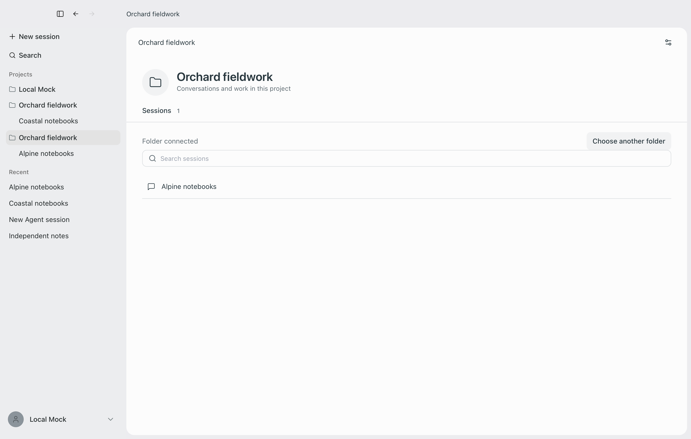

# Project continuity in the native desktop preview

Base: 5ae61146216097757b915dfa5541ebe328ae516c (merged PR #33).

An explicit backup import restores project identity and names alongside conversations. The native workbench can find a conversation in its project, navigate to its messages and continue it without borrowing a similarly named project's context. Existing native conversations and sessions imported by earlier previews must be preserved. Reimporting unchanged content remains idempotent. Unresolved project or directory references must not grant filesystem access. An explicitly selected directory is a separate, local binding. If it moves, browsing history remains available and rebinding requires another selection.

Acceptance uses two synthetic Electron projects, isolated source and destination profiles, duplicate import, same-name isolation, search, explicit continuation, directory relocation and a full native process restart. Observe local mock requests and verify source hashes. Do not read real profiles, install an app or switch the default Electron launcher.

## User flow

1. In the isolated Formal Preview, open the backup importer in Settings and select an Electron backup folder. The reader accepts the workspace index and follows only supported files within that selected backup. Project IDs determine ownership even when two display names match. A valid reference whose project metadata is missing can retain its own recoverable project.
2. Open a project in the sidebar, filter its sessions, and open the original conversation. Use the project’s add-session control for a project draft and the global New session control for a standalone draft. Search can also navigate directly to an imported message.
3. Choose a folder in the project overview to establish a new local binding. If the folder moves or a different directory replaces it, the project reports that its folder is unavailable. Use **Choose another folder** to bind it again. This stores the chosen directory’s identity; it does not enable file tools or use the folder as a model working directory.
4. Quit the preview completely and reopen the same isolated profile. Project IDs, session IDs, subsequent native messages and project-specific tab preferences are read locally. The source backup can be unplugged before reopening.

## Storage and rollback

The existing Electron source backup is opened read-only. The importer neither searches the original workspace paths nor imports credentials. A session imported by the previous preview retains its source fingerprint, journal and local edits. An immutable association file records its newly confirmed project. A conflicting project ID cannot move an already claimed session.

The first project write creates an independent project-aware platform snapshot in the preview profile. The previous preview’s platform snapshot remains available. After the split, preference changes in one version do not synchronize back to the other. To roll back, fully quit the preview and open the previous build or the normal Electron application. Retain the entire preview profile if you plan to return to this build. Earlier builds cannot present the new project catalog. An untouched test-profile copy is the simplest way to restore an exact pre-test view.

Electron remains the default desktop application. The credentialed Channels Preview, actual providers and directory-backed file execution are outside this milestone.

## Native acceptance evidence

The Tauri QA build used the shared React workbench, a local mock provider, a new temporary profile and six synthetic source files. The normal import and folder-binding handlers processed the result of a fixed QA selector. An additional attempt to exercise the macOS system panel did not reach the picker: desktop automation could not identify the isolated QA window. Physical clicks in NSOpenPanel remain unverified. The previous binary matched the SHA-256 recorded in the [#33 acceptance report](2026-11-23-native-session-import.md). The binary SHA-256 was `657bf4e21c1538d0733eafbc657015a1905fd2d70dec2eb0b6935eca24a61746`.

| Process | Observation |
| --- | --- |
| Previous preview, PID 25154 | Imported the Coastal session as an ungrouped conversation and added a local follow-up. Also created an independent native conversation. |
| Upgrade, PID 25216 | Imported two projects with identical names. Two sessions were new and one matched its previous ID. Reimport added zero sessions. |
| Immediate restart, PID 25255 | Coastal and its added message were visible before any navigation. Searching located the exact Alpine message. Its explicit continuation sent three user messages and two assistant messages in one request. |
| Restart after folder relocation, PID 25363 | Alpine and the latest continuation were visible before navigation. The disconnected folder could be rebound to Alpine alone. Its project add-session control and global New session produced different sessions with project and null ownership respectively. |
| Previous preview rollback, PID 25458 | The old Coastal session and its local follow-up remained readable. Reading them left the new project snapshot byte-identical. |

No HTTP requests reached the monitored local provider during import, search, recovery, folder rebinding or rollback. Each explicit send reached it. All six source SHA-256 values were unchanged. Exact request messages are also asserted by a Rust loopback integration test; the native window harness records counts, not private payloads.

To reproduce, build the QA host with `bun apps/tinker-rust/scripts/build-native-qa.ts` and run `python3 apps/tinker-rust/scripts/native-project-qa.py /absolute/path/to/tinker-formal-native-qa --previous-binary /path/to/the/previous/tinker-formal-native-qa`. Use a separate preserved build of #33 for the previous binary. The script creates its own temporary profiles, test directories and evidence.

## Regression checks

The large-event pagination fixture first timed out at its 60-second deadline. Streaming was still progressing. The derived Rust snapshot cache sent each escaped control character directly to the file writer. Buffered output now flushes before the existing file sync, rename and directory sync. The authoritative event log is unchanged. With the same 130 chunks and deadline, the focused test passed in 3.70 seconds. This measures a synthetic edge case, not overall desktop performance.

- Bun with the Rust subprocess bridge enabled: 3,619 passed, zero failed or skipped.
- TypeScript checks across the monorepo, targeted renderer ESLint, Rust formatting and Clippy with warnings denied passed.
- Electron, the Tauri Formal Preview (React assets and the Rust host), the isolated native QA binary and the Rust Lab web frontend built locally.
- Final Rust full suite with `formal-native-qa`, locked dependencies and one test thread: 541 passed, zero failed. Two child-process fixture entry points are ignored when invoked directly.
