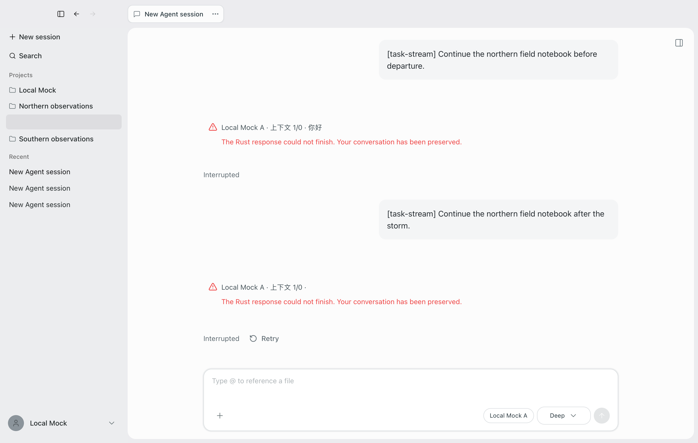

# Native project task lifecycle

Base: merged PR #34 at 5c06d0563883f7609415806ca51dfe0034250339.

An ordinary text send from a native project conversation belongs to the selected session. A user can leave the project, find the conversation with its task status, open the result or stop the same running attempt. A later attempt in the same conversation and an interleaved task in another project must be unaffected by a stale stop, duplicate click or duplicate delivery. A failed or interrupted text task preserves partial text and can be retried explicitly with a distinct identity. Navigation, status queries and process recovery never resend a task. The original Electron application remains the default.

Reuse the existing Rust journal, run controller, formal host and React workbench. The project read API returns status and identity without returning conversation content. Acceptance uses two synthetic projects and an observable local HTTP provider. Verify completion, cancellation, failure, retry and fresh-process recovery, and distinguish an explicit user stop from an interrupted execution. External services, real data and credentials are outside this change.

## How to try it

Use the native Formal Preview with its built-in loopback provider and a disposable profile. Open a project in the sidebar and start a conversation using its add-session control. Send a text message. Open another project, then return to the first project's overview. The status beside the session describes its latest native text task. Open that row to see the stream or saved reply. A global session or a session belonging to another project does not appear in this list.

Stop targets the attempt displayed in the composer. Closing the application with a text response in progress preserves partial output and records an interruption. After reopening, a failed or interrupted final text turn offers **Retry**. Retrying explicitly creates a new request using the original message, channel, model and effort. The previous attempt remains in the conversation. Superseded attempts, image edits, tool runs and explicitly cancelled turns are excluded from the retry action.

## What changed

The Rust host exposes a read-only, generation-scoped project status query backed by the existing session bindings and controller snapshots. It returns session ID, request ID and status. The project view refreshes on entry, focus, a different stream identity or a terminal event. It does not fetch every transcript or refresh on every token. The conversation view uses the existing stream feed and Rust-projected message history. An old stop or redelivered receipt must not affect the next run.

The project status and retry controls are enabled by the native Formal Preview bootstrap. The Electron launcher continues to use its existing backend. Queue, tool, image and credentialed provider previews have their own execution paths. This change introduces no job daemon, external operation permissions or background resubmission.

## Reproduction and rollback

Build the window with `bun apps/tinker-rust/scripts/build-native-qa.ts`. Run `python3 apps/tinker-rust/scripts/native-project-task-qa.py /absolute/path/to/tinker-formal-native-qa` on macOS. The harness creates two synthetic projects in a fresh temporary profile and counts requests at the test host's own HTTP provider. Its process termination check targets only its own child.

To roll back, quit the native preview and use the default Electron app or the preview built from the base commit above. Keep the preview profile if you want to reopen its conversations later. Task controls reuse existing run records and terminal statuses. No user profile conversion or credential migration is required.

## Recovery and request accounting

The window harness drives the normal React controls in a real macOS Tauri WKWebView. It uses independent North and South project/session identities. The HTTP counter observes accepted chat completions at the owned provider. These results do not measure an external provider's billing or network activity elsewhere on the machine.

| Action | Local provider observation |
| --- | --- |
| Start a long text response in each project, switch between them, then stop North | One request per project. South completes with its own result. |
| Fail a later South turn after partial output, then double-click Retry | One failed request and one new successful request. Both contain two user messages and one assistant message, with the same model and effort. |
| Leave another North response running and quit via the application menu | One explicit request. The next process reads the saved partial output and marks the turn interrupted. Browsing both projects starts zero requests. |
| Send again, terminate the test process during streaming and reopen | One explicit request before termination. The next process recovers the same project, session and partial output. Browsing starts zero requests. |
| Explicitly retry the interrupted North turn after restart and stop it | Exactly one new request and a distinct attempt. Explicit stop records cancellation. |

Two issues surfaced during testing and review. A native user-message echo could duplicate the optimistic message when returning to a conversation. The renderer now reconciles matching task identity and message role, including after a restart. A failed durable write could also leave a spurious binding when retrying a frozen store. The host checks durable state before accepting the new binding. The fault-injection regression checks that the journal bytes, binding count and provider request count stay unchanged after that rejection.

The older preview may already have recorded an app exit as a cancellation. This build preserves historical statuses as recorded. It distinguishes new interruptions from explicit stops. The window suite exercises a synthetic text provider. Real credentialed model requests, a cross-project task dashboard and continued execution after the app quits are outside its coverage.

## Local regression checks

- `cargo test --locked --offline --features formal-native-qa --no-fail-fast -- --test-threads=1` passed 547 tests with zero failures. Two child-process fixtures are ignored when invoked directly. Child processes were counted only once.
- `TINKER_TEST_RUNTIME_BINARY=/path/to/tinker-runtime bun test` passed 3,634 tests across 435 files with zero failures. The Rust subprocess bridge was built locally and enabled.
- `bun run typecheck`, ESLint on changed TypeScript and TSX sources, `cargo fmt --all --check` and `cargo clippy --locked --offline --all-targets --all-features -- -D warnings` passed.
- `bun run electron:build`, the Rust Lab frontend build, the Formal Preview frontend and Rust host builds, and the native QA binary build succeeded. Vite reports a chunk-size warning on the shared workbench. No installer was produced.
- English and Chinese labels were exercised in component tests. The multi-process window run used the English interface. The default Electron app was built and regression-tested; the window evidence here is from the Tauri preview.

The final native QA binary SHA-256 was `cb4c0a6c5fc156ffc3cf709b5db28188d507bd6fe19d7c7b5d5fdec2d59b88f2`. PIDs 35056, 35251 and 35291 used the same newly created test profile. The first process recorded five explicit requests, the second recorded one after recovery, and the third recorded one after clicking Retry on an interrupted task. Both restart-only checks recorded zero requests.

An initial screenshot captured a blank conversation while the recovered messages already existed in the DOM. A paused animation-frame regression exposed the native visibility dependency. The native conversation now presents loaded history without waiting for a fade-in frame. The final window harness checks hit testing and visible partial text, then verifies the actual WKWebView screenshot using macOS Vision. The image below was visually inspected; it shows the two interrupted turns, partial replies and the single eligible Retry action.

