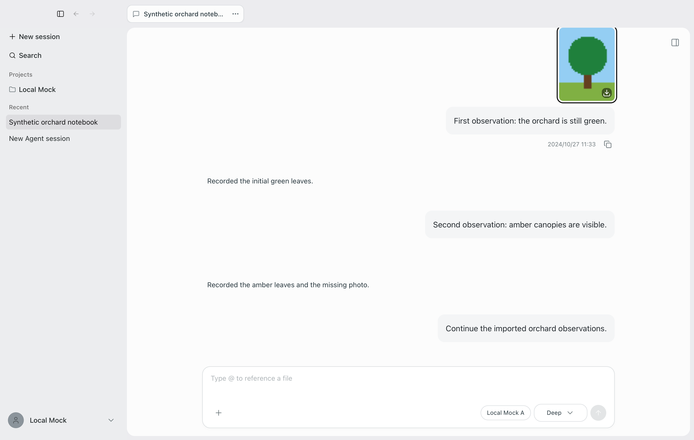

# Continue an Electron conversation in the native workspace

- Base: `363a523813e0ecf76dc927725e0257ab007c43c3` (PR #32)
- Domain: Electron Agent Sessions, desktop runtime sessions and the shared React conversation workspace

## Acceptance

An explicit, cancellable action selects an Electron configuration backup. The native host opens the known session index and selected session files from that root. It imports visible messages and supported referenced local attachments into a separate native preview profile. It never executes old tools or restores old pending actions. The source remains read-only. History can be searched, opened, continued with the imported context and recovered in a fresh process. Previously created native sessions survive.

Before publication, verify selection cancellation, repeated import, corrupt records and missing attachments, retry after interrupted writes, provider context on an explicit send, and zero model requests on import or restoration. Use disposable profiles, synthetic Electron data and a local provider. Distinguish fixture selection from manual interaction with macOS system panels.

## Why this milestone

Before this change, the Rust Lab history reader could page a local JSONL copy. The formal Tauri workspace had no command to bring a backup into Recent, navigate to a matching message and continue it. Native conversation search, credential recovery and the recent image capabilities already had separate coverage. A live provider, project migration, executable tool transcripts, credential migration and switching the production desktop application are outside this batch.

## User flow and scope

In the native formal preview, open **Settings → General → Import conversations**, then choose the folder containing `agent-sessions.json`. The host uses the macOS directory picker. The webview cannot submit a filesystem path. Cancelling before selection reads no backup and commits no sessions. A completed import reports new, previously imported and skipped conversations. An interrupted write can have an unknown outcome. Reopen the profile and select the same unchanged backup to reconcile it.

Import preserves the conversation title, creation and update times, and archive/pin state. Sessions are independent native copies. Source project membership, channel IDs, credentials, model selections, pending operations and approvals are outside the import format. Continuation uses the isolated preview's existing local provider. Text from visible user and assistant messages forms the history prefix. Copied files are available for local inspection. Their bytes, paths and historical tool results are not automatically sent to the provider.

The source reader opens the version-1 session index and exact per-session JSONL filenames. Where the session log is absent or empty, it can resolve a single indexed SDK session under the copied SDK projects directory. It checks file identity and bounded sizes, rejects symbolic and hard links to files, and reports unreadable, malformed or unsupported entries. PNG and JPEG attachments are normalized to PNG. UTF-8 text and Markdown attachments are shown as plain text. Only referenced attachment-store files and copies in the indexed session workspace are eligible. Missing files leave the readable conversation intact.

A deterministic native session ID is derived from the Electron session ID. The native store binds the sanitized content to a fingerprint, persists attachment bytes and an immutable history snapshot, then publishes the session through the existing journal. Reimporting identical content is idempotent. A different backup with the same ID and different sanitized content yields a conflict. The importer does not overwrite later native turns or resurrect deleted sessions.

## Practical limits and rollback

The index is bounded to 128 entries and 1 MiB. The reader caps a transcript at 8 MiB, a batch of source content at 32 MiB and a conversation at 256 visible messages. Continuations use the existing native context budget of 16 preceding user turns and 512 KiB of text. A history beyond that budget can be browsed and searched when it fits the native display limits. Sending then fails before contacting the provider. Unsupported data remains in the original backup.

The source Electron UUID is retained alongside a namespaced native message ID so search cannot collide with a later native request. If the imported history snapshot cannot be verified, that conversation is isolated and other native conversations stay available. Missing attachment bytes are reported when accessed.

The production Electron launcher and store remain available throughout. Use a fresh, isolated native preview profile for evaluation. To roll back, return to Electron or reopen the previous preview with its original profile. Keep the Electron backup and the native test profile separate. Earlier previews do not understand the imported history snapshot, so do not continue newly imported conversations with an earlier preview. No rollback requires editing an Electron index, exporting keys or rewriting existing conversations.

## macOS window acceptance

Built the local formal-native-qa binary with SHA-256 `97cdc1a42065c9b8d81b82e9a349279d6d932d927f86c271bf2491be6363ae1a`. The test interacted with the real Tauri window and shared React workbench through the QA build. It used an isolated profile, a synthetic Electron backup and a loopback chat server. Directory selection used the QA picker fixture. The production NSOpenPanel click and confirmation were not exercised.

1. Created a separate native conversation, then cancelled the first import. The native conversation remained available.
2. Selected the synthetic backup. The report showed one imported and one skipped conversation, including a missing attachment and malformed history. Repeating the action produced zero new and one already-imported conversation.
3. Used Search to open a specific Electron message and verified its stable mapping to the original UUID. An explicit continuation sent one HTTP request containing three user and two assistant messages. Search and import sent zero requests.
4. Quit the application (PID 11596), moved the backup out of reach, and launched the same binary with the same native profile (PID 11672). Reopened and searched the imported conversation and the existing native conversation. Restore and search sent zero requests.
5. Decoded and enlarged the restored 72 × 48 image in the message, checked two known RGBA pixel values and verified that the five source files retained their original SHA-256 values. No real user files or credentials were used.

To reproduce with disposable data on macOS, build the standalone QA binary with `bun apps/tinker-rust/scripts/build-native-qa.ts`, then run `python3 apps/tinker-rust/scripts/native-session-import-qa.py /absolute/path/to/tinker-formal-native-qa`. The script creates a temporary profile and writes the two process IDs, provider observations, source checksums and screenshot to a fresh evidence directory.

## Automated verification on macOS

| Check | Result |
| --- | --- |
| `cargo test --locked --offline --features formal-native-qa --no-fail-fast -- --test-threads=1` | 521 passed, 0 failed. Two child-process fixture entry points are marked ignored for direct invocation. |
| `cargo fmt --all --check` and `cargo clippy --locked --offline --all-targets --all-features -- -D warnings` | Passed. |
| `bun test` | 3,609 passed, one conditional Electron-to-Rust router test skipped. The separate run with `TINKER_TEST_RUNTIME_BINARY` set passed that test. |
| `bun run typecheck` and `bun run electron:build` | Passed. |
| Formal React bundle, formal-preview Rust host and formal-native-qa binary | Built successfully. |

One earlier full run timed out on the existing large streaming-log pagination fixture. The final v1 projection reuses one consistent snapshot per poll. The full suite above passed with the default fixture deadline.
