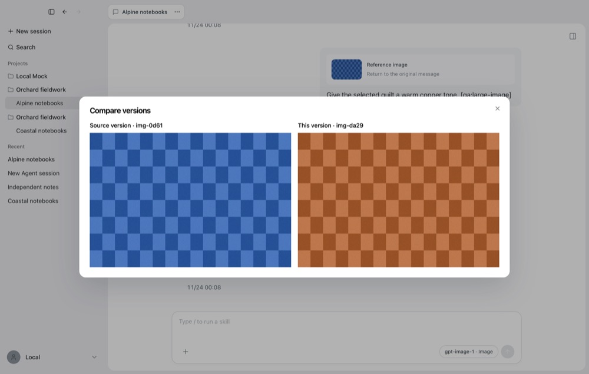

# macOS native preview upgrade and rollback rehearsal

**Status:** Native window rehearsal passed on Apple Silicon. **Baseline:** PR #38, main `d228cc89ea6343f9d0c0e33f2834bb32f83c0103`. **Domain terms:** [CONTEXT.md](../../CONTEXT.md).

## Acceptance contract

Use one Channels Preview profile and its normal React workbench with a synthetic vault and local providers. Import a user-selected Electron backup, explicitly bind its project directory, find an old message, continue with a chosen text model, then generate, reference-edit and export a multi-megabyte PNG in the same conversation. Reopen the native profile in a fresh process without replaying requests. The original Electron source and a separate rollback copy must keep identical file digests and remain readable by the Electron storage implementation. Retain the native output through rollback.

Limit any production change to the blocker that prevents this workflow. Project operations must not overwrite a prepared channel transaction. Opening old sessions must neither authorize a directory nor choose a provider for the user. Preserve the default Electron launch, existing data formats where possible and the prior explicit user actions. No deployment, installed app, user credentials or external model are part of this rehearsal.

## Reproduce on macOS

Use a development checkout with the locked Bun and Cargo dependencies already available. From the repository root:

```sh
bun apps/tinker-rust/scripts/build-channels-native-qa.ts
# Use the path printed by the build. The app stays in its private temporary directory.
python3 apps/tinker-rust/scripts/native-upgrade-rehearsal-qa.py \
  "/private/tmp/tinker-tauri-channels-package-EXAMPLE/Tinker Channels Native QA.app/Contents/MacOS/tinker-channels-native-qa"
```

The runner creates its own working directories and prints its evidence directory. It takes no source profile, provider URL or API key from the tester. The catalog, pictures and keys are synthetic. The QA host runs two loopback providers with separate request counters. A positive control sends text through one and images through the other. The text endpoint checks the imported turns. The image-edit endpoint checks the reference bytes. The ordinary Channels binary has neither the test vault nor the scripted picker.

| Data location | Purpose and protection |
| --- | --- |
| `native-qa/upgrade/qa-electron-copy` under the evidence directory | Source fixture presented to the native importer. The runner fingerprints every file before import and after the native windows close. |
| Separate `tinker-tauri-channels-preview-upgrade-*` directory | Native project bindings, channels, sessions and generated image assets. This is the only application profile used by both native processes. |
| `rollback-home/.asci` under the evidence directory | Fresh independent copy of the source. With both native processes closed, the production Electron storage functions reopen this copy, search the original message, and read the original attachment. |
| `native-qa/upgrade/qa-export.png` under the evidence directory | Original-quality export survives returning to Electron. The report compares this file with the edited native asset. |

## Returning to Electron

Quit Channels Preview and keep its **entire** native profile, including the image assets. Continue using the usual Electron application and its original profile. The rehearsal leaves that installation alone. For the synthetic exercise, the reader uses the separate rollback copy instead. It runs in the repository's Electron runtime with an explicitly isolated config home and no SDK session. It compares both sets of source files and rereads transcripts, project links, search results and attachment digests.

Native follow-up messages, new project bindings, model selection and generated assets stay in the native profile. Export any image needed outside the preview before putting the profile aside. Copying native metadata onto an Electron profile is unsupported. An older Channels Preview can also reject a managed snapshot containing multiple projects. Keep each preview version's profile separately when comparing versions.

## What changed

The previous Channels Preview could run text and image tasks but exposed backup import and project binding only in the synthetic project host. Both hosts now share the project catalog operations. The managed host persists projects in its existing channel snapshot. A prepared channel transaction rejects a concurrent project write and can be prepared again. Old single-workspace snapshots stay readable by the new host.

An imported session starts without a provider binding. Searching, importing and reopening the fixture send zero provider requests. An explicit continuation uses the selected channel and the imported conversation. Project-specific reasoning effort is preserved independently across restarts. The Tauri React adapter uses a host capability for project task status and retains the prior behavior with older hosts. The production Electron main process, preload and shared React layout have no changes in this batch.

The importer rejects matching credentials already known to the process before storing an imported session or its attachments. The guard does not hydrate the vault during import. This check is scoped to known credentials. It is not a general scanner for user secrets in a backup. Existing managed settings operations keep their credential-handling behavior.

## Observed Apple Silicon run

| Step | Evidence |
| --- | --- |
| Start | Local ad-hoc signed `com.tinker.channels-native-qa`, executable SHA-256 `f1230bc9664b0dce02635863f37b09a85a0993d4ff0b93ba0f9f08ba1196e62c`. Both app bundles passed strict local signature verification. No Developer ID distribution or notarization was tested. |
| Upgrade | Seeded an independent native thread first. Imported three old sessions from two identically named projects and a global thread. The independent thread survived. Repeat import created zero sessions. The second project remained unbound. |
| Continue | Cancelled and then selected the project directory. Search focused the original message. The 72 × 48 historical attachment decoded. Cedar received all four source turns in order followed by the new prompt. Project overview showed the completed text task. |
| Images | Harbor generated a 1536 × 1024 PNG. The explicit edit referenced the original bytes. Both versions retained their relationship and the reference thumbnail. Cancelling Save left no output. The completed export matched the edited asset byte for byte, 3,877,810 bytes, SHA-256 `ad67d4621df5cdb8b5ea4c1450ebdce24f1bdf84d381739600131f14bc107097`. |
| Restart | Quit PID 85701 and opened the same profile in PID 86091. Project binding, channel selection, both versions and completed edit status recovered. Opening the other project showed its own history. The comparison displayed the different full-resolution originals. |
| Requests | Cedar recorded 2 discovery GETs and 2 explicit text POSTs. Harbor recorded 2 discovery GETs, 1 generate POST and 1 edit POST. Reading, importing again and browsing after restart added zero requests. No unauthorized requests or active handlers remained. |
| Process samples | Only the native QA executable appeared in its process tree at both observation points. The Rust mock received each expected request. The rehearsal also uses build/test tools and the separate Electron rollback reader outside those native operations. |
| Rollback | Electron 39.8.9 reopened both projects and three transcripts on the rollback copy. The original and independent copy each kept all eight file digests. Manifest SHA-256 was `3632953ad08834f3601a15cd650a97d442d938db02d4f5964972d9a7928ed5f8`. Both native originals and the exported PNG kept their digests through the legacy read. |
| Storage | Twenty native JSON/JSONL files totaled 34,376 bytes with no inline image payloads detected. The two synthetic credential sentinels were absent from 259 profile and evidence files. |



**Trial boundary.** This supports a side-by-side engineering trial with a synthetic backup, isolated profile and local mock. The native UI, restart, image rendering and export wrote real files. The QA bundle injected fixed choices into the import, project directory and Save dialogs. Manual Finder panel selection, the installed Electron GUI, real provider authentication, actual Keychain access, large-scale imports and reverse migration of native-only data were outside this run.

## Local regression gates

| Check | Outcome |
| --- | --- |
| Rust | `cargo test --locked --offline --features formal-native-qa --no-fail-fast -- --test-threads=1` completed with 596 passed, 0 failed and 2 ignored helper entry points across 47 targets. Counted each outer target once. |
| Rust static checks | `cargo fmt --all --check` and `cargo clippy --locked --offline --all-targets --all-features -- -D warnings` passed. |
| TypeScript and Bun | Workspace typecheck passed. Full Bun run with the locally built Rust runtime passed 3,661 tests across 438 files. |
| Rollback guard | Both Python unit tests passed, covering changed source or copy, added files and symlinks. |
| Builds | Electron, Rust Lab web assets, the Rust runtime, native Channels QA and ordinary Channels Preview built. The runtime-only build reports five unused desktop symbols. Ordinary Channels passed the existing QA-symbol exclusion check. |
| Timing regression | An initial parallel Rust run exposed a close test that assumed two consecutive clock reads always differ by at least one nanosecond. The two expiry cases now backdate the test ticket before checking timeout behavior. The production clock and close protocol are unchanged. |
