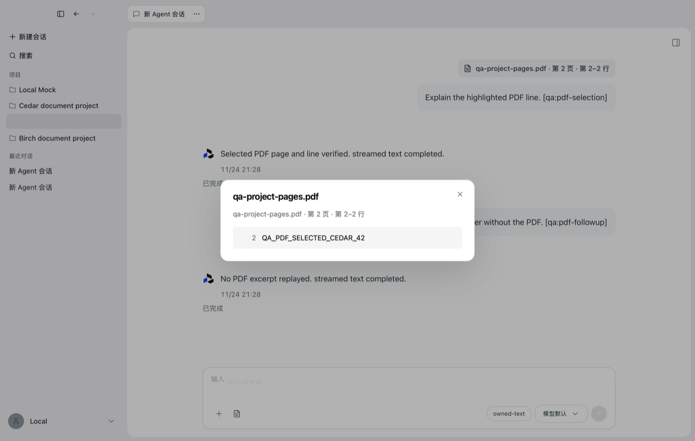

# Cite text from a PDF page in native project chat

| Status | Related issue | Related work | Domain terms |
| --- | --- | --- | --- |
| Native preview | No separate issue | Extends [PR #41](https://github.com/SimmonJ-WYJ/tinker/pull/41) | [Project and session vocabulary](../../CONTEXT.md) |

## User flow

Import a local PDF explicitly into the current project. Browse extracted text one page at a time, preview a range of numbered lines, and attach that range to a question. Opening the source on the sent message must restore the same project snapshot, page and lines after the original file is moved and the application restarts.

## Design and acceptance

- Use a local macOS text-layer extractor with bounded input, output, pages and execution time. Treat extracted text as untrusted. Reject encryption, malformed files, documents without extractable text and inputs over budget. Keep blank pages in a mixed document at their original index.
- Extend the immutable project document store and request binding with a one-based page locator. Keep existing text and Markdown sources readable. Make an explicit retry use the original page. Ordinary follow-up and history browsing must not replay the PDF excerpt.
- Use the same project document panel and shared React controls in the native preview. Verify the physical macOS picker with cancellation followed by a filename containing spaces. Verify the history dialog in a foreground QA window separately from the stored data.
- Use two synthetic projects and local mock listeners to inspect the transmitted page and line range and prove zero calls on restoration. Retain Electron as the production client. Keep the new preview root intact on rollback and open the older preview only with a fresh or pre-upgrade copy.

## Processing and disclosure limits

- The picker grants one file. On macOS the host reads at most 8 MiB and supplies those bytes over stdin to a short-lived copy of the preview executable. The child clears its inherited environment. It reads physical page text with PDFKit. Images, embedded scripts and links have no execution path in this flow.
- The worker allows 100 physical pages and 256 KiB of extracted UTF-8. Parsing takes place on a blocking import worker. The session actor can still process cancellation and navigation. Before publishing, it rechecks the project, window generation, import epoch and credential guard against the extracted text. The parser has an 8-second wall deadline and CPU limits of 5 seconds soft and 6 seconds hard. The host checks physical footprint every 10 ms and stops a worker observed over 384 MiB. Peak allocation between samples can exceed that threshold.
- Up to 8,192 lines per document and 8 KiB per line. An explicit citation covers one physical page, at most 80 lines and 8 KiB. A project stores up to 64 documents and 4 MiB of normalized text. The snapshot stores text and page boundaries. It does not archive the original PDF.
- The page view shows extracted text in PDFKit reading order. Page numbering follows the physical file. Typography, columns, original page labels, annotations, tables, raster previews and OCR are outside this milestone. Mixed PDFs retain the positions of blank pages. Scan-only and encrypted documents produce distinct errors. PDFKit can recover some imperfect documents. Import is not a full PDF conformance check.
- Explicit Send passes the selected filename, physical page, line range and quoted text to the chosen model adapter along with the user's ordinary conversation context. Opening, previewing, restoring or browsing a document does not send it. A retry uses the original binding. An ordinary follow-up has no document attachment unless selected again. A model can repeat information in its answer, which remains part of ordinary conversation history.
- To roll back, quit the new preview. Retain its data root and return to the previous preview with a fresh root or a pre-upgrade copy. Older builds do not understand page-bound PDF citations. Existing TXT and Markdown references retain their previous encoding. The production Electron startup path is separate.

## Acceptance on Apple Silicon macOS

| Check | Local result |
| --- | --- |
| PDF native window and its full process restart | PIDs 88517 → 88681. The restored user message opened the same three-page PDF at physical page 2, line 2, after moving the input. English → Chinese → English. Foreground, hit testing, text, page, line and completed animation verified. |
| Markdown native window and its full process restart | PIDs 88803 → 88948. The historic file and line 2 opened in the foreground in both languages. The original #41 app also displayed the stored Markdown source via the macOS accessibility tree after clicking. Its unmodified background script timed out on a hidden WebView. |
| Network observation | Each run posted twice to its owned loopback channel. One explicit cited question carried only the chosen line. A plain follow-up included no document excerpt. Neither listener received any request during restore or browsing. Other-project read returned `documentNotFound`. |
| Physical system panel | In a separate native build from this branch, cancelled then opened a real NSOpenPanel and selected `资料 Sample.pdf` (1,233 bytes). The catalog remained empty on cancel. Selection showed page 1. Both listeners stayed idle. Repeating the panel-only run on the final binary stopped at a ScreenCaptureKit capture error before the second trial could be completed. The final end-to-end runs used deterministic fixture selections in a real desktop window. |
| Error and limits | The UI rejected scan-only, encrypted, damaged and 101-page PDFs. Parser tests cover xref streams, invalid offsets, extracted-text and raw file size limits. A blank page retains its physical index and cannot be attached. |
| Rust tests | 624 passed, 0 failed, 3 ignored (includes child-process harnesses). `cargo fmt --check` and `cargo clippy --all-targets --features formal-native-qa -- -D warnings` passed. |
| JavaScript and builds | 3,675 Bun tests passed. Workspace type checks, Electron build, Rust Lab frontend, ordinary macOS Tauri preview and QA host build passed. macOS build scripts checked architecture and local code signatures. |
| QA executable SHA-256 | `f51717087953cad6f2baeaf704cee6255880481ebb3055ecf87ed43943998646` |

### Reproduce

- Build the independent host with `bun apps/tinker-rust/scripts/build-channels-native-qa.ts` from the repository root.
- Run `python3 apps/tinker-rust/scripts/native-project-document-qa.py "/path/to/Tinker Channels Native QA.app/Contents/MacOS/tinker-channels-native-qa" --pdf` in a foreground-capable macOS login session. Omit `--pdf` for Markdown. Run them serially. Each invocation generates its own synthetic inputs, loopback channels, data directory, screenshots and JSON report.
- Tests do not use personal documents, production credentials or external models. No release or installer is generated by these tests. Native visual PDF layout, OCR and other operating systems were not tested.
