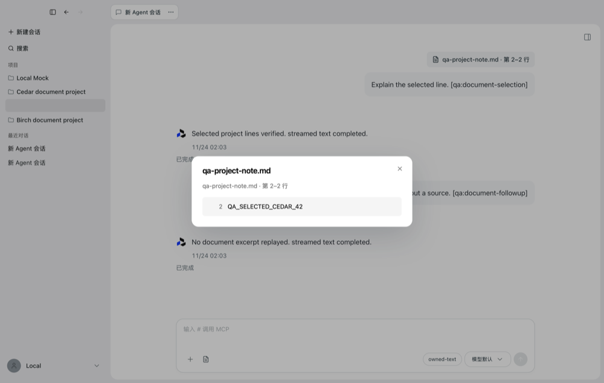

# Project document references in the native workbench

## Goal and boundaries

An operator selects one local UTF-8 text or Markdown file for an existing project. The native host keeps an immutable, project-scoped copy. Reading the list or preview, selecting lines, returning to a message and restarting stay local. A text question can explicitly attach one range to that send. A subsequent question does not reattach the source text automatically. The ordinary conversation history, including previous answers, still follows the existing chat policy.

Electron already has sidebar project files, a file browser, attachment rendering and a PDF viewer. Its PDF extraction worker uses a Node/pdf.js stack. This milestone targets .txt, .md and .markdown in the Tauri preview. A bounded text-layer PDF parser with page-level provenance requires separate acceptance. PDF bytes, scans, archives, arbitrary workspace paths, link fetching and OCR are outside this contract.

## Acceptance

- A picker cancellation leaves the project catalog unchanged. Only the selected regular file is read. There is no recursive scan or renderer-supplied source path.
- The preview shows text with stable, one-based inclusive line numbers. Markdown is source text. A citation identifies a project document and range after the original file is moved or removed and the native process restarts.
- A second project cannot use the first project's document in its chat. Invalid UTF-8, unsupported types, oversized input and invalid excerpts fail before a model call.
- Only an explicit send can add the selected excerpt to the current provider's user message. Treat it as untrusted quoted data. Do not grant tools, expose the original path or replay the original excerpt on a subsequent turn.
- Two owned loopback listeners supply positive and negative controls. The fixture checks received content before returning success and records no request body. Capture counts before browsing and after restart.
- The production Electron entry and its default behavior remain available. To roll back, quit the preview, keep its private data directory and use the existing production client. Prior preview releases do not provide the new document UI. Do not reverse-import the new document store.

## File-panel baseline

On the 5e967fd preview code line, the operator confirmed Local Mock A conversation recovery and cancelling the import dialog. In a separate QA process the actual macOS Open dialog selected a synthetic folder with a Chinese name and a space. The first import reported three sessions and two projects; the second reported zero newly imported sessions and three already imported. The harness verified the original file manifest and unchanged mock request counts. Desktop control timed out during the second selection; the resulting import report was verified in the application by the test harness. Project rebinding, attachment selection and the native overwrite confirmation remain separate system-panel checks.

## Limits, privacy and recovery

- Input must be a regular file encoded as UTF-8. The import normalizes a UTF-8 BOM and line endings. A file can contain up to 256 KiB, 8,192 lines and 8,192 bytes per line. A project can keep 64 document snapshots with up to 4 MiB of normalized text in total.
- Each cited question can attach one inclusive range of up to 80 lines and 8,192 bytes. The user can preview that range before sending. The stored message identifies the document, filename and range. Moving the external file has no effect on the retained snapshot.
- The question and selected excerpt are sent to the chosen model as user content. The excerpt is labeled as untrusted, and this path does not grant tool execution. A model can quote the excerpt in its answer, which is then part of ordinary conversation history.
- Old sessions remain readable in the new preview. An older Rust preview can reject journals that contain the new source locator. To use an older preview, keep the new root intact and use a pre-upgrade copy or fresh isolated root. The default Electron client continues to use its own data.

## Reproducing the native check on macOS

Build the isolated QA bundle with `bun run --cwd apps/tinker-rust channels:qa:desktop:build`. Run `python3 apps/tinker-rust/scripts/native-project-document-qa.py "<QA bundle>/Contents/MacOS/tinker-channels-native-qa"`. The runner creates two disposable projects, synthetic inputs, a temporary application profile and two owned loopback listeners. It verifies the received request bodies inside the mock and records counts and source hashes without saving request bodies. It quits the window, moves the synthetic source files and starts a new process using the same profile. The runner prints the location of its summary and window snapshot.

## Acceptance evidence

| Check | Observation |
| --- | --- |
| Native workbench | Two separate macOS processes, PIDs 14423 and 14655, using the same disposable profile. The locally built QA executable had SHA-256 `751f8f1a1aa4da8af98b99a3d5990957ee52ab4beff6892019f8806c08f80507`. |
| Project isolation | Each project listed only its own input. Reading the first project's document ID from the second returned `documentNotFound`. Cancelling the fixture picker kept an empty catalog. Invalid UTF-8, an oversized input and an image-only PDF produced distinct errors. |
| Actual HTTP content | The selected loopback channel accepted two discovery GETs and two inference POSTs. The first question included precisely the selected line as quoted user content. The follow-up omitted the excerpt. The adjacent-line and second-project markers never appeared in the requests. The second listener received no requests. |
| Restart | The runner verified the input hashes and moved its original files away. After process restart, the original message still opened line 2 of the project snapshot. Browsing and recovery added zero requests to either listener. English → Chinese → English preserved the source, line number and displayed range. |
| Picker coverage | Document selection and cancellation used a fixture in an actual macOS WebView and native host. Physical system-dialog coverage for the earlier backup importer is recorded above. |
| Rust | 611 passed, 2 ignored across top-level suites with `formal-native-qa`, counting each subprocess harness only once. After tightening the pending-file guard, reran the nine document storage tests. Clippy passed for all targets with warnings denied. Rust formatting and whitespace checks passed. |
| TypeScript and application builds | Workspace type checks passed in all six packages. Full Bun suite passed 3,667 tests across 440 files. Electron built successfully. Native QA and ordinary preview use the existing separate application build path. |

