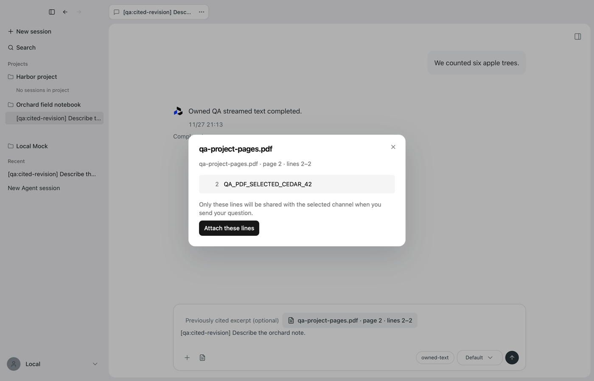

# Revise a question with a project citation

In the native preview, open the answer's **More** menu and choose **Edit question in new branch** or **Regenerate in new branch**. If the original question cited a project document, either action opens a child draft containing the question. The original conversation remains available in the sidebar.

The composer shows the earlier filename and line range, including the page number for a text-layer PDF. Open the reference to read the passage. Choose **Attach these lines** to include it, remove the attachment to omit it, or send the question directly without it. A chosen excerpt is visible in the composer before Send. Changing the model clears the attachment. Reopening an unsent draft restores the suggestion and requires a fresh attachment decision. Both actions use the reasoning effort shown in the draft's model menu when Send is pressed. Plain-text regeneration retains its existing one-click behavior.

## What the channel receives

- Preparation resolves the assistant message ID in the source session. Rust checks the matching user question, completed answer and citation against the project's managed document snapshot before publishing the child.
- The child contains the representable conversation prefix up to the old question. The old answer and later turns stay in the original session. Historical citations in that prefix do not grant access to their text.
- Explicit Send uses the native text path. Only a selection attached to this question adds a bounded excerpt (up to 80 lines and 8 KiB) labeled as untrusted source material to the current user message. Local preview, draft recovery and ordinary follow-up never reattach it. Imported conversations, tools and image actions remain outside the supported revision targets.
- The parked draft uses the original channel, model and configuration revision until the user chooses a different model or a request is accepted. A changed original route fails its guard. The locator and route are local draft metadata. A portable project export does not transfer either as a pending attachment or a send instruction.

## Reproduce with synthetic data

Build the isolated macOS QA app with `bun apps/tinker-rust/scripts/build-channels-native-qa.ts`. Pass the emitted app path to `python3 apps/tinker-rust/scripts/native-cited-revision-qa.py "/path/to/Tinker Channels Native QA.app"`. The harness opens the packaged Tauri window against two owned loopback channels. It uses a fixed synthetic PDF selection and distinct contents under the same filename in two projects. The mock validates the received messages and excerpt before returning its success response.

## Rollback and compatibility

Quit the native preview and open the default Electron app. Keep the preview profile to retain new branches. Returning to Electron does not import those branches. Revert this milestone and rebuild to remove the feature from a preview. This preview reads the PR #50 plain revision route format. An older preview can read the passive history of a newly parked cited branch, but it does not recognize the new citation suggestion or its source-route guard. Keep the newer preview for sending those drafts.

## Verified on macOS

| Observation | Result |
| --- | --- |
| Full application quit and reopen | Four distinct processes. The parked prompt survived, and its attachment had to be selected again. The source and four independent child sessions survived the final restart. |
| Explicit submit | The listener verified the prefix and the current user question. With the attachment it received only page 2, line 2. After removal it received the question without a document field. A subsequent question did not replay the excerpt. |
| Request counts | Channel A received eight inference POSTs and channel B received zero, including after changing the default. Both received two catalog GETs. Opening menus, preparing children, previewing citations and restoring history added zero inference POSTs. |
| Project and error isolation | Both original PDF files were removed from their fixture locations. Historical sources opened from the managed snapshots. The other project's same-name document remained separate. A simulated 503 and a stopped stream preserved the source. |
| Verification boundary | Signed ad hoc QA executable SHA-256 `ee03d9bc7f7cdeed88758a9bb3b77911b902a2415a9fc8dce0b00821601ba29d`. The packaged window and loopback HTTP exchanges were real. The PDF picker used a fixed synthetic selection. Live channels and the system file panel were outside this check. |

