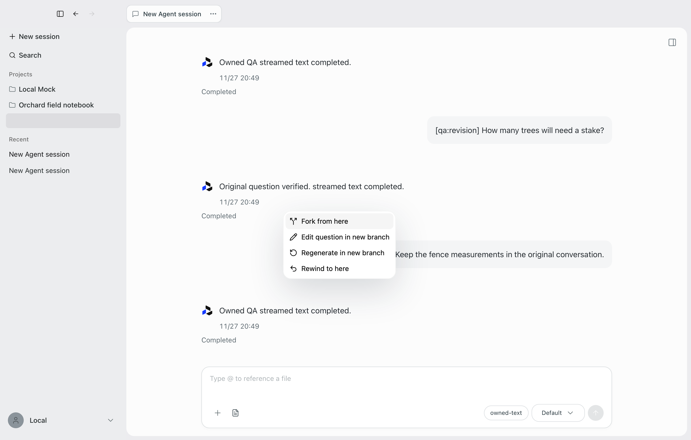

# Edit a question or regenerate a reply in a native conversation

A native preview user may choose a completed ordinary text turn in a conversation and start a new branch immediately before the selected question. Editing opens a draft for explicit submission. Regenerating submits the original plain question exactly once through the normal native text path. The source session remains accessible on success, failure, cancellation and restart.

The Rust host resolves an assistant UUID against the source session, verifies the matching user/assistant pair, and copies only its representable completed prefix through the existing journaled fork and managed-asset path. No executed tool, old answer, subsequent turn, attachment grant or selected document excerpt is replayed. Reject unsupported targets and unrepresentable prefixes before creating the child. Browsing, editing a draft and restart do not request inference.

Use the shared React conversation menu in the isolated Tauri preview. Keep Electron's existing commands, UI and persistence compatible. Verify first-turn and mid-history branches, source isolation, duplicate activation, target eligibility, request count and exact context with synthetic fixtures. Exercise edit, regeneration and persistence through the packaged native window and record any gaps. Returning to Electron leaves the preview data in place.

## User entry point and request boundary

Open the existing More message actions menu on the answer to the question you want to revisit. **Edit question in new branch** prepares a branch and fills its composer. The user can change the text before sending. **Regenerate in new branch** creates a separate answer using the selected turn's original question, channel and model. The original conversation remains in the sidebar.

The host obtains the question and source route from stored native history. The renderer cannot supply an arbitrary question or copied history to the preparation command. An unavailable or changed original route must not trigger an automatic fallback. Preparing a branch grants no access to the source session's tools or files. The existing native send, stop, history and project paths handle the new turn.

## Rollback

Quit the preview and reopen the default Electron app. Keep the native profile if you want to revisit its branches. No reverse import is performed. To remove this feature from a later preview build, revert this milestone and rebuild. Committed branches use the existing native fork storage format.

## Restoration and limits

The child keeps its original channel, model and configuration revision locally until its first accepted text request. A session-bound fingerprint in the existing journaled seed authenticates the route file. This file holds public routing identifiers only and stays out of portable project archives. A parked editor uses the preview's existing draft capture on orderly quit, subject to the existing aggregate 64 KiB draft limit. A deliberate composer model choice applies to the open view. An automatic model-list update cannot redirect the parked draft. Regeneration also carries the original reasoning effort when present.

Targets must be completed native plain-text turns. Historical document selections and image actions need a fresh explicit attachment or image action. An earlier representable project image or document citation can remain visible in the copied prefix. Imported, queued, in-flight or tool-bearing turns cannot be replayed as ordinary questions. No command, file grant, approval or selected document excerpt is inherited.

## Reproduce the window check

Build the QA bundle with `bun apps/tinker-rust/scripts/build-channels-native-qa.ts`. Pass its bundle path to `python3 apps/tinker-rust/scripts/native-conversation-revision-qa.py`. The harness operates the packaged workbench in a separate profile, opens the reply menu and uses two loopback channels. The HTTP fixture validates the message array, selected model and stream setting independently of what the renderer displays.

On Apple Silicon, the packaged Tauri window opened the English and Chinese message menus. The test entered three ordinary turns on channel A, selected B as the default, and revised the middle turn. Four branches had distinct titles after reopening the project. The original kept all three turns. The modified draft survived a complete process exit before Send.

| Observation | Result on the synthetic profile |
| --- | --- |
| Query on the wire | First user message, its answer, then the edited or original middle question. The old middle answer and the later turn were absent. |
| Channel A | 2 model-discovery GETs and 7 explicit chat POSTs. Three created the source history. Four exercised edit, double-activated regeneration, HTTP 503 and cancellation after a visible stream fragment. |
| Channel B | 2 discovery GETs and zero chat POSTs after switching the default. |
| Restore | Five distinct application processes. Draft preparation, reopening histories and restoring the parked draft made zero additional chat POSTs. |
| Failure and cancellation | Their new branches retained the terminal status while the original and both successful branches kept their content. |
| Scope | Packaged macOS WKWebView, synthetic sessions and loopback HTTP. Paid providers and the installed Electron client were outside the run. |

