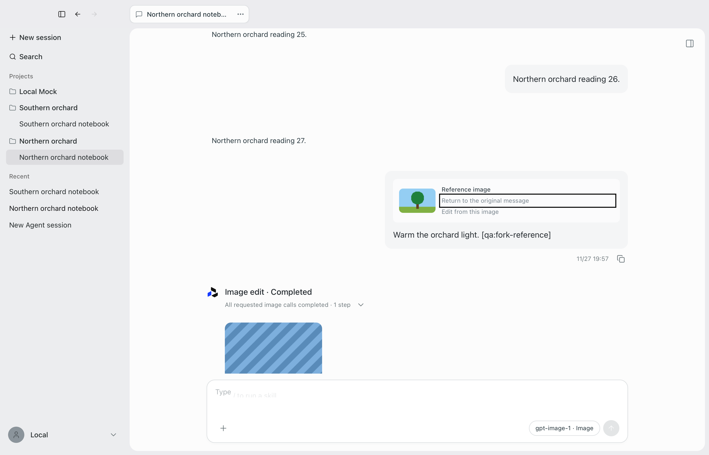

# Continue from an imported history image

A Tauri project conversation can already link an edit back to a generated image in the same native history. An imported Electron conversation instead renders its archived image attachments as passive images. Let the user explicitly select one of these managed images for an edit using the existing composer. Resolve the exact earlier attachment by owner session, message and managed file, including when two messages display the same filename. Never read the original path or derive a source from matching pixels alone.

After an explicit send, preserve the verified source link with the reference. Opening its source card should focus and highlight the owning message. Returning should restore the reading position and keyboard focus. The retained thumbnail and full image stay available when the source cannot be resolved. Reading, selecting, navigating and restoring do not submit a provider request. Only the explicit send uses the selected channel. Project backup restore must either remap locators consistently or safely omit the jump. Use synthetic data to test the packaged window and cross-session isolation. Electron remains the default.

## Storage and rollback

The host accepts a current generation, a native session ID, the projected imported message ID and a managed PNG basename. It checks the imported session manifest, that message's attachment list and the stored byte digest. The selected copy uses the normal image draft and explicit edit path. Its identity also includes the source message and attachment, so two uses of identical bytes can still point to different messages.

New references store the original message and attachment identifiers. The wire path and projected message ID are derived for the current session when history is displayed. A portable restore with a remapped session ID also remaps the managed reference ID. Existing picked images and generated versions retain their previous identities. For an imported image, the source bytes available to this workflow are the normalized archived PNG. An original external JPEG, PDF or disk location is outside this operation.

To return to the default application, quit the isolated preview and open Electron. Keep the native profile, including its image index and managed PNGs, together. Older native preview binaries have a strict imports index reader and may reject a session containing the new source metadata. Use a separate pre-upgrade profile backup if testing an older preview. New native edits do not migrate back into Electron, and the original Electron backup remains available.

## Reproduce and verify

Build the dedicated app with `bun apps/tinker-rust/scripts/build-channels-native-qa.ts`. Pass the resulting QA bundle path to `python3 -B apps/tinker-rust/scripts/native-history-image-source-qa.py`. The harness creates two isolated projects and local mock channels. It tests the real workbench menus, image controls, lightbox, scroll position and focus inside packaged macOS WKWebView. Backup and image file selections use the owned test picker. No real account, supplier or system picker interaction is required.

| Action | Apple Silicon window result |
| --- | --- |
| Import and select an archived image | Two project histories share the original message ID, display name and identical tree image. The selected conversation also contains a different red image with the same name. Selecting the 72 × 48 tree produced a matching draft with zero inference requests. |
| Explicitly send the edit | The mock verified the selected PNG's bytes. Its SHA-256 was `1bc0996405d5b643514c9b3729d195287fa78abdb147ad6b08a4a50681287e52`. The source backup's file checksums stayed unchanged. |
| Fully quit and reopen | The new process opened the full image after the test input was moved. The archive source link focused and highlighted the correct message. The scroll position moved from 3,042 to 40 pixels and returned to 3,042. Focus returned to the same link. |
| Compare a generated image and a file with no earlier message | The generated reference jumped to its own result and returned from 3,514 to the prior 3,628 pixels. The picked file still opened in the lightbox without an active source link. |
| Verify network use | Across both projects the selected channel saw two discovery GETs and three explicit edit POSTs. The second channel received zero requests. Restart, source navigation and full-image preview added zero. |

Rust tests covered exact ownership, reopen, independent references to the same image, archive remapping and rejection of inconsistent metadata. Renderer tests covered remounted controls, ambiguous targets, foreign sessions, stale selections, and ordinary native text inventing attachments. The original Electron attachment format and ordinary Markdown rendering have their own regression coverage.

A separate three-process run of `native-project-media-fork-qa.py` verified a branch containing a byte-identical copy of a source image. After editing the copy, the sent reference highlighted the branch's result and returned keyboard focus to its own source link. Creating the branches or using these controls added no requests.
