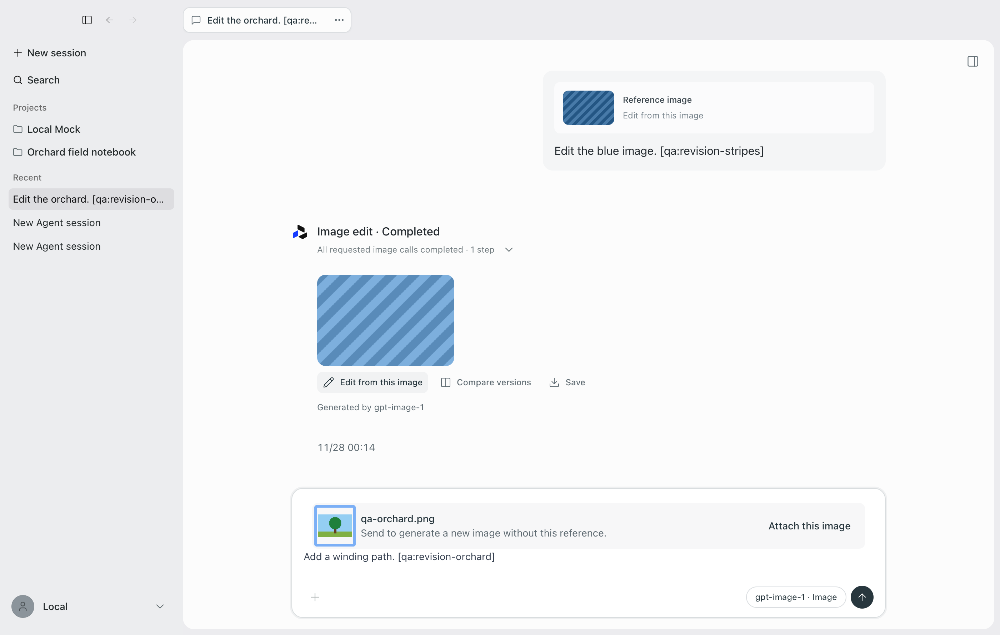

# Revise an image edit in a project conversation

In the native Channels Preview, **Edit question** and **Regenerate** on a completed managed image edit open a separate, unsent branch. The composer shows the prior prompt and a preview of its exact input. Choose **Attach this image** to edit it again, or leave it detached and send to generate a new image. Closing and reopening the draft preserves the prompt and candidate. Attaching the image is a fresh choice each time the draft opens.

## What the branch owns

- The Rust host checks the selected reply, its matching question and the completed edit receipt in that conversation. It stages the prefix before that turn and remaps the input into the child session. It excludes the selected result, subsequent turns and historical tool permissions.
- Two imports can share a display name. The managed asset ID and verified bytes identify the input. An earlier generated input retains its source message in the branch. A directly imported input can be viewed without a jump to a nonexistent source.
- Image send requires the original channel, model and configuration revision. The renderer clears the selection when the route changes. The host compares the revision again at admission. Replaying an identical accepted request returns its receipt. A changed input or stale route cannot send again under that receipt.
- A portable backup carries history, not proof of local execution. A local sidecar identifies edits subsequently accepted on this machine. The sidecar is excluded from backups. An unreadable parked branch is isolated so other sessions can open. Restore a known-good copy of the native profile to recover damaged data.

## Reproduce the window test

Build an isolated Channels Native QA application from the repository root and pass the path printed by the builder to the test:

```sh
bun apps/tinker-rust/scripts/build-channels-native-qa.ts
python3 apps/tinker-rust/scripts/native-image-revision-qa.py "/path/to/Tinker Channels Native QA.app"
```

The test creates two local HTTP providers and synthetic images under temporary directories. First it submits two different reference images with identical filenames. It then exercises the actual preview window, revision controls and composer, checking received image content and read-only navigation. It takes an application-window snapshot and writes the listener counts, image digests and launch PIDs to the printed evidence directory. File selections use the QA picker. External services and production credentials are outside its scope.

## Rollback

Quit the preview and use the existing Electron application. Keep the preview profile if the branch is needed later. A prior native version does not understand the new image revision draft fingerprint. Return to this version to continue that draft. There is no reverse import of these branches into Electron.

## Acceptance results

The packaged macOS arm64 QA application completed five launches with distinct process IDs and restored six sessions. Two loopback listeners independently recorded nine image POSTs on the source route and zero on the other route. Each received two catalog reads during configuration. Reopening the parked draft, inspecting the preview, locating a historical message and restarting added no model POSTs.

| Window check | Observation |
| --- | --- |
| Reattach the original file | Two different files named `qa-orchard.png` had different SHA-256 digests. The selected thumbnail, full preview and mock edit body matched the intended pixels. |
| Generate without attaching | Removing the reference switched the next explicit send to generation. The new user message had no image reference. |
| Reopen and navigate | A reference to an earlier generated image focused the matching message in the child. Return restored keyboard focus and the scroll offset from 170 to 1453 CSS pixels. |
| Upstream failure | A simulated 503 left the branch failed and the original images readable. An initial window run exposed a stale running label. Refreshing the visible history after receipt reconciliation fixed it. |
| Stop and reopen | A slow edit was already accepted by the local listener when stopped. The window kept the cancelled state after restart, discarded its late result and preserved the original output hashes. |
| Route and replay | The window blocked other channels and models. Renderer and host regressions covered credential rotation under an unchanged ID and duplicate request receipts. |



The test used synthetic file selections and local HTTP. Production model behavior, paid billing and physical file picker interactions were outside this run.
