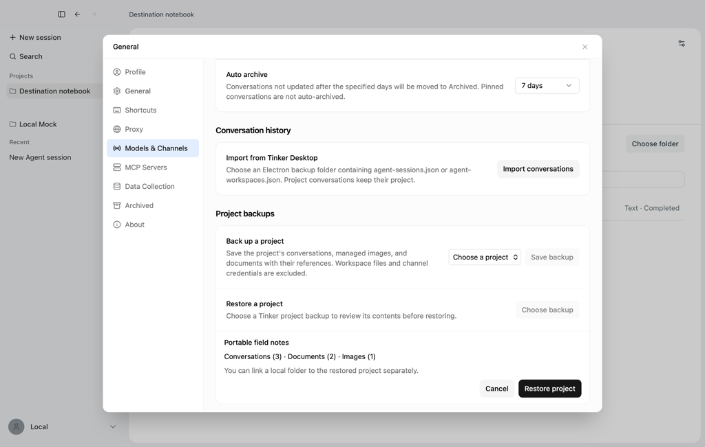

# Portable native project backups

| Status | Baseline | Domain vocabulary |
| --- | --- | --- |
| Implementation and acceptance | PR #42, 03b791a | [Project and session](../../CONTEXT.md) |

## Behavior

- The user chooses one native project and a destination file. Export includes only project-owned sessions, managed image bytes, document snapshots, and the locators in historical messages.
- Import accepts one explicitly selected archive and displays a preflight summary. Confirmation publishes a new unbound project. Cancelling selection or preflight makes no changes.
- The versioned format carries data, not workspace grants or executable history. Do not copy or follow original project directory paths, session log paths, channel configuration, account state, vault entries or external links.
- Restore preserves ownership and references even after moving the archive between clean data roots. It validates the entire payload before making a project visible. An invalid version, budget violation, dangling reference, damaged file or conflict fails closed. Identical imports are idempotent and existing projects survive failed or interrupted restores.
- Acceptance uses synthetic data and local mock providers. Compare image bytes, open historical Markdown lines and PDF pages after restart, and observe model traffic during browsing and restoration. Test actual macOS panels separately from deterministic fixture selections.

## Format and ownership

The native preview exposes **Settings → General → Project backups**. Choose a project and save to a new `.tinkerproject` file. On the receiving Mac, select the file, review its project name and counts, and confirm. Restore creates an unbound project. Link a local directory separately if needed.

Version 1 uses an eight-byte magic, a four-byte format version, an eight-byte payload length and a SHA-256 digest of the typed JSON payload. The total file limit is 64 MiB. Existing per-session, document, image and destination catalog limits also apply. The digest detects accidental damage. The archive is unencrypted and includes the user's selected project content, including conversation text.

Document snapshots carry normalized text and page/line boundaries. Restore does not reconstruct an original PDF file or its page artwork. Managed images retain their original PNG bytes. Source directory grants, provider credentials and machine preferences are outside the format. Only completed, cancelled, failed or interrupted supported history can be transferred. Finish active tasks first. The importer rejects unsupported tool history. Browsing a restored project never resumes a model request.

## Publication and recovery

Preflight validates document and image payloads in private temporary storage, checks citations against the staged documents, validates session IDs and checks destination capacity. Confirmation repeats validation. A durable intent coordinates asset installation, the session journal, a receipt, and publication of the project catalog. An interrupted publication is completed before the next preview window opens. Session ID collisions are remapped with their asset references. A different project with a conflicting identity or name is rejected. Reopening the exact archive after a successful restore preserves subsequent local edits.

## Reproduce

Build the isolated `formal-native-qa` Channels app with `bun apps/tinker-rust/scripts/build-channels-native-qa.ts`. Run `python3 apps/tinker-rust/scripts/native-portable-project-qa.py "<bundle>/Contents/MacOS/tinker-channels-native-qa"`. The script creates disposable profiles, moves the source and its input files out of the way, restores into a destination with existing work, and restarts the app. Its summary reports app PIDs, both mock request counts, the PNG fingerprint and source locators. The default mode injects picker selections in the QA build. The optional `--system-panels` mode pauses for real AppKit selection and cancellation.

## Verified on Apple Silicon

| Scenario | Observed result |
| --- | --- |
| Cross-root restore | Three source conversations, two documents and one image restored. The destination's existing conversation and channel survived an overlapping session ID. |
| Repeat, cancel and damage | Cancelling preflight added no project. Corrupt input failed. Restoring the same archive twice kept one copy. |
| Restart | Separate source, destination and reopened destination process IDs were 427, 755, 1030. Original input files and source profile were moved away before restoration. |
| Documents | Historical user-message links opened Markdown line 2 and PDF page 2, line 2. Both displayed the expected synthetic excerpt in the reopened WKWebView. Foreground focus throughout citation inspection was not established. |
| Image | The full-size 1536 × 1024 PNG was 3,877,810 bytes. Its restored lightbox blob and the source file shared SHA-256 `da5abb87eb804a3fa494199461e86cc97d53df6fd03050d020fad1efd095aa71`. |
| Requests | The destination provider counts stayed at their pre-import baseline through preview, confirmation, duplicate restore, restart, and browsing. Both monitored endpoints were local mock servers. |
| File panels | macOS displayed the real save dialog with the proposed backup name. Desktop control timed out on cancellation. Physical backup open/save completion and the PDF picker recheck remain unverified. The completed round trip used deterministic QA picker selections. |
| Local checks | 635 Rust tests passed, 3 ignored entry points. 3,681 Bun tests passed. Workspace type checks, Rust format and Clippy with warnings denied passed. Electron, ordinary Tauri Channels Preview and the native QA bundle built locally. |

## Rollback

Keep the archive and preview data root, quit the new preview, and use the previous preview with a pre-upgrade copy or fresh root. A restored session adds a version 3 entry to the native journal. Older previews can reject this journal. The separate Electron application and its existing backup importer remain available. No reverse migration to an older client is implied.
