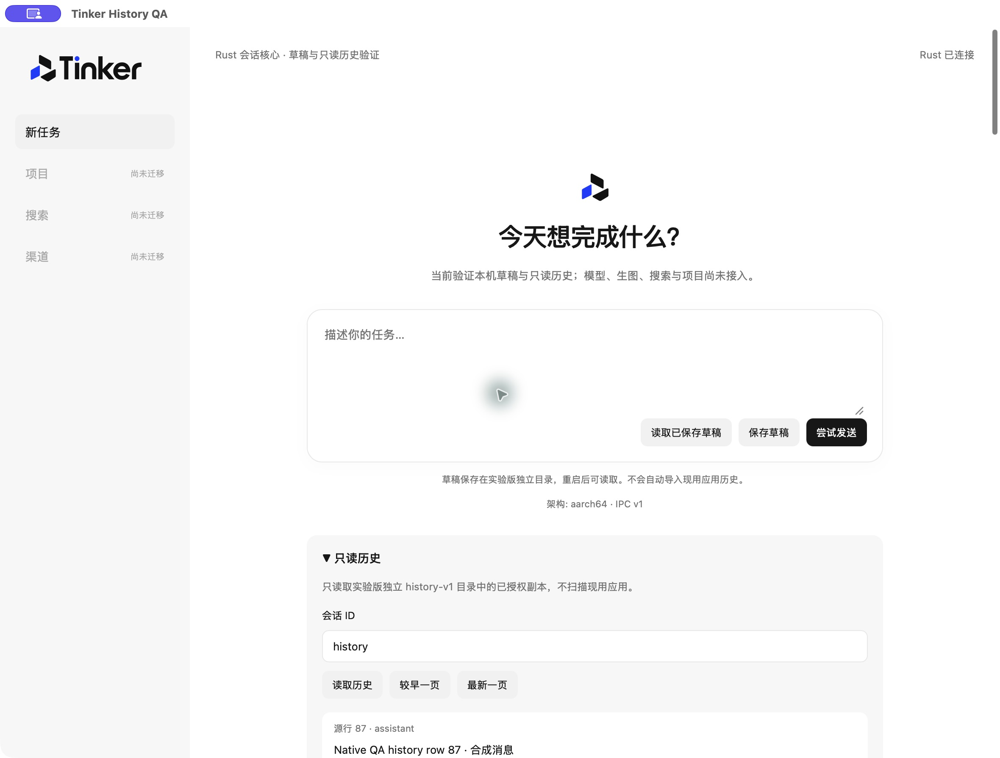
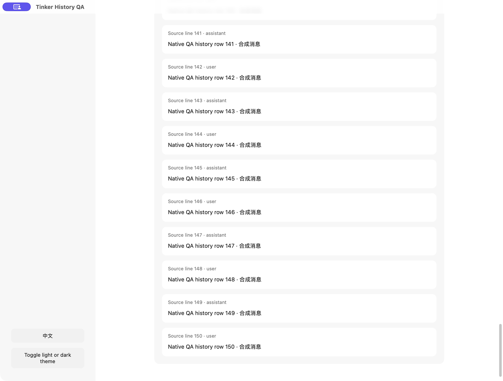

# Tauri SDK 历史接线验证与回滚

基线main：`fdf92f3bb758d04c6f469fe8915d62e41a15f36b`。本阶段只接隔离Rust Lab的历史读取，不接生产Electron、模型、工具或后台任务。

## 生产不变与实际范围

用户追加要求：“你这次改完确保界面和功能还有UI没有任何变化吧？”

- 生产`apps/electron`、`packages/shared`、`packages/core`、`packages/ui`和`bun.lock`与基线差异为0，没有新增文件
- 新阅读区、样式、文案和命令仅属于`apps/tinker-rust`实验应用，不进入Electron入口或安装版
- 原开发目录当前89个未提交文件逐项指纹核对不变，没有覆盖或清理用户工作
- 提交钩子可以更新仓库根和Rust Lab的package版本，除此之外不修改生产依赖或版本
- 已有生产相关测试通过不等于安装版全部交互逐项实机验收，不能据此保证未测流程或像素级一致

## 调用链

React HistoryPanel → `window.__TAURI__.core.invoke('read_session_history')` → Rust独立command → `spawn_blocking` → HistoryLibrary → 有界SDK/legacy扫描器 → 严格前端响应解码 → 安全文本阅读。

命令只接`sessionId`、`beforeLine`和`limit`，不接文件路径。后端固定读取自身`app_local_data_dir()/history-v1/<sessionId>.jsonl`。默认64条、最多256条、单行1MiB、页源行预算8MiB，沿用源行游标。门控使用共享try_lock，忙时返回固定错误，不堆叠多个解码。

原始SDK和旧消息可混排。原始JSON完整保留，包括uuid、parent_tool_use_id、工具输入/结果、thinking签名、图片引用、模型元数据和未知未来类型。text只提取顶层text块或字符串正文，不把tool_result内部文本当用户正文。SDK user允许合法缺省message/content，错误形状明确拒绝。界面仅安全文本预览，结构化记录有提示，没有执行工具、加载raw中的文件或渲染HTML。

## 已通过

| 检查 | 实际结果 |
| --- | --- |
| Rust全部测试 | 63 passed，0 failed，含原有草稿/历史/生命周期和SDK、host、IPC回归 |
| Tauri InvokeRequest链 | 真实handler参数解码、async服务、JSON响应序列化与固定错误码，通过mock runtime验证 |
| SDK新增测试 | 12项通过，原14项legacy读取测试保留通过 |
| 前端src测试 | 15项通过，含原契约和新解析/界面测试 |
| 全仓Bun | 3211 passed，0 failed，362文件，44.64秒 |
| 生产专项回归 | 42 passed，0 failed，11文件，覆盖会话导航/消息渲染/图片/工具显示及附件 |
| 类型与构建 | 全项目typecheck、Rust Lab Vite build、Electron build通过 |
| Rust质量 | fmt check、clippy all-targets -D warnings通过 |
| 前端lint | 临时只读扩展现有ESLint规则范围至Rust Lab的7个相关TS/TSX文件，max-warnings=0通过，生产配置未改 |
| 完整原生构建 | 独立QA配置的Tauri release `.app`构建通过，没有发布或替换安装版 |
| 原生实际交互 | 下节所述，使用真实Tauri bridge，没有模拟前端invoke |

先写失败测试再实现。首次缺frontendDist导致测试环境编译失败，补齐前端构建后得到预期SDK/host缺失失败。user缺省/string兼容也有单独先红后绿记录。

## 独立原生验收

QA标识`com.tinker.rustlab.historyqa.20261108`，启动前同时验证bundle标识和编译后二进制包含该标识。使用新建、与现用应用分离的QA目录，仅放150条合成SDK记录。没有读取现用Tinker或真实Rust Lab历史，没有复制用户日志。

- 原生界面显示Rust已连接
- 展开只读历史，读取得到源行87–150，共64条
- 较早一页读取23–86，最新一页返回87–150
- 切换missing会话后显示本地化缺文件提示
- 恢复history会话可重新读取
- 父界面切换英文后，历史标签/按钮和说明同步切换
- 读取前后合成JSONL的SHA-256一致
- QA进程已由本批清理，不影响现行Tinker





截图只含合成数据，属于独立QA应用，不能代表生产界面已验收。

## 失败、恢复与未运行

首次debug QA构建因ENOSPC失败，同期全仓测试3178通过、33失败，日志证实临时文件创建空间不足。这轮结果未被视为通过。释放本批失败的QA构建缓存和按既有摘要校验过的可再生合成大输入文件后，保留源码、测量结果、指纹和生成器，改用现有release缓存完成QA构建。随后完整Bun重跑3211通过、0失败。未清理用户目录、安装或真实数据。

未运行/未实现：安装版全流程实机回归、真实用户日志导入、SDK/工具实际执行、后台取消/重连/rewind、图片富交互在Rust Lab中的迁移、Windows/Linux原生运行、恶意同系统用户并发替换文件的完整防御、跨文件重写稳定游标。

本阶段没有量化SDK适配器或整个应用的内存峰值。源行预算不等于解析后堆内存上限，也不能套用上一阶段的读取器测量作为整机改善结论。每页仍扫描文件前缀。

## 使用与回退

本原型不会自动寻找生产历史。仅在已有授权的前提下，用户可将所选日志的副本放入Rust Lab独立`history-v1`目录，文件名为受限ID加`.jsonl`，在阅读区输入相同ID。不要将原始用户日志提交到Git或覆盖原应用文件。当前验收仅使用合成副本。

- 未合并时：保持/关闭本Draft即可，main和现行安装不变
- 合并后的代码回退：在独立分支审阅并revert本PR的合并提交，正常测试后走PR，不对用户开发仓库做reset/clean
- 精确停用：移除main.rs的history state/command注册和React HistoryPanel挂载，恢复上一版只验证草稿的Rust Lab，旧snapshot/save_draft/submit_draft/recover_draft命令和草稿schema不变
- 历史只有只读打开，没有迁移、改写、修补或删除，回退不需要数据格式反向转换，也不应删除历史副本
- 真实Tinker安装及用户原工作区从未被本阶段替换

## 复现主要检查

```sh
bun run --cwd apps/tinker-rust build
CARGO_TARGET_DIR=/tmp/tinker-history-check cargo test --offline --locked --manifest-path apps/tinker-rust/src-tauri/Cargo.toml
CARGO_TARGET_DIR=/tmp/tinker-history-check cargo clippy --offline --locked --all-targets --manifest-path apps/tinker-rust/src-tauri/Cargo.toml -- -D warnings
cargo fmt --check --manifest-path apps/tinker-rust/src-tauri/Cargo.toml
bun run typecheck
bun test
bun run electron:build
```

离线Cargo检查要求依赖已缓存。原生QA需要另设identifier，不可直接拿现用应用数据做冒烟。原始命令日志、分项报告、环境失败记录和生产不变断言留在Tinker-A本地diagnostics，不把本机路径/日志或构建产物加入提交。
